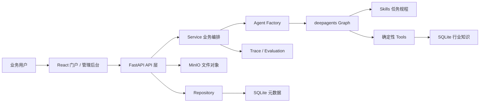
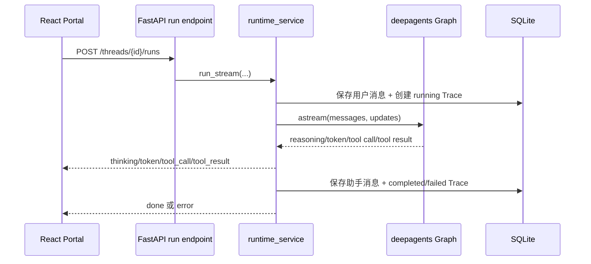

# 智脑工业智能体平台｜项目简历与面试备战手册

> 文档定位：用于简历撰写、5 分钟项目介绍、技术深挖与压力面试。
>
> 事实口径：内容以当前仓库源码为依据。文中的“已实现”只代表代码中存在相应实现与测试覆盖，不等价于已经在生产环境验证；业务指标、团队规模、个人 ownership、线上并发量与成本收益均未从仓库得到证明，不应自行补写。

## 项目简历｜可直接改写版

### 项目名称

智脑工业智能体平台（Industrial DeepAgents Platform）

### 项目角色

核心开发 / 技术负责人（二选一，按真实经历填写）。如果只是参与部分模块，应改为“负责 Agent 运行时、知识工具链、评测与可观测模块中的若干能力”，不要使用“独立完成整个平台”。

### 项目简介

面向电梯与升降装备非标订单技术方案场景，建设从自然语言需求、行业条款检索、确定性尺寸计算、方案生成，到运行追踪和效果评测的一体化多租户智能体平台。系统以 FastAPI 承载 API 与 SSE 流式运行时，以 deepagents/LangChain 组织 Agent、文件系统、任务规划和工具调用，以 SQLite 保存业务元数据和运行记录，以 MinIO 保存上传文件，并通过 React 18 单文件前端提供门户与管理后台。

### 技术栈

Python、FastAPI、Pydantic、SQLite/WAL、deepagents、LangChain、langchain-openai、MinIO、JWT、bcrypt、SSE、React 18 UMD、marked、DOMPurify、Langfuse（可选）、pytest。

### 简历职责与技术亮点

- 设计并落地“前端门户 → FastAPI → deepagents Graph → Skill/Tool → SQLite/MinIO”的分层架构，按路由、服务、仓库拆分认证、会话、Agent、评测、Trace、知识库与文件领域。
- 建设配置驱动的 Agent Factory：按 Agent 配置和项目维度选择模型、工具、文件后端、规划中间件与 Skills，并通过配置更新时间、工具集、项目和技能目录指纹生成缓存键，降低重复构图成本。
- 将模型推理与确定性业务能力分离：模型负责需求理解、缺参追问和工具编排；井道尺寸、设计规范、工艺路线、设备参数与售后规则由受约束工具返回，避免让模型直接生成关键工程数值。
- 建设符合 deepagents 目录规范的 12 个 Skills，以 `SKILL.md` YAML frontmatter 作为目录唯一事实来源，支持摘要加载、任务命中后读取全文，并显式标注真实接通、演示数据与未接通能力。
- 打通 SSE 流式对话链路，将 `thinking`、`token`、`tool_call`、`tool_result`、`done`、`error` 拆为稳定事件；过滤子 Agent 内部 token，保留顶层回答，并在前端展示推理状态、工具执行卡片、Token 和耗时。
- 实现租户、项目、用户三级隔离与 owner/admin/member/viewer RBAC；JWT 每次请求重新校验成员关系，API Key 仅存 SHA-256 摘要且明文只在创建时返回，业务查询按 `tenant_id`/`project_id` 收口。
- 建设项目级文件空间与共享只读 Skills 挂载：普通模式通过 `CompositeBackend` 路由 `/skills/`，禁止写共享技能库并拦截 `.env`、密钥和凭据路径；可选本地执行模式使用受限环境、超时与输出上限，并明确其不是强隔离沙箱。
- 实现文件上传安全链路：登录与项目归属校验、文件名归一化、扩展名/MIME 联合校验、大小限制、MinIO 对象键隔离，存储失败直接返回错误且不回退本地文件系统；SQLite 只记录元数据。
- 建设评测闭环，支持关键词全命中、归一化精确匹配和 LLM-as-judge 三种评分方式；逐用例记录输出、得分、原因、延迟、Token 与 Trace 关联，单个裁判异常不会中断整批评测。
- 建设可观测链路：记录运行状态、输入/输出摘要、工具调用、工具结果、延迟、Token、错误与可选 Langfuse 链接；持久化前执行长度截断和敏感信息遮蔽，前端支持 Trace 筛选与详情查看。
- 前端采用同源单文件 React 应用，覆盖门户对话、项目、Agent 配置、技能选择、知识检索、文件上传、评测和 Trace；助手 Markdown 经 DOMPurify 消毒，用户消息按纯文本展示。

### 项目结果口径

可安全表述：完成了一个可运行的多租户工业智能体平台原型，形成了 Agent 配置、行业工具、Skills、SSE、文件存储、评测和 Trace 的端到端代码闭环，并以认证隔离、项目隔离、工具链、上传安全、评测和可观测测试覆盖关键路径。

不可直接表述：提升了多少方案效率、替代了多少人工、支撑了多少用户/QPS、节省了多少成本、已在生产稳定运行。仓库没有这些证据。

### 30 秒简历版

我参与建设了一个基于 FastAPI 和 deepagents 的多租户工业智能体平台，面向电梯非标方案设计。核心不是做一个聊天页面，而是把模型判断、确定性工程工具、渐进披露 Skills、项目级文件空间、SSE 运行时、评测和 Trace 串成闭环。系统通过租户/项目双重约束、RBAC、敏感路径拒绝、MinIO 文件隔离和 Trace 脱敏守住安全边界；同时明确区分已接通数据、演示数据和未接通能力，避免用模型伪造工程结论。

---

# Part 0｜使用说明与三条心法

## 0.1 怎么使用这份手册

- 一面或业务面：先背 Part 1，再从 Part 2 选择 5 个关键词展开。
- 技术面：用 Part 3 点题，用 Part 4 回答架构、运行时、安全、评测和演进问题。
- 压力面：先说“当前代码事实”，再说“为什么这样设计”，最后说“如果上生产会如何演进”。
- 简历投递：只复制与本人真实职责一致的条目，项目角色、周期、团队人数和业务结果必须按实际补充。

## 0.2 三条心法

### 心法一：先讲业务闭环，再讲框架名词

不要一上来罗列 deepagents、LangChain、SSE。先讲清楚：非标方案需要收集参数、查规范、做计算、给方案、留证据；模型适合理解与编排，关键数值必须交给确定性工具。

标准句式：

> 这个项目解决的不是“怎么接一个大模型”，而是“怎么把非标方案设计变成可约束、可追踪、可评测的 Agent 工作流”。

### 心法二：任何结论都分四层

1. 代码事实：当前源码已经实现什么。
2. 验证事实：本次实际运行或测试证明了什么。
3. 个人贡献：本人究竟负责了什么，按真实情况表达。
4. 演进建议：生产化还需要什么，不把建议包装成现状。

### 心法三：回答设计题必须给取舍

每个方案至少讲一个收益和一个代价。例如：

- SQLite/WAL 简化部署，但不适合多实例高并发写入。
- 进程内 Agent 缓存减少重复构图，但多进程不共享且需要失效策略。
- 本地执行后端便于原型验证，但不是容器/微虚机级强隔离。
- Skills 渐进披露减少首轮上下文，但命中和全文读取依赖模型遵循指令。
- SSE 适合服务端单向流式输出，但断线续传、幂等与同线程并发需要额外协议。

---

# Part 1｜开场脚本（5 分钟口述）

## 0:00—0:40｜背景与目标

我做的是“智脑工业智能体平台”，面向电梯和升降装备的非标订单方案设计。这个场景的难点是：客户输入通常是自然语言，关键参数可能不完整；方案又必须引用设计规则并做尺寸计算，不能让模型凭经验生成工程数值；同时企业使用还需要多租户隔离、权限、文件、评测和审计。因此我们的目标不是做普通聊天，而是把“需求理解—缺参追问—规则检索—确定性计算—方案输出—运行留痕”做成一个平台闭环。

## 0:40—1:30｜整体架构

系统前端是 React 18 单文件应用，提供业务门户和管理后台；后端是 FastAPI，按 API、Service、Repository 分层；SQLite 保存用户、租户、项目、Agent、会话、评测和 Trace 元数据；MinIO 保存上传文件；Agent 层基于 deepagents 和 LangChain，模型通过 OpenAI 兼容协议接入。一个请求进入后，会先做身份和租户校验，再根据 Agent 配置与当前项目构建或复用 Graph，执行期间通过 SSE 返回推理状态、正文 Token、工具调用和工具结果，最后把消息和 Trace 落库。

## 1:30—2:25｜Agent、Skill 与 Tool 的职责

我把能力分成三层：模型负责理解需求和决定下一步；Skill 负责某类任务的操作规程、输出结构和边界；Tool 负责可验证的确定性动作。比如用户问井道尺寸，模型先识别梯型、载重、速度、轿厢、开门和对重参数，Skill 要求先查条款，再调用 `shaft_size_calculator`，具体尺寸由代码规则计算而不是模型心算。平台目前有 12 个 Skills，目录接口直接读取 frontmatter，只有名称和摘要先进入 Agent 上下文，命中后再读取完整说明。

## 2:25—3:15｜隔离与安全

平台按租户和项目隔离。JWT 中携带用户和租户，但服务端不会只信 Token，而是每次请求重新查询成员关系；不同角色拥有不同管理权限。项目文件根目录是 `tenant_id/project_id`，共享 Skills 通过 `/skills/` 只读挂载。普通文件后端配置了敏感路径拒绝；开启本地代码执行后，则使用独立项目目录、清理继承环境、设置超时和输出上限。同时我们明确把本地执行定位为原型能力，不把它说成生产级强隔离。

## 3:15—4:05｜SSE、可观测与评测

运行时同时消费 deepagents 的 `messages` 和 `updates` 两类流：前者用于顶层模型 Token 和推理状态，后者用于工具调用、工具结果和最终消息。为了避免子 Agent 的中间输出污染主回答，会根据 checkpoint namespace 和 node 过滤嵌套 token。每次运行都会形成 Trace，记录状态、延迟、Token、工具事件和错误，敏感内容持久化前做遮蔽。评测支持 contains、exact 和 LLM judge，结果还能反向关联到 Trace，从“这个回答得分低”追到“当时调用了什么工具、返回了什么”。

## 4:05—4:40｜前端体验

前端不仅展示最终文本，还展示思考状态、工具执行卡片、耗时、Token 和可选 Langfuse 链接。流式请求使用 `AbortController`，切换会话时取消旧流，并用 ref 和序号避免历史消息请求覆盖正在发送的新消息。助手回答支持 Markdown，但必须经过 DOMPurify；用户消息始终按纯文本展示，降低注入风险。

## 4:40—5:00｜边界与总结

当前仓库更准确的定位是可运行原型，而不是已经完成生产验收。知识库是种子数据，DuckDuckGo 搜索已接通；ERP、设备日志、财务以及 OCR/CAD 等仍是演示或未接通能力；文件解析接口目前只把任务标记为 queued，还没有后台消费者。下一阶段我会优先补可靠任务队列、真实解析器和向量检索、远程强隔离沙箱、同线程并发控制与断线恢复，再用真实模型和黄金数据集做回归。

---

# Part 2｜速记卡（关键词锚点）

| 主题 | 关键词锚点 | 一句话回答 |
|---|---|---|
| 业务闭环 | 参数识别、缺参追问、条款、计算、方案、留痕 | 模型负责编排，规则与计算由工具兜底，最终结果可追踪、可评测。 |
| 分层 | API → Service → Repository | 路由做校验与编排，服务承载运行逻辑，仓库收口 SQL。 |
| Agent Factory | 配置驱动、项目绑定、缓存、指纹失效 | 同一 Agent 在不同项目使用不同文件空间，配置或 Skills 变化会改变缓存键。 |
| deepagents | 文件工具、`task`、Todo、Backend、Skills | 框架提供通用执行骨架，业务能力通过工具和技能扩展。 |
| Skill | YAML frontmatter、摘要加载、渐进披露、边界 | Skill 是任务 SOP，不直接替代真实数据源。 |
| Tool | schema、确定性、可测试、错误文本 | 关键数值和业务动作进入工具，模型不自行心算。 |
| 知识检索 | SQLite、AND 关键词、分类/设备族过滤 | 当前是结构化种子知识检索，不是向量 RAG。 |
| 多租户 | JWT `tid`、成员复核、租户条件 | Token 指明当前租户，数据库成员关系决定真实权限。 |
| 项目隔离 | `tenant/project` 根目录、对象键、项目校验 | 会话文件和上传对象都绑定项目，跨租户返回不可见。 |
| RBAC | owner/admin/member/viewer | 管理 Agent 需 admin，成员和 API Key 以 member 权限运行，owner 管成员和 Key。 |
| API Key | 随机值、SHA-256、一次明文 | 服务端只保存摘要和前缀，创建响应之后无法再次读取明文。 |
| SSE | thinking/token/tool/done/error | 把模型过程翻译成稳定前端事件，而不是直接暴露框架对象。 |
| 顶层输出 | namespace/node 过滤 | 子 Agent 的 token 计入用量但不混入主回答。 |
| 推理兼容 | `reasoning_content` | 自定义 ChatOpenAI 转换逻辑保留供应商推理增量并单独转发。 |
| 可观测 | run + events、脱敏、截断、Langfuse | 本地 Trace 是主记录，可选 Langfuse 是增强能力，失败不影响主流程。 |
| 评测 | contains/exact/LLM judge、0.6 阈值 | 三种裁判覆盖规则回归和语义评审，逐条结果关联 Trace。 |
| 文件 | 扩展名+MIME+大小、MinIO、元数据 | 文件内容进对象存储，SQLite 只存键与状态，存储失败不回退本地。 |
| 前端安全 | 用户纯文本、助手 Markdown、DOMPurify | 既保留 Markdown 体验，又避免渲染未清洗 HTML。 |
| 原型边界 | queued 无消费者、本地执行非强隔离、进程内任务 | 主动讲边界比把原型包装成生产系统更可信。 |

## 2.1 三组必须背熟的调用链

### 对话链

`PortalChat.send` → `runSSE` → `POST /api/threads/{id}/runs` → `run_thread` → `run_stream` → `build_agent` → `compiled.astream` → SSE → 消息/Trace 持久化。

### 工具链

模型生成 tool call → deepagents tools node 执行 → `industrial_tools` 查询 SQLite 或做规则计算 → ToolMessage → 模型组织最终答案 → Trace 记录调用与结果。

### 评测链

`POST /api/eval/runs` → 创建 pending run → `asyncio.create_task` → 租户级进程内锁 → `run_agent_once` → contains/exact/LLM judge → 保存 result → 回填 `trace_run_id` → 汇总通过率与平均分。

---

# Part 3｜贯穿全局的设计哲学（点题）

## 3.1 概率推理与确定性执行分离

模型最擅长理解模糊意图、补充问题和工具选择；工程尺寸、权限判断、对象键和评分规则必须由确定性代码完成。这个边界既降低幻觉，也让单元测试有稳定断言。

## 3.2 Skill 管方法，Tool 管动作，数据库管事实

- Skill：何时使用、按什么步骤、如何输出、哪些结论不能给。
- Tool：输入 schema、规则计算、检索和外部调用。
- Service：一次业务运行的编排、异常和状态。
- Repository/存储：持久化事实，不把聊天上下文当业务事实库。

## 3.3 渐进披露优于全量提示词

12 个技能的全文如果全部注入系统提示，会放大 Token、稀释指令并增加冲突。当前设计只暴露摘要，任务命中后通过文件工具读取完整 `SKILL.md`。代价是需要监控技能命中率与读取行为。

## 3.4 隔离不是一个开关，而是多层约束

身份隔离、租户数据隔离、项目文件隔离、对象存储键隔离、共享 Skills 只读、敏感路径拒绝、前端渲染消毒各自解决不同问题。只做 JWT 或只做目录隔离都不够。

## 3.5 对用户输出稳定事件，不泄漏框架细节

后端把 LangGraph/deepagents 流翻译成有限 SSE 事件，前端只依赖这份协议。这样更换模型或框架内部节点时，不必重写整个 UI；同时可以单独控制子 Agent 输出、工具详情和错误文案。

## 3.6 可观测先于智能优化，评测先于上线承诺

没有 Trace 时，低质量回答只能靠猜；没有评测集时，提示词和工具变化无法回归。系统让每次对话和评测共用运行记录，并把失败、工具事件和 Token 留下来，为后续优化提供证据。

## 3.7 对未接通能力说真话

“Skill 已打包可调用”不等于“真实数据源已接通”。当前前端同时展示 `connected` 和 `data_live`，技能正文也要求声明演示数据。可信系统的第一原则不是每次都给答案，而是在证据不足时拒绝伪造。

---

# Part 4｜技术专题与面试追问

## 4.1｜业务问题、领域建模与总体架构

### 核心回答

平台把非标方案设计拆成“参数—规则—计算—方案—评测—追踪”六个环节，并用多租户平台能力承载会话、文件和配置。

### 领域对象

- `tenant`：组织边界。
- `membership`：用户在租户内的角色。
- `project`：文件、会话和业务任务的隔离单元。
- `agent`：模型、提示词、工具和能力开关配置。
- `thread/message`：用户对话及最终消息历史。
- `industrial_knowledge`：共享行业种子知识。
- `industrial_file`：MinIO 对象的元数据与解析状态。
- `agent_run/run_event`：运行与工具事件。
- `eval_dataset/case/run/result`：离线评测闭环。

### 为什么选择单体分层而不是一开始拆微服务

当前范围是可运行原型，FastAPI 单体、SQLite 和同源前端能降低部署与联调成本；代码仍按领域分层，为以后把评测 Worker、文件解析、模型网关拆成独立服务保留边界。微服务不是目标，清晰边界和可迁移性才是目标。

### 高频追问

**Q：这和普通 RAG 聊天有什么区别？**

A：当前知识检索本身还是 SQLite 关键词检索，不能把它包装成向量 RAG；差异主要在平台闭环：除了检索，还包含确定性计算、Skills 规程、任务规划/子 Agent 能力、租户与项目隔离、文件、Trace 和评测。

**Q：为什么不直接让模型生成方案？**

A：自然语言组织可以交给模型，但关键参数和尺寸是高风险结论。系统要求先检索条款，再调用计算工具，缺参或越界则追问或转人工复核。

**Q：项目最大的技术价值是什么？**

A：把一次不可复现的模型回答转成“输入有边界、执行有工具、过程有事件、结果有评测、问题可追踪”的工程系统。

### 源码证据

- `backend/app/main.py`：应用入口、统一异常、路由与同源前端挂载。
- `backend/app/db.py`：领域表、迁移、种子知识与默认 Agent。
- `backend/app/api/`、`backend/app/services/`、`backend/app/repositories/`：三层边界。

## 4.2｜deepagents Agent Factory、后端与缓存

### 核心回答

`build_agent` 不是创建一个固定 Bot，而是根据 Agent 配置和项目上下文动态组装模型、工具、文件后端、权限、中间件和 Skills，再缓存编译结果。

### 构建过程

1. 用 Agent ID、项目 ID、更新时间、沙箱/规划开关、工具集、模型名和技能目录指纹生成缓存键。
2. 创建 OpenAI 兼容模型；自定义 `ReasoningChatOpenAI` 保留供应商的 `reasoning_content` 增量。
3. 将文件根目录绑定到 `data/fs/{tenant_id}/{project_id}`。
4. 普通模式：`FilesystemBackend` + `CompositeBackend`，把共享技能库挂载到 `/skills/`，拒绝敏感路径读写并拒绝技能库写入。
5. 本地执行模式：`LocalShellBackend`，配置虚拟模式、项目工作目录、最小环境、超时与输出上限。
6. 按 Agent 配置选择平台工具；需要规划时加入 `TodoListMiddleware`。
7. 调用 `create_deep_agent` 编译 Graph 并写入进程内缓存。

### 为什么缓存键要包含技能目录指纹

如果只按 Agent ID 缓存，修改 `SKILL.md` 后旧 Graph 可能继续持有旧技能摘要。当前用技能文件最大 mtime 作为轻量变化信号，简单但有边界：时间戳精度、批量复制保留时间以及多进程缓存都可能导致失效不一致。生产环境可改为内容哈希或发布版本号，并通过集中式事件通知各实例失效。

### 沙箱模式的真实边界

- 当前是本地 Shell 后端，不是容器、微虚机或远程沙箱。
- 代码注释明确说明，执行后端与文件权限规则不能同时使用。
- 当前沙箱分支不挂载平台 Skills，因此“可执行代码”和“共享 Skills”在这一版是互斥能力。
- 清理环境、限制 cwd、超时和输出只能降低风险，不能证明内核级隔离。

### 高频追问

**Q：为什么缓存按 project 维度？**

A：Graph 绑定的文件后端根目录属于项目。同一 Agent 配置如果跨项目共用 Graph，文件访问边界就可能错位，因此项目必须进入缓存键。

**Q：双检锁做了吗？**

A：读取和最终写入都在锁内，但实际构建发生在锁外，两个并发请求可能重复构图，最后一个覆盖相同键。这样避免长时间占锁，但没有彻底消除重复构建。若构建成本明显，可以使用 per-key Future/Lock 做 single-flight。

**Q：Skills 修改后一定立即生效吗？**

A：单进程中下一次计算缓存键会读取目录最新 mtime；但不能承诺跨进程一致。生产化应使用显式 Skill 版本并广播缓存失效。

### 源码证据

- `backend/app/services/agent_factory.py`：模型适配、缓存键、后端选择、权限、Skills 与 Graph 构建。
- `backend/app/services/builtin_tools.py`：框架工具、平台工具与能力开关目录。

## 4.3｜Skill、Tool 与行业知识可信性

### 核心回答

Skill 解决“模型应该怎样做”，Tool 解决“系统实际做了什么”，数据源声明解决“结果能否被当成真实业务事实”。

### 12 个 Skills 的分类

- 知识与联网：`knowledge-search`、`web-search`。
- 文件规程：`text-file-parser`、`pdf-parser`、`office-parser`、`spreadsheet-parser`、`image-drawing-parser`。
- 企业/行业演示：`erp-purchase`、`equipment-logs`、`finance-info`、`drawing-recognition`、`solution-review`。

目录接口扫描 `backend/skills/*/SKILL.md`，解析 YAML frontmatter 中的 `name`、`description` 和展示元数据。前端的技能名称、说明、图标与分类都来自这个入口，避免后端、前端维护两份列表。

### 关键工具

- `query_design_rules`：按关键词、设备族和类别查设计条款。
- `shaft_size_calculator`：校验设备族、载重、速度、轿厢尺寸、门型和对重位置后计算井道宽深。
- `process_route`：查询工艺路线与会签节点。
- `equipment_params`：查询设备与部件参数。
- `after_sales_policy`：查询售后规则。
- `web_search`：通过 DuckDuckGo 返回标题、链接和摘要，失败时返回可降级的错误文本。

### 当前“知识检索”是什么

`list_knowledge` 将查询按空格切词，每个词对标题、正文和 tags 做 `LIKE`，多词之间是 AND；设备族和类别用精确过滤。它简单、可解释、适合小规模种子数据，但没有 embedding、召回/重排、版本、权限、引用片段和知识更新流水线，所以不能称为完整企业 RAG。

### Tool 为什么返回 `ERROR:` 文本而不是总抛异常

业务参数错误和外部搜索失败可以作为 ToolMessage 返回给模型，模型能够追问、换词或降级，而不必让整个 Agent run 失败。系统性异常仍应进入失败 Trace；两者不能混为一谈。

### 高频追问

**Q：如何减少工程场景幻觉？**

A：第一，系统提示和 Skill 要求缺参先追问；第二，关键数值只来自工具；第三，查询无命中就明确说明；第四，工具结果和 Trace 可回放；第五，用黄金用例做回归。仍不能把原型知识库当正式规范库。

**Q：`connected=true` 是否代表真实系统已接通？**

A：不是。当前它表示 Skill 已打包、Agent 可以读取；`data_live` 才表达代码中的数据接通状态，而且“代码已接通”也不等于生产可用。ERP、设备日志、财务、OCR/CAD 等在技能正文中明确为演示或未接通。

**Q：如何演进成真正 RAG？**

A：引入租户/项目文档索引、分块与元数据、embedding 召回、关键词混合检索、reranker、权限过滤、版本和失效策略；回答中返回文档、页码、条款版本与片段，再用召回率和答案忠实度评测。

### 源码证据

- `backend/skills/*/SKILL.md`：技能 frontmatter、工作流和数据边界。
- `backend/app/api/industrial.py::_skill_catalog`：动态技能目录。
- `backend/app/services/industrial_tools.py`：行业工具与确定性计算。
- `backend/app/repositories/knowledge.py`：当前关键词检索实现。

## 4.4｜多租户、RBAC 与项目隔离

### 核心回答

平台采用“Token 指明上下文，数据库确认权限，SQL 和文件路径落实隔离”的纵深模型。

### 身份与权限链路

1. 登录成功后签发 HS256 JWT，包含 `sub=user_id`、`tid=tenant_id` 和过期时间。
2. 每次请求解码 JWT 后，仍以 `user_id + tenant_id` 查询 membership；成员被移除后，旧 Token 也会失效。
3. 切换租户前查询 membership，成功后签发带新 `tid` 的 Token。
4. `require_login/member/admin/owner` 在路由入口做权限分级。
5. API Key 使用随机值，数据库只保存 SHA-256；通过 Key 调用时统一降为 member 权限并记录创建者归属。

### 数据与文件隔离

- Agent、Thread、Trace、Evaluation、File 查询均带租户条件。
- 选择项目时验证项目属于当前租户。
- deepagents 文件根目录按租户和项目拆分。
- MinIO 对象键为 `tenant/project/file/filename`，SQLite 再保存同样的租户与项目元数据。
- 平台 Skills 是共享库，但挂载为只读；行业种子知识也是全局共享，不应存放客户私有条款。

### 高频追问

**Q：JWT 里有 role 为什么还查数据库？**

A：当前 JWT 不存 role，而是每次查 membership。即使存了 role，也应处理撤权时效；数据库复核换来了即时撤权，代价是每次请求多一次查询。

**Q：为什么跨租户资源多返回 404 而不是 403？**

A：按 `id + tenant_id` 查询，不命中统一返回不存在，可以减少资源枚举和租户信息泄漏。

**Q：SQLite 能支撑多租户吗？**

A：逻辑隔离可以，但生产规模受单机、写并发、备份与高可用限制。当前开启 WAL 和 busy timeout 适合原型；规模化应迁移 PostgreSQL，并评估行级安全、连接池和租户索引。

**Q：还有哪些隔离风险？**

A：需要继续做跨租户自动化测试、对象存储下载鉴权、数据库约束与审计；共享全局知识不能混入租户私有文档；API Key 还可以增加过期、作用域、轮换和吊销审计。

### 源码证据

- `backend/app/security.py`：密码、JWT、API Key 和 RBAC。
- `backend/app/api/tenants.py`：租户切换、成员与 Key 生命周期。
- `backend/app/services/agent_factory.py::project_fs_root`：项目文件根。
- `backend/app/api/industrial.py`：项目归属和文件对象键。
- `backend/tests/test_auth_rbac.py`、`backend/tests/test_projects.py`：权限与隔离回归用例。

## 4.5｜SSE 流式运行时与前端一致性

### 核心回答

运行时的职责是把框架内部消息流翻译成稳定协议，并确保“用户看到的最终回答、数据库消息、Trace 状态”尽量一致。

### 后端事件处理

- 先落用户消息和 running Trace，再构建 Agent。
- 立即发送空 `thinking`，避免模型启动阶段 UI 长时间无反馈。
- `messages` 模式负责流式 Token、推理增量和 usage。
- `updates` 模式负责工具调用、工具结果和终态 AIMessage。
- 通过 `langgraph_checkpoint_ns` 嵌套层级和 `langgraph_node` 过滤子 Agent token，只展示顶层模型内容。
- 成功时保存助手消息、完成 Trace 并发送 `done`；异常时完成 failed Trace，仅向前端返回通用错误和 run ID。

### 前端一致性处理

- 使用 `ReadableStream.getReader()` 自行解析 SSE frame，因为请求是带 JSON body 的 POST，不适合原生 `EventSource`。
- `AbortController` 在切换会话或组件卸载时终止旧流。
- `turnRef` 防止旧流继续修改新会话最后一条消息。
- `sendSeqRef` 防止并行的历史消息 GET 覆盖已经插入的发送态消息。
- `stickRef` 只在用户位于底部附近时自动滚动，避免阅读历史时被强制拉回底部。

### 已识别的一致性边界

- 后端没有累积 token 文本，只从终态 `AIMessage` 取得 `final_text`。代码注释称“若只有流式文本则回退”，但实际回退为固定提示，因此供应商若没有终态文本，前端看过的流式内容可能不会作为最终消息落库。
- 历史重建只恢复用户与助手最终文本，不恢复 tool call/ToolMessage，也没有为会话传入持久化 checkpointer；因此跨轮工具上下文和 Todo 状态不是完整事件回放。
- 同一 thread 没有请求级串行锁、幂等键和运行版本，多个并发发送可能出现消息顺序竞争。
- SSE 断线后没有基于 event id 的续传，前端只能重试或重新加载已持久化历史。

### 高频追问

**Q：为什么同时订阅 messages 和 updates？**

A：messages 适合低延迟 token，updates 适合捕获节点级工具和终态。只用一种很难同时满足流畅 UI 和可追踪工具事件。

**Q：为什么不把子 Agent token 也展示？**

A：子任务中间文本会与主回答交叉，破坏语义和 UI；当前仍累计其 usage，但只展示主模型输出。若业务需要，可增加独立 `subagent_event` 面板，而不是混入正文。

**Q：如何做断线恢复？**

A：为 run_event 生成单调序号并在事件写库后发送；客户端携带 last event id 重连；服务端从持久化事件补发，运行 Worker 与 HTTP 连接解耦。还要为发送请求增加 `request_id` 幂等约束。

### 源码证据

- `backend/app/api/threads.py`：SSE endpoint。
- `backend/app/services/runtime_service.py`：流式事件、过滤、持久化和失败处理。
- `frontend/index.html::runSSE`、`PortalChat`：SSE 解析、Abort 与 ref 一致性。

## 4.6｜文件上传、MinIO 与安全边界

### 核心回答

文件能力采用“对象存储保存内容、数据库保存元数据、项目权限约束访问”的模式，并坚持存储失败不降级到本地目录。

### 上传链路

1. `require_member` 验证调用者。
2. `_require_project` 验证项目属于当前租户。
3. `_safe_filename` 去路径、NFKC 归一化、替换特殊字符并限制长度。
4. 扩展名必须在 allowlist 中，MIME 必须与扩展名匹配。
5. 按 1 MiB 分块读取并累计大小，超过限制立即返回 413。
6. 对象键包含 tenant、project 和 file UUID。
7. MinIO 写成功后才插入 SQLite 元数据；SDK 缺失返回 503，写失败返回 502。
8. parse endpoint 只把状态更新为 queued 或 unsupported。

### 为什么不回退本地文件系统

静默回退会让同一份元数据在不同节点指向不同本地文件，破坏一致性、备份和访问控制。可用性问题应显式暴露，让调用方重试或运维修复对象存储。

### 当前文件解析的真实状态

目前代码完成了上传、元数据、解析 Skill 映射和 queued 状态，但没有任务 Worker 消费队列，也没有 MinIO 下载内容后调用 PDF/Office/OCR/CAD 解析器的链路。门户发送时只把附件文件名、大小、Skill 和状态拼入消息前缀，Agent 并未获得真实文件内容。因此不能在面试中说“已完成多格式文件解析”。

### 高频追问

**Q：扩展名和 MIME 校验足够吗？**

A：不够。生产环境还应校验 magic bytes、解压炸弹、宏和恶意对象，接入病毒扫描；下载需要短时签名 URL 或服务端鉴权代理；解析器应运行在资源隔离 Worker 中。

**Q：当前分块读取是否真正流式？**

A：不是。虽然按块读取并做大小保护，但最终把 chunks 合并为完整 bytes 后上传，因此峰值内存接近文件大小的两倍。可以改为 `SpooledTemporaryFile` 或边读边上传，并处理失败清理。

**Q：如何设计解析任务状态机？**

A：`uploaded → queued → parsing → succeeded/failed`，记录 attempt、worker、started/completed、错误码、解析产物对象键和 parser version；用队列保证重试与幂等，状态更新使用条件更新避免重复消费。

### 源码证据

- `backend/app/api/industrial.py`：文件校验、上传、元数据和状态。
- `backend/app/services/minio_service.py`：Bucket 初始化和对象读写。
- `frontend/index.html::PortalComposer`：上传、入队和附件前缀。
- `backend/skills/*-parser/SKILL.md`：解析目标与未接通边界。

## 4.7｜可观测、评测与质量闭环

### 核心回答

Trace 回答“这次运行发生了什么”，Evaluation 回答“这个版本在一组标准问题上表现怎样”，两者通过 run ID 联通。

### Trace 数据模型

- `agent_runs`：租户、会话、Agent、来源、评测关联、状态、输入/输出摘要、延迟、Token、错误、Langfuse 引用。
- `run_events`：序号、事件类型、工具名与数据。
- 查询支持 status/source/agent/thread、limit/offset，并始终带 tenant 条件。
- 24 小时统计聚合运行数、成功率、平均延迟和平均 Token。

### 数据保护

输入、输出和事件都有长度上限；API Key、Bearer Token、智谱样式 Key 和 `sk-` Key 在持久化前用正则遮蔽。统一 500 处理不向客户端返回堆栈，详细错误进入 Trace。

需要诚实说明：正则脱敏不是完备的数据防泄漏方案。生产环境还应做结构化字段白名单、Prompt/Tool 参数分级、PII 检测、访问审计、保留周期与删除机制。

### 三种评测

- `contains`：expected 用 `|` 分隔，全部关键词出现才得 1 分。
- `exact`：去首尾、压缩空白、转小写后精确比较。
- `llm_judge`：裁判模型输出 0—1 JSON 分数与理由，分数裁剪到合法范围。
- 当前通过阈值是 0.6；裁判异常对当前用例记 0 和错误，但不会终止整个 run。

### 并发与可靠性边界

- 评测通过 `asyncio.create_task` 在 Web 进程内启动，进程重启会丢失未完成任务。
- `_tenant_locks` 只在单进程内按租户串行，多 Worker/多实例不共享。
- 每个 case 顺序执行，稳定但吞吐有限。
- LLM judge 有模型漂移、提示词敏感和成本问题，不能代替确定性断言与人工抽检。

### 高频追问

**Q：为什么评测也复用 Agent Runtime？**

A：避免在线链路和评测链路实现分叉。`run_agent_once` 使用同一个 `build_agent`、同一套工具和 Trace，只是不发 SSE、没有会话历史。

**Q：如何让评测可复现？**

A：固化模型、提示词、Agent 配置、Skill/Tool 版本和数据集版本；记录随机性参数、检索快照和依赖版本；同一用例多次运行报告分布，而不是只看一次得分。

**Q：LLM judge 怎么防偏差？**

A：JSON schema 校验、多裁判或 pairwise、人工标注校准、位置互换、理由抽检；关键规则优先使用确定性评分，LLM judge 只评语义质量。

**Q：怎么演进到生产任务系统？**

A：把评测执行放入持久化队列和独立 Worker，引入租户配额、取消、重试、心跳与超时；用数据库/Redis 分布式锁或任务分区替代进程内锁。

### 源码证据

- `backend/app/services/trace_service.py`、`backend/app/repositories/traces.py`：Trace 写入、查询和统计。
- `backend/app/util.py::sanitize`：敏感信息遮蔽。
- `backend/app/services/eval_service.py`：三类评分、批量执行和租户锁。
- `backend/app/api/evals.py`、`frontend/index.html::EvalView`：评测 API 与报告界面。

## 4.8｜难点复盘、真实边界与生产化演进

### 面试中最值得讲的三个难点

#### 难点一：模型流、工具流和最终状态如何对齐

问题：模型 Token、工具调用、工具结果和终态来自不同 stream mode，子 Agent 还会产生嵌套输出。

当前解法：同时消费 `messages`/`updates`，用 namespace/node 过滤顶层 Token，以 tool call ID 对齐工具卡片，并在结束时统一持久化助手消息和 Trace。

进一步方案：以 run event log 为事实源，每个事件持久化后发送；最终消息由事件归并器生成，支持断线续传、幂等和回放。

#### 难点二：共享能力与项目隔离如何兼得

问题：业务文件必须按项目隔离，但 Skills 又应该全平台共享并统一升级。

当前解法：项目文件后端作为默认路由，共享 Skills 通过 `/skills/` 单独挂载并禁止写入；Graph 缓存进入 project ID 和 Skills 指纹。

进一步方案：Skills 制品化和版本化，租户可选择发布版本；远程沙箱按 run 创建短生命周期执行环境，只挂载项目临时副本和只读技能镜像。

#### 难点三：智能能力如何做到可信而不是“看起来会”

问题：模型可以流畅回答，但工程结论、ERP/财务数据和文件解析可能并无真实依据。

当前解法：数值进入确定性工具，Skill 明确数据源声明，目录区分 `connected` 与 `data_live`，无结果时要求拒绝编造；运行和评测均可追踪。

进一步方案：真实系统连接器、来源级权限、数据版本、引用证据、离线黄金集和线上反馈共同构成可信闭环。

### 当前代码边界清单

| 主题 | 当前事实 | 面试中应如何说 | 生产化方向 |
|---|---|---|---|
| 知识库 | SQLite 种子数据 + LIKE AND 检索 | 可解释的原型知识检索 | 混合检索、重排、版本、引用、租户文档 |
| 文件解析 | 上传与 queued 状态已实现，无消费者 | 文件接入骨架已完成，真实解析未闭环 | 队列、Worker、解析器、结果索引 |
| OCR/CAD/ERP/财务/日志 | Skill 中是演示或未接通 | 规程和接口边界已设计 | 客户连接器、鉴权、审计、错误恢复 |
| 沙箱 | 本地 Shell、清理环境、超时/输出限制 | 原型执行环境，不是强隔离 | 容器/微虚机/远程沙箱、网络策略、配额 |
| 会话记忆 | 保存用户/助手最终文本 | 有对话续接，但不是完整 Graph checkpoint | 持久化 checkpointer、工具事件与摘要策略 |
| 并发 | 聊天无 thread 锁；评测锁仅进程内 | 已识别竞争窗口 | request ID、乐观锁、分布式队列/锁 |
| 任务可靠性 | `asyncio.create_task` | 适合单进程原型 | 持久任务队列、Worker、心跳、重试 |
| Agent 缓存 | 进程内字典 + mtime 指纹 | 降低重复构图 | 显式版本、single-flight、跨实例失效 |
| 数据库 | SQLite WAL | 低运维原型存储 | PostgreSQL、迁移工具、备份与高可用 |
| Trace 脱敏 | 正则 + 长度截断 | 基础防护 | 结构化白名单、PII、权限、保留策略 |
| 测试 | 仓库有覆盖关键路径的 pytest 用例 | 不声称本次已全量通过 | 固化依赖、CI、真实模型/SSE 回归 |

### 如果让我继续做，优先级如何排

#### P0：补齐真实性与可靠性

1. 文件解析队列与 Worker，真实读取 MinIO 对象并生成可检索产物。
2. 对话 `request_id`、同 thread 串行/乐观锁、运行状态与断线恢复。
3. 评测迁出 Web 进程，增加持久任务、重试、超时和取消。
4. 远程强隔离执行后端，限制网络、CPU、内存、时长和文件挂载。

#### P1：补齐知识与质量

1. 租户/项目文档索引、混合检索、reranker、引用与版本。
2. Agent/Prompt/Skill/Tool/Data 版本共同写入 Trace。
3. 黄金集、工具正确性、忠实度、安全性和回归门禁。
4. 真实模型 SSE 集成测试和故障注入。

#### P2：规模与治理

1. PostgreSQL、对象生命周期、备份与灾备。
2. 配额、限流、成本预算、审计和数据保留。
3. 多实例缓存失效、模型路由、熔断与降级。
4. 按租户发布 Skill 版本并支持灰度。

### 压力追问与回答模板

**Q：你这个项目最大的不足是什么？**

A：文件解析和部分企业数据源还没有真实闭环，评测任务也是进程内执行；所以我把它定位为完整度较高的工程原型，而不是已经生产验收的平台。好处是边界已清晰，下一步能按解析 Worker、持久任务和真实数据源逐层替换，而不需要推翻 API、Agent 和 Trace 主线。

**Q：如果模型选错工具怎么办？**

A：先通过明确工具描述和 Skill 工作流降低选择错误；再通过 Trace 和评测统计错误类型；高风险动作在 Tool 内做参数校验与权限检查，必要时加入审批。不能只依赖提示词保证正确。

**Q：如果模型供应商更换怎么办？**

A：当前模型通过 OpenAI 兼容接口封装，Factory 是统一创建点；但 `reasoning_content` 是供应商差异。迁移时保留统一的业务 SSE 事件，针对新供应商增加 adapter，并用同一评测集回归工具调用、流式格式和 Token 统计。

**Q：为什么没有上来就做多 Agent？**

A：deepagents 已提供 `task` 子 Agent 能力，但领域问题能否拆分应由收益决定。当前先把单 Agent 的工具、证据和评测闭环做稳；复杂方案可再拆为参数审查、规范检索、设计计算和评审子任务，并通过隔离上下文减少污染。

**Q：如何证明你的设计有效？**

A：当前能证明的是代码链路、测试设计和静态语法校验；不能用仓库证明生产收益。有效性应通过真实模型集成测试、黄金数据集、工具正确率、引用忠实度、端到端成功率、P95 延迟和人工复核结果来验证。

**Q：发生错误时怎么定位？**

A：先用 run ID 查 Trace 状态与错误，再按事件序列判断模型调用前失败、工具调用失败还是最终持久化失败；评测结果可直接跳转对应 Trace。客户端只看到通用错误，避免泄漏堆栈和敏感配置。

---

# 附录 A｜源码证据索引

| 主题 | 关键文件 |
|---|---|
| 应用入口与统一异常 | `backend/app/main.py` |
| 配置、模型与存储参数 | `backend/app/config.py` |
| 表结构、迁移、种子数据、默认 Agent | `backend/app/db.py` |
| 请求/响应模型 | `backend/app/models.py` |
| JWT、API Key、RBAC | `backend/app/security.py` |
| Agent 构建、后端、缓存、Skills | `backend/app/services/agent_factory.py` |
| SSE 运行时、历史、Trace | `backend/app/services/runtime_service.py` |
| 平台与行业工具目录 | `backend/app/services/builtin_tools.py` |
| 行业检索与尺寸计算 | `backend/app/services/industrial_tools.py` |
| 评测执行 | `backend/app/services/eval_service.py` |
| Trace 脱敏与编排 | `backend/app/services/trace_service.py`、`backend/app/util.py` |
| 可选 Langfuse | `backend/app/services/observability.py` |
| MinIO | `backend/app/services/minio_service.py` |
| 对话 API | `backend/app/api/threads.py` |
| 文件、知识与技能目录 API | `backend/app/api/industrial.py` |
| 评测与 Trace API | `backend/app/api/evals.py`、`backend/app/api/traces.py` |
| SQL 数据访问 | `backend/app/repositories/` |
| Skills | `backend/skills/*/SKILL.md` |
| React 门户与后台 | `frontend/index.html` |
| 权限、项目、运行时、行业、评测、Trace 测试 | `backend/tests/` |

# 附录 B｜本次验证记录

- 已做：逐项阅读入口、运行时、Agent Factory、工具、Skills、权限、上传、评测、Trace、前端和测试代码。
- 已做：使用当前系统 Python 3.10.9 执行 `python -m compileall -q app tests`，静态语法校验通过。
- 未完成：全量 pytest。系统默认 Python 缺少 FastAPI；另一现有 Conda 环境虽包含 FastAPI/deepagents，但缺少 `pydantic-settings`，测试在收集阶段停止，未产生通过/失败用例结果。
- 未做：真实模型 API、真实 SSE 浏览器操作、MinIO、DuckDuckGo、Langfuse、OCR/CAD、ERP、财务、设备日志和生产环境验证。
- 因此：本文可以作为源码级面试材料；涉及“线上效果、性能、稳定性和业务收益”的表述必须在获得真实证据后再补充。

# 附录 C｜面试前 10 分钟检查表

- 我能否在 30 秒内说清业务问题，而不是只报技术栈？
- 我能否画出前端、FastAPI、Agent、Tool、SQLite、MinIO、Trace 的主链？
- 我能否解释 Skill 和 Tool 的区别？
- 我能否讲清 `build_agent` 为什么必须绑定 project？
- 我能否解释 SSE 为什么同时使用 `messages` 和 `updates`？
- 我能否说出至少三层隔离，而不是只说 JWT？
- 我能否明确说明文件解析当前没有消费者？
- 我能否说明本地执行不是生产级强隔离？
- 我能否给出一次低分评测如何追到 Trace 的路径？
- 我能否把个人贡献、团队成果、代码事实和演进建议分开？
