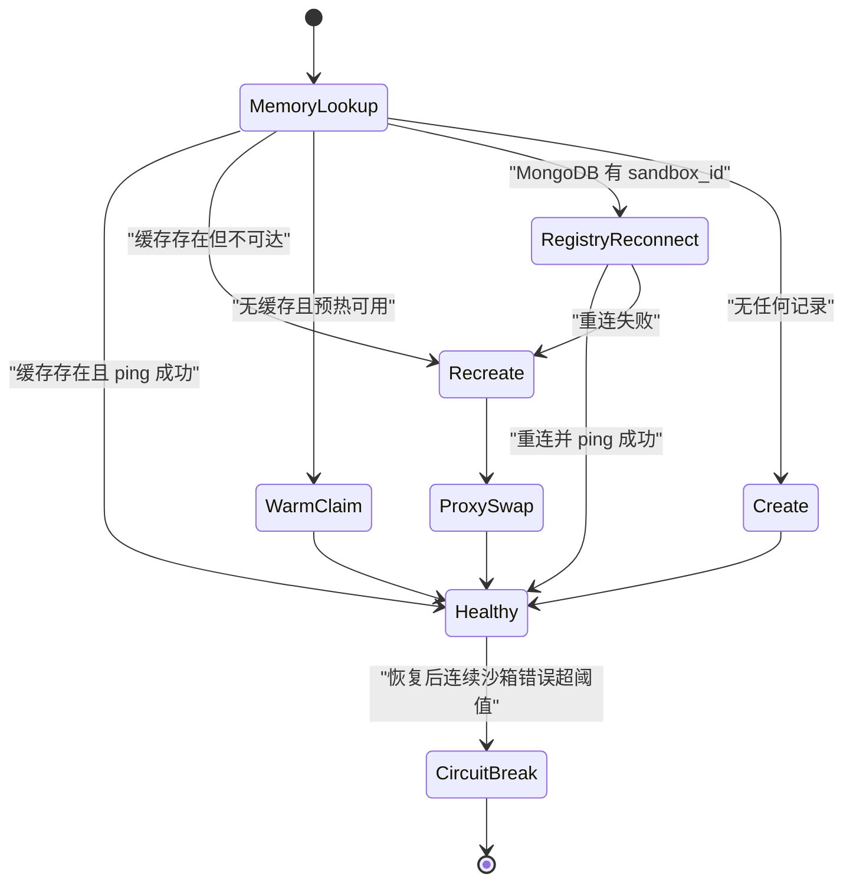

---

# Part 4｜核心专题与高频追问

## 4.1｜业务闭环与系统边界

### 4.1.1 真实业务链路

**分析链路：**

1. 用户提出“某物料有哪些供应商、历史价格如何、是否需要补库”等问题。
2. 主 Agent 委派采购分析 Agent。
3. 分析 Agent 调用 supplier、part、inventory、order_search_details 等 MCP 工具获取内部数据。
4. 必要时使用 web_search 或沙箱内网页抓取补充外部信息。
5. 在沙箱内执行分析脚本，生成 Markdown 报告；可选调用统一图表入口。
6. 返回报告路径、摘要、结论和采购建议，必要时再下载到本地交付目录。

**订单链路：**

1. 用户提出创建或修改订单。
2. 主 Agent 委派订单 Agent。
3. 订单 Agent 提取 `partId / quantity / unitPrice / order_id` 等字段并校验。
4. 缺字段时调用 `request_order_info` 触发中断，用户补充后恢复。
5. 字段完整后调用 `order_create` 或 `order_update`，执行前再触发审批。
6. 审批通过后 MCP 调用 Java ERP API；失败则返回真实错误，不把模型文本当成功凭证。

### 4.1.2 为什么不是让模型直连数据库

- 数据库表结构会把模型和内部实现强耦合；MCP 暴露的是业务语义。
- REST 后端可以集中做权限、校验、事务和审计。
- 工具 Schema 能缩小模型参数空间，便于回归测试。
- 更换模型或 Agent 框架时，ERP 业务事实层不需要重写。

### 4.1.3 高频追问

**问：为什么需要主 Agent，前端直接选功能不行吗？**

答：固定流程可以由前端路由，但自然语言请求常同时包含查询、分析、解释和写操作。主 Agent 的价值是做意图识别、任务拆解和跨域协调；一旦进入确定性业务动作，仍交给专业 Agent 和工具。对于高度固定的订单流程，我也会考虑进一步下沉为显式 Workflow，减少模型参与。

**问：这个项目最核心的业务价值是什么？**

答：把分散的 ERP 查询、外部信息采集、分析产物和订单操作放到同一对话闭环中。源码能证明闭环能力，不能证明具体提效比例；线上收益需要埋点和业务基线验证。

**证据入口：** `src/agent/main_agent.py`、`src/agent/subagents/configs/procurement_analyst.yaml`、`src/agent/subagents/configs/procurement_order.yaml`、`src/mcp_server/tools/`。

---

## 4.2｜Graph Factory 与多 Agent 编排

### 4.2.1 为什么做启动期预计算

`precompute_agent_context()` 在启动时加载 MCP 工具、构造图表统一入口并读取子 Agent YAML。这些组件不依赖用户，可以复用。请求期 `create_main_agent()` 再绑定用户沙箱、StoreBackend 路由和用户相关中间件。

这比“启动时只建一个全局 Graph”更适合当前沙箱模型，因为每个用户需要不同执行后端；也比“每次都重新连接所有 MCP Server”减少重复初始化。

### 4.2.2 子 Agent 如何配置化

YAML 至少声明 `name / description / system_prompt / tools`，加载器完成格式校验，再把工具名模式映射为实际工具对象，并追加差异化中间件：

- 分析 Agent：摘要中间件 + 模型/工具调用上限。
- 订单 Agent：模型/工具调用上限 + `interrupt_on` 写操作审批。

### 4.2.3 图表工具为什么聚合

代码将符合命名规则的 `generate_*_chart/map/diagram/graph` 工具映射到 `chart_type`，对模型只暴露 `generate_visualization(chart_type, chart_config)`。好处是减少工具列表和选择歧义；代价是统一入口的参数 Schema 变宽，因此又用 `chart_params.md` 做按需参考。

### 4.2.4 高频追问

**问：多 Agent 一定优于单 Agent 吗？**

答：不一定。拆分只有在工具集合、上下文、权限或失败处理明显不同的时候才值得。这里分析是长链路读任务，订单是短链路写任务，治理策略不同，所以拆分有依据。若只是提示词不同但工具和状态完全相同，单 Agent + Workflow 可能更简单。

**问：YAML 工具匹配有什么风险？**

答：当前实现使用子串匹配，灵活但可能误匹配同名工具。生产上应改为精确名称或显式前缀语法，启动时对“零匹配、多匹配、重复命名”做失败校验，而不是只打印 warning。

**问：为什么每次请求还要创建 Graph？**

答：Graph 需要绑定当前用户的稳定沙箱代理和运行上下文；公共组件已预计算，因此请求期主要是轻量装配。后续可以按 user_id 缓存已编译 Graph，但要同时解决配置热更新、资源回收和并发安全。

**证据入口：** `src/agent/main_agent.py`、`src/agent/subagents/loader.py`、`src/agent/middleware_config.py`、`src/agent/tools/chart_generator.py`。

---

## 4.3｜MCP 工具层与 ERP 集成

### 4.3.1 MCP 在这里解决什么

FastMCP Server 不是业务数据库，而是协议适配层：

- 对 Agent 暴露稳定、可描述的工具 Schema。
- 对 Java ERP 发起标准 REST 请求。
- 负责 snake_case 到 camelCase 的参数映射。
- 统一检查 HTTP 状态和业务 `code`。
- 通过 lifespan 维护 `httpx.AsyncClient` 连接池，避免每次工具调用新建连接。

当前业务工具包括供应商模糊搜索、零部件分页/搜索/按供应商查询、库存预警、订单创建/修改和订单明细查询。

### 4.3.2 空结果为什么单独兼容

`ensure_nonempty_content()` 将空列表和空对象转换为字符串 `[]` / `{}`，避免 MCP 编码为模型不接受的空 content 数组。这是协议边界上的小问题，但能说明工程实践：工具“业务上为空”和“协议上无内容”不是一回事。

### 4.3.3 订单工具的当前边界

- `order_create` 自动补订单号和下单时间。
- `order_update` 也复用了 `_prepare_request()`，因此即使调用方只想改交期，也可能自动补 `orderNumber` 和 `orderTime`；这与 YAML 中“最小变更”目标不完全一致，应拆成 create/update 两套准备逻辑。
- 订单号是“日期 + 三位随机数”，无法从代码证明唯一；真正唯一性应由 ERP 服务端唯一索引或幂等键保证，并在冲突时可重试。
- 工具当前多以字符串或 `{error: ...}` 返回失败，后续可统一为 `success / error_code / retryable / data` 结构，便于 Agent 稳定决策。

### 4.3.4 高频追问

**问：为什么不用普通 LangChain Tool，非要 MCP？**

答：本地函数也能工作，但 MCP 把工具提供方独立成服务，便于跨语言复用、统一发现和独立部署。这里 Java 负责 ERP，Python 负责 Agent，MCP 正好作为边界。代价是多一跳网络、版本兼容和可观测性成本。

**问：如何防止模型传错参数？**

答：第一层是工具 Schema，第二层是订单 Agent 的字段校验，第三层是人工审批，第四层应是 Java 后端强校验和数据库约束。不能只依赖 Prompt。

**问：超时和重试怎么设计？**

答：当前 httpx 总超时为 30 秒，但没有统一重试策略。读请求可按错误类型做有限指数退避；写请求不能盲重试，必须携带幂等键并先查结果，否则可能重复下单。

**证据入口：** `src/mcp_server/server_main.py`、`src/mcp_server/http_base.py`、`src/mcp_server/result_utils.py`、`src/mcp_server/tools/order_tools.py`。

---

## 4.4｜用户级沙箱、热替换与故障治理

### 4.4.1 为什么按用户而不是按 thread 建沙箱

一个用户的多条会话共享沙箱，可以复用依赖、报告、数据文件和动态技能；不同用户使用不同沙箱，降低文件和代码执行互相影响。它是在隔离强度与资源成本之间的折中：比全局沙箱安全，比每个请求新建沙箱更有连续性。

### 4.4.2 沙箱状态机

### 4.4.3 Proxy 热替换为什么关键

Graph、工具和中间件都可能已经持有 sandbox backend。如果重建后直接换一个对象，旧引用仍指向失效沙箱。`SandboxBackendProxy` 提供稳定对象身份，`replace_backend()` 只换内部真实 backend，调用方无需感知。这是典型的间接层换取恢复能力。

### 4.4.4 健康检查与熔断为什么分开

- Health Middleware 在 Agent 执行前 ping，负责发现和恢复。
- Circuit Breaker 检查最近连续沙箱错误，超过阈值后 `jump_to=end`，负责止损。
- Tool Error Middleware 把单次异常转成 `ToolMessage(status="error")`，让 Agent 有机会调整策略。
- Model/Tool Call Limit 防止模型或工具无限循环。

### 4.4.5 当前并发风险

预热沙箱认领使用 `_warm_lock`，但同一新用户的两个并发请求可能同时通过内存未命中和数据库未命中，各自创建远程沙箱；MongoDB 的 user_id 唯一索引只能约束注册记录，不能自动回收多创建的远程资源。演进方案是 user_id 维度的单航班锁、数据库租约或分布式锁，并在锁内二次检查。

### 4.4.6 高频追问

**问：为什么不用容器平台直接解决？**

答：底层可以是容器平台，但应用仍要解决用户到沙箱的绑定、重连、预热、文件播种、稳定引用和失败语义。平台解决资源，业务层解决生命周期。

**问：每次 Agent 执行都 ping 会不会慢？**

答：会增加网络开销。当前实现偏保守。生产上可以引入短 TTL 健康缓存、失败触发检查或后台心跳，但需要权衡“更快发现失效”和“减少额外调用”。

**证据入口：** `src/agent/backends/sandbox_manager.py`、`src/agent/backends/sandbox_proxy.py`、`src/agent/middlewares/sandbox_health.py`、`src/agent/middlewares/sandbox_breaker.py`、`src/agent/middlewares/tool_error.py`。

---

## 4.5｜上下文工程、Checkpoint 与 Memory

### 4.5.1 四种数据不要混为一谈

| 数据 | 当前载体 | 用途 | 权威性 |
|---|---|---|---|
| Agent 执行状态 | MongoDBSaver | 中断恢复、跨重启会话状态 | 执行权威，不是业务权威 |
| 用户偏好 | StoreBackend 下的 `preferences.md` | 个性化输出、近期供应商/查询 | 辅助信息，可被纠正 |
| 展示消息 | MongoDB `session_display_messages` | UI 完整回放 | 展示权威，不用于订单事实 |
| 订单/库存/供应商 | Java ERP | 业务查询与写入 | 业务事实源 |

### 4.5.2 为什么展示消息单独保存

模型运行态可能因为摘要而压缩历史，也包含框架内部消息；前端需要的是稳定、完整、可渲染的用户/助手/工具事件。项目将两者分开，并为文本字段设置 500,000 字符截断，避免单文档过大。

### 4.5.3 长上下文如何控制

- 大工具结果由 DeepAgents 自动卸载到文件系统，上下文只留路径和预览。
- 摘要中间件在接近窗口时压缩历史，也提供 `compact_conversation` 主动压缩。
- 分析 Agent收到长报告后可先摘要再继续。
- 模型和工具调用上限提供硬边界。
- Skill 和图表参数按需读取，避免常驻 Prompt。

### 4.5.4 用户偏好怎么更新

MemoryUpdateMiddleware 在 Agent 回复后判断是否为有意义的采购交互，用摘要模型提取供应商和查询摘要，合并写回偏好文件；供应商最多保留 10 个，查询最多 5 条。提取失败不会阻塞主流程。

### 4.5.5 当前持久化边界

配置中 `STORE = InMemoryStore()`，所以偏好和“持久化技能”并没有真正跨进程持久；MongoDB Checkpoint 是持久的，但不能替代 Store。面试中应说“已经抽象出 StoreBackend 路由，当前开发实现是内存 Store，生产需替换为持久后端”，不能说长期记忆已经跨重启可靠保存。

### 4.5.6 高频追问

**问：摘要会不会丢信息？**

答：会，所以摘要不是事实库。关键业务事实应重新查 ERP；完整历史可落文件或展示库；摘要只保留决策所需上下文。对于订单审批状态，用 checkpoint 而不是自然语言摘要恢复。

**问：Memory 和 RAG 有什么区别？**

答：这里的 Memory 是用户偏好和近期行为摘要；RAG 通常是从外部知识库检索事实材料。前者服务个性化，后者服务知识 grounding，生命周期和可信度不同。

**证据入口：** `src/agent/config.py`、`src/agent/middlewares/tools_summarization.py`、`src/agent/middlewares/memory_update.py`、`src/api_view/agent_loader.py`。

---

## 4.6｜Skill 系统与能力扩展

### 4.6.1 Skill 与 Tool 的区别

- Tool 是可执行能力，例如查库存、创建订单、生成图表。
- Skill 是操作手册和配套脚本，告诉 Agent 在特定任务中如何选择工具、组织步骤和产出格式。
- 子 Agent 是职责和上下文边界，拥有一组 Tool 与 Skill。
- Workflow 是强顺序流程；当规则足够确定时，应减少模型自由度。

### 4.6.2 动态技能生命周期

项目内置 skill-management：下载或创建技能，在主 Agent 沙箱目录中校验和试运行，再通过 `assign_skill` 复制到目标 scope，并写入 StoreBackend；沙箱重建后 UserSkillsRestoreMiddleware 尝试恢复。SkillsSyncMiddleware 则把仓库内置技能同步进沙箱。

### 4.6.3 为什么采用渐进式加载

子 Agent先扫描 Skill 目录，只有命中任务时才读取具体 `SKILL.md`。这样新增技能不必把完整手册写进系统 Prompt，也不会让所有任务承担无关 token 成本。

### 4.6.4 安全与治理边界

- 动态下载代码即供应链风险。沙箱降低宿主机影响，但不能替代来源白名单、签名/哈希校验、压缩包路径穿越检查、依赖锁定和网络出口控制。
- `zipfile.extractall()` 需要显式验证成员解析后的路径仍在目标目录内。
- Skill 上线应记录版本、来源、审核人、测试结果和回滚版本。
- 工具权限应按 Agent 白名单分配，订单写工具不能因为动态技能而扩散给分析 Agent。

### 4.6.5 高频追问

**问：Skill 为什么不直接写死在 Prompt？**

答：Prompt 适合稳定全局规则，Skill 适合可复用、按需加载、可版本化的领域流程。全部写死会放大上下文、降低可维护性，也不利于不同 Agent 复用。

**问：如何评估一个新 Skill 可以上线？**

答：至少做结构校验、脚本语法与最小运行测试、工具权限审查、恶意路径与网络行为检查、固定样例回归、版本和回滚记录。当前仓库实现了部分结构/运行校验，完整供应链治理仍是演进项。

**证据入口：** `src/skills/main/skill-management/SKILL.md`、`src/agent/tools/assign_skill.py`、`src/agent/middlewares/skills_sync.py`、`src/agent/middlewares/user_skills_restore.py`。

---

## 4.7｜HITL、SSE 流式协议与前端交互

### 4.7.1 为什么中断不是普通问一句

普通模型提问结束后，下一条消息可能被当作新任务；LangGraph interrupt 会把执行停在明确节点，并由 checkpoint 保存状态。用户提交补充或审批后，`Command(resume=...)` 从原位置继续，更适合事务流程。

### 4.7.2 两类中断语义

1. `order_info_supplement`：字段不完整，需要用户补充自由文本。
2. `hitl_approval`：参数已经形成，但写操作需要 approve/reject。

前端 `InterruptBanner.vue` 对两类中断展示不同 UI；后端在发出 interrupt 后先保存展示消息，再发送 `done(interrupted=true)` 并结束本次 SSE，等待 `/resume` 新请求。

### 4.7.3 SSE 事件契约

| 事件 | 作用 |
|---|---|
| `token` | 增量助手文本，带 main/子 Agent 来源 |
| `tool_start` | 创建工具调用卡片 |
| `tool_args` | 追加流式参数 |
| `tool_result` | 返回文本和图片 |
| `tool_end` | 将调用状态置为完成 |
| `interrupt` | 展示补数或审批界面 |
| `done` | 当前流结束，可带 interrupted 标志 |
| `error` | 以协议事件结束失败，避免前端永远 loading |

### 4.7.4 为什么同时监听 messages 和 values

`messages` 适合 token、工具调用和工具结果；`values` 适合检测 Graph 的 interrupts。开启 `subgraphs=True` 后，namespace 可识别消息来自主 Agent 还是子 Agent，前端因此能展示来源。

### 4.7.5 当前身份一致性问题

初始请求会从 localStorage 读取随机 user_id 并发送；但 `resumeChat()` 当前请求体只发送 `resume`，后端 `ResumeRequest.user_id` 默认成固定值 `laoxiao`。若初始用户不是该值，恢复时可能绑定错误沙箱/上下文。生产修复应让恢复请求显式携带原 user_id，更理想的是从认证主体获得身份，并校验 thread_id 的归属，不能信任客户端自报。

### 4.7.6 高频追问

**问：为什么用 SSE，不用 WebSocket？**

答：当前主要是服务端单向推流，用户补数和审批通过新的 HTTP POST 提交，SSE 足够简单，也更容易穿过代理。若需要高频双向协作、实时取消确认或多人协同，再考虑 WebSocket。

**问：客户端断线怎么办？**

答：checkpoint 可以保存 Graph 状态，但当前还需要补充事件序号、Last-Event-ID 或结果查询机制，避免重连后重复展示。写操作还必须依靠服务端幂等保证，不能只靠 SSE 连接状态。

**证据入口：** `src/api_view/api/chat.py`、`src/agent/tools/hitl_tools.py`、`frontend/src/api/chat.js`、`frontend/src/components/InterruptBanner.vue`、`frontend/src/App.vue`。

---

## 4.8｜稳定性、安全、测试与演进答辩

### 4.8.1 当前已经实现的防线

- 环境变量加载且不覆盖进程已注入配置，`.env` 被要求不提交。
- CORS 默认仅开放本地开发地址，生产可用 `ALLOWED_ORIGINS` 指定来源。
- 工具异常转结构化错误消息，避免单工具异常直接击穿整个 Agent。
- 沙箱健康检查、重建、热替换和熔断组合治理基础设施故障。
- 写操作通过人工审批；本地下载文件名使用 `Path(...).name` 防止本地路径穿越。
- 消息字段设置长度上限，避免单条 MongoDB 文档无限膨胀。
- 模型和工具调用设置硬上限，限制失控循环成本。

### 4.8.2 当前必须诚实说明的缺口

| 优先级 | 缺口 | 风险 | 建议 |
|---|---|---|---|
| P0 | 缺少服务端认证与 thread 所有权校验 | 越权访问会话、恢复他人任务 | 接入统一身份，所有 chat/history/resume 按 owner 校验 |
| P0 | resume 用户身份未从初始请求可靠延续 | 绑定错误沙箱和 Memory | 移除固定默认值，由认证主体解析 user_id |
| P0 | 写请求缺少可靠幂等键 | 超时重试可能重复下单 | 前端请求 ID + ERP 唯一约束 + 结果查询 |
| P1 | `order_update` 自动补订单号/时间 | 非预期字段被更新 | 拆分 create/update 请求准备器 |
| P1 | 同用户并发建沙箱缺少单航班 | 重复创建远程资源 | user_id 锁/租约，锁内二次检查 |
| P1 | `InMemoryStore` 非持久 | 重启后偏好和已分配技能丢失 | 替换为 Mongo/Redis/数据库 Store |
| P1 | 动态 Skill 下载校验不足 | Zip Slip、恶意代码、依赖污染 | 白名单、签名、路径校验、版本锁和审批 |
| P1 | 调试日志可能记录参数/结果 | 采购或供应商信息泄露 | 脱敏、分级、采样、权限与保留期 |
| P2 | `/health` 只返回静态 healthy | 无法反映 Mongo/MCP/Sandbox 状态 | 增加 readiness 与依赖探测 |
| P2 | 工具错误契约不统一 | Agent 难以判断是否重试 | 标准错误码、retryable 和 trace_id |

### 4.8.3 测试策略怎么回答

**当前仓库事实：**

- 有针对 MCP 空结果兼容、工具调用 ID 提取和 OpenSandbox timeout 的局部单元测试。
- 本次文档生成时 `python -m compileall -q src tests` 通过。
- 设置 `PYTHONPATH=src` 后，`tests/test_mcp_result_utils.py` 定向执行结果为 2 passed。
- 直接运行全量 pytest 时，当前环境未安装 `deepagents`、`langchain` 等项目依赖，因此无法完成全量测试；这不是线上通过证明。

**生产前建议测试金字塔：**

1. 单元测试：订单参数映射、错误结构、Skill 路径校验、沙箱状态机、Memory 合并。
2. 契约测试：MCP Schema 与 Java API DTO 对齐，覆盖空数据、业务错误码和超时。
3. Graph 测试：固定模型响应，验证委派、调用上限、中断与 resume。
4. 集成测试：MongoDB + Fake ERP + Fake Sandbox，覆盖重启重连与故障重建。
5. 端到端测试：浏览器发起订单，补数、拒绝、批准、断线恢复。
6. 安全测试：越权 thread、恶意 Skill ZIP、路径穿越、Prompt Injection、敏感日志。
7. 评测集：采购意图路由、参数抽取准确性、工具选择、事实引用、拒绝执行。

### 4.8.4 可观测性怎么设计

一次请求至少贯穿 `request_id / thread_id / user_id / graph_run_id / tool_call_id / sandbox_id`。指标建议分四层：

- API：首 token 延迟、总耗时、SSE 中断率、断开率。
- Agent：模型调用次数、工具调用次数、委派次数、摘要次数、token 成本。
- Tool/MCP：按工具统计成功率、业务错误、超时、重试和后端耗时。
- Sandbox：创建/认领/重连/重建次数、预热命中、健康检查耗时、孤儿资源数。

日志应避免记录完整 Prompt、订单详情和密钥；必要字段脱敏并设置访问控制和保留周期。

### 4.8.5 如果让你继续做，三阶段路线图

**阶段一：守住事务和身份边界**

- 接入认证授权，修复 resume 身份一致性和 thread owner 校验。
- 为订单写入增加幂等键，拆分 create/update 参数准备。
- 统一 MCP 错误契约，补订单契约测试。

**阶段二：提升可靠性与可运营性**

- 用持久 Store 替换 InMemoryStore。
- 增加 user_id 单航班锁、孤儿沙箱回收和完整 readiness。
- 建立全链路 trace、指标面板和敏感日志治理。

**阶段三：建立 Agent 评测与能力治理**

- 建立离线采购任务集和线上反馈闭环。
- 对 Prompt、模型、Skill 和工具 Schema 做版本管理及灰度。
- 将稳定的订单流程进一步 Workflow 化，把模型限制在抽取和解释环节。

### 4.8.6 压轴追问

**问：这个项目最体现你工程能力的点是什么？**

答：不是某个框架 API，而是把不确定模型放进可治理系统：用子 Agent 隔离职责，用 MCP 隔离业务后端，用沙箱隔离执行副作用，用 checkpoint 恢复流程，用 HITL 守住写操作，用熔断和调用上限处理失败。

**问：你会如何证明系统真的有效？**

答：先定义任务级指标，而不是只看模型主观回答。分析任务看事实正确率、工具选择、报告完整性和耗时；订单任务看字段抽取、审批到达率、写入成功率、重复写入为零和越权为零。再用固定评测集做版本对比，线上只在有审计和回滚的前提下灰度。

**问：如果模型换掉，系统还剩什么？**

答：ERP 工具契约、业务校验、HITL、沙箱、状态持久化、流式协议和可观测性都应保留。模型是可替换的推理组件，不应成为业务事实或权限系统。

---

