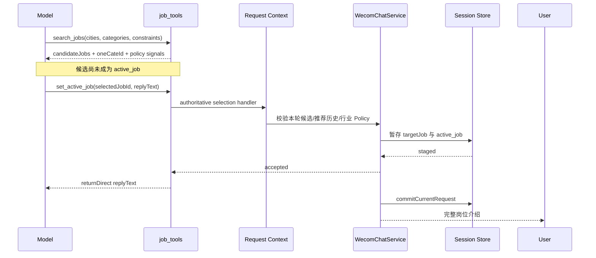
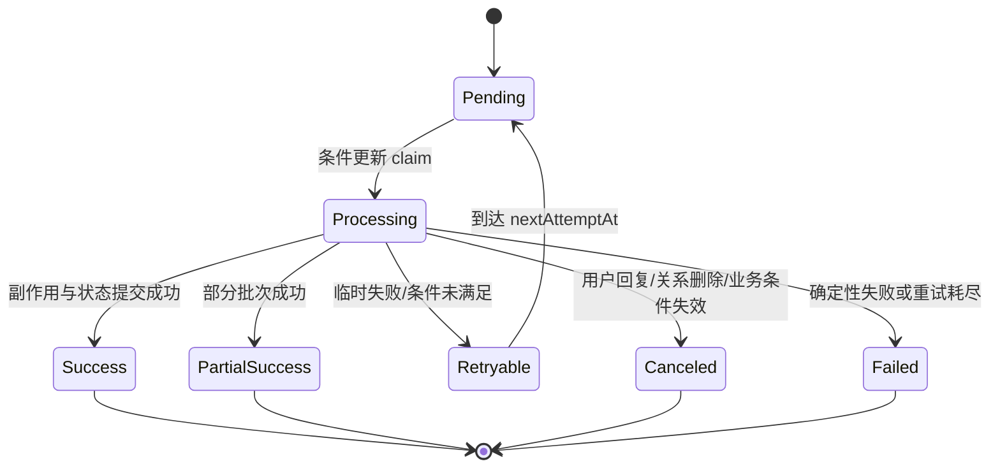

答：主动读取存在漏读和跨行业误读。当前行业属于工程已知上下文，应由系统注入；按需知识 Skill 才适合由模型选择读取。

### 4.4｜Session、Memory 与并发：如何守住多轮一致性

#### 4.4.1 Session 与 Memory 的分工

| 状态 | 典型内容 | 生命周期 |
| --- | --- | --- |
| Session | 当前请求、当前岗位、推荐历史、消息与 Tool 记录 | 会话级、较短期 |
| Memory | 稳定画像、偏好、摘要、每日记忆 | 用户/身份级、跨会话 |
| Request Context | 本轮临时 metadata、候选、待提交状态 | 单请求 |

请求内写入先暂存到 `WecomRequestContext`。`WecomChatService` 在回复 guard、工具副作用和 active 检查全部通过后，调用 Session 与 Memory 的 `commitCurrentRequest`。取消或异常走统一 rollback。

#### 4.4.2 latest-wins 的四层控制

1. `WecomTurnCoalescer`：把私聊短窗口连续消息合并为一轮，并可 supersede 当前 active run。
2. `SessionTurnSequencer`：同一 identityKey 的本地执行有序。
3. `SessionExecutionCoordinator`：新请求替换 active handle，可中断旧线程并更新权威请求。
4. `KvSessionStore`：以独立 active 列记录 activeRequestId、revision、lease 和状态，持久化前再次检查请求仍有效。

在多实例场景，`KvSessionStore` 如果底层实现 `LeaseLockStore`，使用分布式租约锁；否则退化为进程内 `ReentrantLock`。面试时要主动说明：进程内锁只解决单实例竞争，多实例一致性依赖共享 KV 的租约能力。

#### 4.4.3 关键业务阶段保护

普通模型推理可以被新消息取消，但建群等动作已经进入外部副作用后，强行中断可能留下“群建了一半”。协调器读取当前关键阶段：

- 可中断且新消息明确改变业务目标：允许 interrupt。
- 不可中断阶段：返回 protected，新消息排队。
- 关键阶段完成后：把排队消息按序写入历史或开始下一轮。

这体现了取消粒度从“线程”升级为“业务阶段”。

对于远程建群等不可安全重放的动作，还要 claim 可恢复的副作用 fence。线程超时或取消时，如果无法确定对端是否已执行，系统保存未知/处理中状态并等待查询或回调收敛，不能直接再发一次请求。

#### 4.4.4 防止旧快照覆盖新状态

KV 可能在极短时间读到旧副本。`markRequestStatus` 不直接拿旧主会话整包回写，而将 completed/failed 的权威状态放在独立 active 列；只有主会话 `updatedAt` 明确晚于 claim 时间时，才补写状态，避免覆盖刚提交的新消息与推荐岗位。

#### 4.4.5 长对话压缩的工程细节

`AihireCompressingConversationMemoryService` 不只是“超过长度做摘要”，还处理：

- 摘要折叠为唯一系统消息，避免每轮重复合并多条摘要。
- 保留最近消息并按阈值触发摘要。
- 移除 reasoning/thinking 元数据，避免模型内部过程回灌。
- 规范 assistant tool_calls 与 ToolResponse 配对，防止兼容协议返回 400。
- 将 `search_jobs` 的大候选 JSON 投影成轻量字段，但保留 requestId、候选 ID、类目和后处理所需信息。
- 回滚时只裁掉本请求新增消息；读到旧快照或空历史时宁可保留，不能覆盖整段会话。

#### 4.4.6 TableStore 历史为什么不能在读取失败时返回空列表

`TableStoreConversationMessageStore` 通过 `ConversationMessageStore` SPI 保存 Agent history。为了规避单属性大小限制，它把序列化后的消息拆成固定大小 chunk，并用单独 metadata 行记录 chunk 数、消息数、TTL、更新时间和业务元数据。

普通历史写入是 read-modify-write。如果读取失败被伪装成“没有历史”，随后写入本轮少量消息，就会把原有长历史静默覆盖。因此存储层在读取异常时保留失败语义并抛给上层；线程因 latest-wins 被中断时，还会恢复 interrupt 标记。对于群交接等不可变快照，先写新 chunk，最后更新 metadata；metadata 行是新快照的可见提交点，发布成功后再清理旧 chunk。

这体现一个通用原则：**fail-open 不能破坏数据不变量**。回复可否降级由上层决定，但底层存储不能把“未知”伪装成“空”。

#### 4.4.7 典型追问

**问：latest-wins 会不会丢用户消息？**

答：被取消的是旧请求继续生成并提交回复的权力，不等于必须丢弃用户输入。关键阶段的新消息可以排队，并在受保护轮次提交后按顺序保存；取消回调也可保留被取消请求的用户消息。

**问：为什么 Session 和 Memory 要分别 commit？能否做到强事务？**

答：当前是应用层请求事务语义，两者按顺序提交，并在提交前多次检查 active。若底层分属不同存储，严格原子事务成本高；可进一步引入版本化 commit marker、事务日志或 outbox 做恢复。面试中应说明当前代码边界，不把它说成跨存储 ACID。

**问：摘要会不会丢关键信息？**

答：关键信息不应只存在摘要里。当前岗位、推荐记录和稳定画像有结构化状态；摘要主要保留对话语义。压缩后仍保留最近消息及必要工具导航字段。

### 4.5｜岗位上下文与 `active_job`：如何避免推荐、答疑、拉群串岗

#### 4.5.1 为什么一个 `jobId` 不够

对话中至少有四种岗位：

- `sourceJob`：用户从外部渠道进入时携带的来源岗位。
- `targetJob / active_job`：当前正在向用户介绍并用于后续答疑、资格判断、拉群的唯一岗位。
- `recommendedJobRecords`：实际向用户展示过的推荐历史。
- 候选集合：`search_jobs` 本轮返回但尚未展示的岗位。

若把候选直接当已推荐，或把来源岗位一直当当前岗位，后续问“工资多少”或“拉群吧”就可能指向错误岗位。

#### 4.5.2 搜岗到选岗的两阶段协议



#### 4.5.3 `set_active_job` 的校验顺序

1. `selectedJobId` 与 `replyText` 必填。
2. 候选行业 Policy 不能处于待解析状态。
3. 本轮存在候选集时，岗位必须属于本轮搜索结果。
4. 岗位必须存在于推荐历史，或能由本轮候选构造推荐记录。
5. 必须能构造完整 `TargetJobRecord`。
6. 候选一级类目必须与当前行业策略一致，或存在候选 Policy 证明。
7. 将岗位绑定到当前求职对象，并写入 active job 与 runtime metadata。

#### 4.5.4 `returnDirect` 的纠错与回滚

`returnDirect=true` 的风险是工具失败信息可能被直接当用户话术。项目增加 `ActiveJobReturnDirectRecoveryHook`：如果最后一个 `set_active_job` 返回 `ACTIVE_JOB_CORRECTION_REQUIRED`，移除 return-direct 完成标记，让模型继续纠错；正确的文本结果才直接结束。

此外，主服务会区分：

- 校验未通过：返回模型内部纠错信号，不向用户暴露错误 JSON。
- 状态暂存成功但最终 commit 失败：回滚，不发送 direct reply，也不使用固定成功兜底。
- 已有模型生成的安全恢复话术：可以作为失败响应，但必须标记请求失败。

#### 4.5.5 岗位拒绝与搜索排除

用户说“这个太远”“不做夜班”“不要保洁”时，拒绝范围不同：岗位、岗位属性、类目、城市、区县或通勤。工具协议要求结构化记录 scope 与 dimension，并将拒绝 ID/城市/类目合并到后续搜索条件。不能把“太远”扩大为拒绝整个城市，也不能让历史排除永远覆盖用户本轮重新接受。

#### 4.5.6 典型追问

**问：为什么设置 active_job 还要带 replyText？**

答：因为“选中了哪个岗位”和“向用户展示了哪个岗位”必须在同一个语义边界。拆成两个独立步骤会出现状态已经切换但回复失败，或回复成功但状态未切换的窗口。

**问：能否靠数据库事务解决？**

答：数据库事务只能覆盖本地状态，无法让模型生成和企微发送自动加入同一事务。当前方案先把权威状态暂存在请求事务中，只有全部校验与提交成功才允许成功话术出站；更进一步可用 outbox 将状态提交和出站消息关联。

**问：用户重新提到历史岗位怎么办？**

答：允许从推荐历史恢复，但仍要验证当前行业与上下文，不允许随意使用从未展示的候选 ID。


### 4.7｜标签、拉群、外呼与促活：异步业务如何做成可恢复系统

#### 4.7.1 共用模式

这四类业务看似不同，底层都可以抽象为：



共同字段包括业务 ID、状态、版本/claim、重试次数、nextAttemptAt、失败码、失败原因、requestId/traceId 和时间戳。

#### 4.7.2 人才标签抽取

标签任务创建时：

1. 校验 C 端用户、来源类型和来源引用。
2. 获取当前生效的标签定义快照。
3. 以用户、来源类型和来源引用申请短窗口防重。
4. 创建 task，并按标签定义分批创建 batch。
5. 拉群前触发可使用更高优先级。

Worker 执行时先原子 `markTaskRunning`。claim 失败说明其他 worker 已处理，当前实例返回 skipped。随后加载会话与线索上下文，逐批调用抽取模型，解析并按标签定义校验。有效与无效记录都落明细，最终合并快照；部分批次失败但存在有效结果时标记 `partial_success`，并按需通知下游。

关键设计：标签不是模型自由生成的键值。标签定义、允许值、证据消息和快照合并策略都由代码约束；临时闲聊不能自动升级为长期事实。

#### 4.7.3 拉群交付

`group_delivery_tools` 将拉群拆成 readiness、create/reuse、欢迎语、私聊告知、激活调度和取消等动作。进入 readiness 或建群时标记关键业务阶段，真实远程副作用前冻结业务身份与请求关联，防止并发消息任意打断或旧回调覆盖新岗位。

拉群前至少核验：

- 当前 `active_job` 是否存在且与求职对象一致。
- 岗位与商家交付上下文是否一致。
- 候选人的硬性条件是否满足或需要补充。
- 用户是否明确同意拉群，并保存同意原话作为审计证据。
- 手机号补采策略是群前还是群后执行。

“建群接口成功”不自动等于“交付完成”。还需要看候选人、文员成员关系、欢迎语、私聊告知和激活任务的结果。

远程超时也不能简单重放 create：结果可能已经在对端生效，只是本地没有收到响应。此时应保留 `CREATING/PENDING` 或 effect 标识，等待状态 MQ/查询收敛。回调处理还要核验稳定请求 ID、当前岗位、托管身份与 epoch；陈旧 effect 只能忽略或重试，不能直接覆盖 Session。

#### 4.7.4 文员未进群补偿

当前代码包含专门的文员入群补偿状态机：

```text
INITIAL_CHECK
→ STAFF_REPLACE_REQUESTED
→ WAITING_REPLACEMENT_CONFIRM
→ STAFF_CONFIRM_TIMEOUT_2M
→ STAFF_CONFIRM_TIMEOUT_5M
→ STAFF_CONFIRM_TIMEOUT_10M
→ STAFF_REPLACED / COMPLETED_ORIGINAL_JOINED / COMPLETED_NO_AVAILABLE_STAFF
```

核心处理：

- 先查询原文员成员关系；`JOINED` 才完成，`ABSENT` 才选替换，`UNKNOWN` 延迟重试。
- 替换文员排除原文员和已尝试人员，避免循环邀请。
- 邀请接口成功后仍查询成员关系，不把 API 接受当实际入群；同一替补人员的邀请次数也有上限，避免无止境重复动作。
- 2 分钟向群内安抚，5 分钟私聊提醒文员，10 分钟仍未入群则记失败并换人。
- 失败事件、安抚和飞书告警分别用稳定事件 ID / milestone 防重。
- 每个 relayId 用租约推进，避免多实例同时替换。
- 成功后调度群激活；duplicate 视为已调度，保持幂等。

#### 4.7.5 私聊到群聊 Agent 的交接

群聊不是把私聊 Agent 换一个 Prompt 后继续跑。当前工程把群业务拆到与 `wecom` 并列的 `cwecome-craw-conversation-group`：

```text
私聊拉群工具
→ 选择并校验职位/求职对象范围
→ 生成结构化 handoff summary
→ 保存交接记录与群绑定
→ 群就绪事件初始化群状态
→ 群消息入库
→ due task + worker lease
→ Group Agent 生成候选回复
→ 发前复核
→ MQ 派发并回写状态/历史
```

交接摘要只保留当前 `jobId + jobSeekerId` 范围内、具有可信归属的用户与助手发言。`set_active_job` 必须有调用与成功结果配对，只有实际输出的 returnDirect 正文可作为已回答证据；全局压缩摘要、模型思考、其他职位工具结果不能混入。摘要模型失败、超时或结构非法时保存明确的降级状态，并以已确认事实继续建群，不能把“摘要不可用”解释成“用户没有待确认问题”。

群 Agent 使用局部 Skill Registry，只加载 group-opening、group-conversation 与只读复用的 job-qa，不污染单聊全局 Skill。群会话、绑定、CAS、worker lease、pendingReply 与派发状态独立持久化；文员接管、停发或租约失效后，旧模型回复必须丢弃或复核，避免过期回复出站。

#### 4.7.6 外呼通道

外呼模块把业务请求与供应商适配分开。请求包含 referenceId、手机号、内部渠道和场景变量；客户端根据 sendSource、行业和 Nacos 路由解析 appKey/taskId，可选 A/B 分组，找不到配置时回退基础枚举。

供应商返回要同时判断 HTTP 状态和业务 code，成功后保存供应商 requestId/seq。日志对手机号脱敏。这里应进一步关注：业务幂等键是否在供应商侧生效、重复提交如何查询、回调如何落状态；不能只用每次新生成的 UUID 当业务防重。

#### 4.7.7 促活发送

`ReactivationDispatchService` 扫描到期任务后先 claim 为 dispatching，再依次检查：

1. 是否处于发送黑窗。
2. 候选人促活状态是否允许。
3. 前置触达槽位和时间间隔是否满足。
4. 任务创建后用户是否已回复。
5. 好友关系是否删除，实时检查失败应 cancel、reschedule 还是 fail。
6. 引用岗位是否仍然有效。

只有 guard 全部允许才调用 Sender。成功后写发送历史、更新任务/用户状态，并以 `taskId + wecomMsgId` 形成出站对话历史幂等键；若消息带岗位卡，还将推荐岗位写回 Session，避免促活消息和主对话岗位历史断裂。

#### 4.7.8 典型追问

**问：标签抽取为什么允许 partial_success？**

答：标签按批次执行，单批失败不应抹掉其他可靠结果。保留明细与批次状态后，可以合并有效标签，同时让失败批次进入补偿或人工诊断。

**问：文员邀请失败为什么要区分 UNKNOWN 和 ABSENT？**

答：ABSENT 是权威查询确认未入群，可以换人；UNKNOWN 可能是查询接口异常，直接换人会导致多个文员同时进入群。因此 UNKNOWN 应重试查询。

**问：促活为什么发送前还要查一次？**

答：任务从生成到发送存在时间差，用户可能已经回复、删除好友或岗位下线。生成时检查只能证明过去，发送前 guard 才能阻止过期动作。

**问：状态机如何防止卡死？**

答：每个非终态必须明确 nextAttemptAt、超时和最大重试；processing 状态需要超时回收；同时记录最后失败码和推进版本。没有这些字段的状态机只是枚举，不是可恢复执行器。

**问：为什么群聊要单独建模，不能复用私聊 Session？**

答：私聊 owner 是单个求职者，群聊同时包含求职者、文员、机器人和接管状态；回复时机、权限和停发条件不同。直接复用会让私聊历史、行业 Prompt 和群状态互相污染。共享的是经过校验的业务事实与交接摘要，不是整段运行时上下文。

**问：交接摘要为什么不能只让大模型自由总结？**

答：自由总结无法证明某句话属于哪个职位和求职对象，也无法区分候选岗位、成功切换和失败工具调用。当前方案先用代码做范围筛选、调用结果配对和引用白名单，再让模型抽取结构化 concerns/answered/unresolved，最后仍由代码校验对象、职位、长度和引用。

### 4.8｜稳定性、可观测性、测试与故障复盘

#### 4.8.1 稳定性分层

| 层次 | 当前机制 | 解决的问题 |
| --- | --- | --- |
| 输入层 | 参数校验、消息类型准入、回环过滤 | 非法请求和机器人自循环 |
| 并发层 | identity 串行、latest-wins、关键阶段保护 | 旧回复覆盖新意图、半完成副作用 |
| 模型层 | fallback、超时分类、回复 guard | 模型异常和内部文本泄漏 |
| Tool 层 | 权威校验、错误码、retryable、nextStep | 模型误调用与伪成功 |
| 状态层 | request stage/commit/rollback、revision、lease | 脏写、旧快照覆盖与多实例竞争 |
| 异步层 | claim、幂等、重试、终态、补偿 | 重复消息和临时依赖失败 |
| 出站层 | 发送前 guard、状态回写、历史幂等 | 过期触达与主对话断层 |
| 观测层 | Metrics、SLS、Langfuse、结构化日志 | 故障定位和业务追踪 |

#### 4.8.2 观测模型

主链路可按下面的关联键排查：

```text
sessionId / identityKey
  └─ requestId + revision
      ├─ modelRequestId + modelCallSequence
      ├─ activeIndustryId + policy source
      ├─ toolCallId + toolName + duration
      ├─ skillName + source
      ├─ business taskId / relayId / eventId
      └─ outbound messageId / provider requestId
```

`WecomChatService` 记录 context enrich、session claim、industry route、processor、tool side effects、memory flush、state commit 和 event emit 等阶段耗时。`AihireModelObservabilityInterceptor` 记录模型请求序号、模型名、消息数、字符估算和工具数。Harness 执行器还形成 run/task、路由模式、delegated、预算消耗和未决项等诊断字段；当前源码允许 Observer 回退为 NONE，不能仅凭字段存在声称 Harness trace 已在线上生效。SLS emitter 对统一事件字段做规范化并异步发送，异常只记录日志，不反向拖垮主对话。

Langfuse 侧将一轮业务请求映射为 trace，把模型调用映射为 generation，把工具调用映射为 span。两套观测并不重复：SLS 更适合业务事件统计与排障，Langfuse 更适合模型/工具调用链分析。但“具备观测链”不等于“正文已完全脱敏”：会话内容、身份字段和打开后的 Raw HTTP body 都必须结合当前配置、字段映射和日志样本单独审计。

当前代码还保留 Legacy 与 OpenTelemetry 两类 Langfuse 协议，通过统一配置选择主出口，并可配置 OTel 镜像双写。正确的迁移顺序是先双写对比 trace/generation/tool span 结构，再切主协议；两个出口需要故障隔离。Legacy 内存队列和任何旁路上报都属于 best-effort，不能承诺零丢失。

#### 4.8.3 指标口径

代码中已定义企微进入与回复、岗位工具、知识工具、候选人工具、LLM 成功/失败/超时与 fallback、KV Session/Memory、身份迁移等指标枚举。面试时要区分：

- “枚举和上报调用已存在”是代码事实。
- “监控平台已注册且线上有数据”需要环境配置和平台查询证明。
- 不能因为 code 已填写，就声称告警已上线或指标达到某个数值。

当前静态扫描可看到 `CwecomeMetrics` 的默认 Reporter 为 Noop，未找到明确的生产 Reporter 装配；文员补偿部分也包含进程内计数与结构化日志。因此简历可以写“建立指标门面和埋点调用点”，不能写“已经形成跨节点监控与告警闭环”。

#### 4.8.4 安全配置与敏感信息边界

当前仓库静态配置中可见历史默认凭据形态与 env 配置文件，因此面试时不能说“配置安全已经完全解决”。正确表述是：

- 任何口令、Token、AK/SK 都不进入简历、面试材料、日志样例或截图，统一写作 `[REDACTED_SECRET]`。
- 运行配置应迁移到 Secret Manager、容器 Secret 或受控环境变量，并对已经进入历史的凭据执行轮换，而不只是从当前文件删除。
- 日志默认关闭正文优于“开启后再截断”；截断只控制体积，不等于 DLP、掩码或字段级脱敏。
- SLS、Langfuse、Raw HTTP 和业务事件需要分别审计用户原文、手机号、身份 ID、岗位/群 ID 与工具参数，建立最小采集、访问控制和留存周期。
- `.env`、部署脚本和示例配置也要纳入 Git 跟踪审计，不能只扫描 Java 源码。

这类发现应作为“安全债务与改进项”陈述，不能包装成已完成治理；是否已在部署侧替换和轮换，需要配置平台与发布记录证明。

#### 4.8.5 测试策略

2026-11-05 对当前工作区做静态盘点，共找到 573 个位于 `src/test/java` 下的 Java 测试源文件，分布在 app、candidate、conversation、cron、dao、outbound、rpc、common 和工具目录。这个数字只说明测试资产规模，不说明当前全量测试已经执行或全部通过。高价值测试不是追求总数，而是覆盖边界：

- `SessionExecutionCoordinatorCriticalPhaseTest`：关键阶段下的中断与保护。
- `KvSessionStoreLockTest`：Session 锁和并发行为。
- `WecomChatServiceJobToolSessionStateTest`：选岗持久化、回滚与 direct reply。
- `RuntimePolicyContextAssemblerTest`：通用与行业 Policy 选择。
- `NacosIndustrySkillConfigClientTest`：远程配置校验与降级。
- `TagExtractTaskServiceImplTest` / `TagExtractionWorkerServiceImplTest`：任务防重、claim、批次与快照。
- `WecomFriendRelationOperationsImplTest` / `WecomFriendDispatchOperationsImplTest`：关系幂等与派发状态。
- `ReactivationDispatchServiceTest` / `ReactivationPreSendGuardTest`：发送前取消、重排与失败。
- `DefaultStaffJoinCompensationServiceTest`：文员入群确认与替换状态机。
- `AihireHarnessModeConfigurationTest`：REACT/AUTO/CHECKLIST 的启动准入与依赖校验。
- `EvaluationLegacyAutoDelegationTest` / `EvaluationInlineAutoTest`：AUTO 路由、子任务回执、静默与汇总边界。
- `TableStoreConversationMessageStoreTest`：分块历史、TTL、清理与失败语义。
- `GroupAgentAutoConfigurationTest` 及 group 模块测试：群装配、交接、租约、回复派发和上下文隔离。

Harness 评测还要守住“真实执行”和“成功判定”边界：评测入口限制为 localhost，默认不应触发真实执行，只有显式执行开关才允许运行；HTTP 接受或模型生成草稿都不是成功，至少要看到最终 `REPLY_PUBLISHED` 及对应事件链。历史对照报告只能证明当时的样本与版本，不能替代当前 checkout 或生产灰度验证。

验证金字塔建议：

```text
纯函数/策略单测
→ Service + fake repository 状态转换测试
→ DAO 条件更新与唯一约束测试
→ 模块集成测试
→ 通道沙箱与模型回放
→ 小流量生产观测
```

本文只完成静态代码证据和文档结构验证；是否所有测试当前均能构建通过，需要实际执行 Maven 后才能确认。

#### 4.8.6 典型故障复盘一：旧请求覆盖新请求

**现象**：用户连续发送 A、B，两次模型调用并发，A 最后返回并写入状态，覆盖 B 的新意图。

**根因**：只在 HTTP 层异步执行，没有身份级权威请求、提交前 active 校验和请求级状态隔离。

**治理**：identityKey 串行器 + active request claim + latest-wins + 中断 + commit 前多次 `ensureActive` + canceled rollback。

**剩余边界**：分布式场景必须确认共享 KV 的租约实现已启用；单机锁不能代替多实例一致性。

#### 4.8.7 典型故障复盘二：岗位话术与 active_job 不一致

**现象**：用户看到岗位 B，但后续答疑或拉群使用岗位 A。

**根因**：模型展示岗位与状态切换是两个独立步骤，候选结果也可能串轮。

**治理**：本轮工具结果按 requestId 归属；`set_active_job` 同时接收岗位 ID 和完整话术；先权威校验并暂存状态，成功后才 returnDirect；提交失败不发送成功话术。

#### 4.8.8 典型故障复盘三：建群成功但文员未入群

**现象**：群已创建、候选人已在群，但指定文员缺席；如果只看 createRoom 成功，会误判交付完成。

**根因**：把 API 请求成功当成成员事实，缺少文员成员查询、确认时间窗和替换状态。

**治理**：以 membership 查询为事实源；区分 JOINED、ABSENT、UNKNOWN；按 2/5/10 分钟推进确认，失败换人、安抚和告警；租约与 milestone 防止重复执行。

#### 4.8.9 典型故障复盘四：促活误打扰

**现象**：任务生成后用户已经回复或删除好友，系统仍发送促活。

**根因**：只在任务生成时检查，缺少发送前的实时事实校验。

**治理**：claim 后再次检查用户活动、实时私聊回复、好友关系、发送时间窗和岗位状态；分别返回 cancel、retry later、fail 或 allow。

#### 4.8.10 典型故障复盘五：子任务完成但没有回答用户

**现象**：AUTO 委派的子任务或工具已经完成，主回复却只汇报“执行成功”，没有回答用户原始问题；或者汇总阶段再次调用写工具，造成重复副作用。

**根因**：把 task completion 当成 conversation completion，未区分工具回执、证据、未决项和用户可见答案；汇总角色仍带有执行工具权限。

**治理**：子任务保存结构化 receipt 和状态；主流程根据 DIRECT/DELEGATE/PAUSE/SUMMARY 明确收口；只读汇总上下文不携带执行域与写工具；最终发布仍回到原 owner，且同一副作用不能因汇总失败被重跑。

#### 4.8.11 面试官追问防守

**问：你认为当前系统还有什么不足？**

答：第一，Session 与 Memory 如果落在不同存储，当前是应用层事务语义，还可增加 commit marker 或 outbox 提升恢复能力；第二，部分跨系统动作仍依赖重试补偿，需要持续核验幂等键和终态；第三，模型与行业 Policy 的效果必须靠回放集和线上灰度指标验证，不能只看单测；第四，指标门面存在但当前仓库未发现生产 Reporter 装配，不能把埋点等同于监控闭环；第五，标签 MQ 消费异常更依赖应用侧失败状态与重新扫描，需要加强卡死告警；第六，配置凭据、外呼请求日志和观测正文仍需统一 Secret/PII 治理。

**问：你如何证明这些设计有效？**

答：我会分四层证据：代码路径证明机制存在；单元/集成测试证明关键状态转换；回放和沙箱证明模型及通道行为；生产 SLS、trace 和业务库证明线上效果。当前这份材料只引用前两类中的静态文件，线上结论必须另取数据。

**问：如果让你重新做一次，优先做什么？**

答：先定义业务事实和状态机，再设计 Agent 协议；优先建设 requestId、幂等、outbox/补偿和观测字段，然后接模型。因为模型接入通常最快，真正昂贵的是上线后无法解释或恢复的半状态。

**问：你个人最能体现架构能力的工作是什么？**

答：不是某个框架接入，而是把对话、策略、真实动作和状态提交拆成明确边界，并把同一原则复用到选岗、关系、标签、拉群和促活：模型只能在受控接口内提出动作，成功语义由确定性系统确认，失败能回滚或补偿，整个过程可追踪。

#### 4.8.12 面试前自检清单

- [ ] 能在 30 秒说清项目不是普通聊天机器人。
- [ ] 能画出 Controller → Service → Processor → Agent → Tool → State 的调用链。
- [ ] 能解释 Agent、Skill、Tool、Workflow 的判定标准。
- [ ] 能解释为什么 Session/Memory 不是业务事实库。
- [ ] 能完整讲出 latest-wins、关键阶段保护和请求级回滚。
- [ ] 能说明多行业为什么一轮只允许一份 Policy。
- [ ] 能讲清 `set_active_job` 的校验、returnDirect 和失败处理。
- [ ] 能用好友关系说明跨系统最终一致性。
- [ ] 能用标签或促活说明 claim、幂等、重试和终态。
- [ ] 能解释“建群成功”和“文员实际入群”的差别。
- [ ] 能解释 REACT、AUTO、CHECKLIST，以及为什么单轮 DIRECT/DELEGATE 不是部署模式。
- [ ] 能说明 Harness 为什么不能拿走原 owner 的状态提交和发消息权限。
- [ ] 能说明私聊到群聊为什么交接结构化摘要，而不是复制整段历史。
- [ ] 能解释 TableStore 读取失败为什么不能降级为空历史。
- [ ] 能区分代码事实、测试证据、部署配置和生产结果。
- [ ] 遇到配置凭据和日志正文问题时，只说风险与治理方案，不复制任何秘密值。
- [ ] 不背诵未经本人确认的规模、指标或团队归属。

#### 4.8.13 代码证据索引

以下路径均为仓库相对路径，面试前可直接复制定位：

| 主题 | 证据路径 | 可核验内容 |
| --- | --- | --- |
| 构建与技术栈 | `pom.xml` | Java 21、Spring Boot、Spring AI Alibaba、Dubbo、RocketMQ、Nacos 等版本和模块聚合 |
| 项目定位 | `docs/文档总览.md` | 业务范围、核心架构口径和设计原则 |
| 总体设计 | `docs/主对话/C端智能体整体技术设计方案.md` | 分层、模块、业务流程和稳定性设计 |
| HTTP 入口 | `cwecome-craw-app/cwecome-craw-app-ali/src/main/java/com/aihire/cwecraw/appali/web/WecomController.java` | chat、event、回调模拟、Session/Memory 调试接口 |
| 句子 MQ 入口 | `cwecome-craw-app/cwecome-craw-app-ali/src/main/java/com/aihire/cwecraw/appali/messaging/juzibot/JuzibotSentenceCallbackConsumerHandler.java` | MQ 消费、回调适配与主链调用 |
| 消息合并 | `cwecome-craw-conversation/cwecome-craw-conversation-inbound/src/main/java/com/aihire/cwecraw/appali/messaging/coalesce/WecomTurnCoalescer.java` | 短窗口合并、active run 替换与 drain |
| 入站处理 | `cwecome-craw-conversation/cwecome-craw-conversation-inbound/src/main/java/com/aihire/cwecraw/appali/messaging/consumer/WecomInboundProcessor.java` | turn buffer、主对话调用、出站与 checkpoint |
| 主对话编排 | `cwecome-craw-conversation/cwecome-craw-conversation-wecom/src/main/java/com/aihire/cwecraw/wecom/WecomChatService.java` | requestId、行业路由、Agent 调用、guard、commit/rollback、事件 |
| 本地轮次串行 | `cwecome-craw-conversation/cwecome-craw-conversation-wecom/src/main/java/com/aihire/cwecraw/wecom/SessionTurnSequencer.java` | identityKey 进程内串行；不等同分布式锁 |
| 并发协调 | `cwecome-craw-conversation/cwecome-craw-conversation-wecom/src/main/java/com/aihire/cwecraw/wecom/SessionExecutionCoordinator.java` | latest-wins、取消、关键阶段保护、状态标记 |
| Session 存储 | `cwecome-craw-conversation/cwecome-craw-conversation-wecom/src/main/java/com/aihire/cwecraw/session/KvSessionStore.java` | claim、active 列、锁、租约、旧快照保护 |
| Memory 存储 | `cwecome-craw-conversation/cwecome-craw-conversation-wecom/src/main/java/com/aihire/cwecraw/agent/evolution/KvMemoryStore.java` | 请求级记忆暂存、提交、回滚、身份迁移 |
| Agent 处理器 | `cwecome-craw-conversation/cwecome-craw-conversation-agent-ali/src/main/java/com/aihire/cwecraw/agentali/AliAgentWecomChatProcessor.java` | AgentRequest、runtime context、Tool/Skill 结果归属、direct reply 解码 |
| 长对话压缩 | `cwecome-craw-conversation/cwecome-craw-conversation-agent-ali/src/main/java/com/aihire/cwecraw/agentali/memory/AihireCompressingConversationMemoryService.java` | 摘要、工具配对修复、候选响应瘦身、推理元数据清理 |
| 通用规则 | `cwecome-craw-conversation/cwecome-craw-conversation-agent-ali/src/main/resources/workspace/aihire-wecom-agent/AGENTS.md` | 事实优先级、真实动作、隐私和输出边界 |
| Skill 选择 | `cwecome-craw-conversation/cwecome-craw-conversation-agent-ali/src/main/java/com/aihire/cwecraw/agentali/IndustrySkillSelector.java` | 模型可见通用 Skill 与行业 Policy 隔离 |
| Policy 装配 | `cwecome-craw-conversation/cwecome-craw-conversation-agent-ali/src/main/java/com/aihire/cwecraw/agentali/skill/RuntimePolicyContextAssembler.java` | 通用规则、唯一行业 Policy 与运行时快照 |
| Nacos Skill | `cwecome-craw-conversation/cwecome-craw-conversation-agent-ali/src/main/java/com/aihire/cwecraw/agentali/skill/NacosIndustrySkillConfigClient.java` | 远程配置、缓存、校验和回退 |
| 岗位工具 | `cwecome-craw-conversation/cwecome-craw-conversation-tools/cwecome-craw-tool-job/src/main/java/com/aihire/cwecraw/tools/job/AihireJobServiceTool.java` | `job_tools` 动作与 `set_active_job` |
| direct reply 纠错 | `cwecome-craw-conversation/cwecome-craw-conversation-agent-ali/src/main/java/com/aihire/cwecraw/agentali/activejob/ActiveJobReturnDirectRecoveryHook.java` | 校验失败回到模型而非直接暴露 |
| 拉群工具 | `cwecome-craw-conversation/cwecome-craw-conversation-tools/cwecome-craw-tool-group/src/main/java/com/aihire/cwecraw/tools/group/AihireGroupDeliveryTool.java` | readiness、资格校验、建群及后续动作 |
| 好友关系 | `cwecome-craw-candidate/src/main/java/com/aihire/cwecraw/candidate/wecomrelation/ops/WecomFriendRelationOperationsImpl.java` | eventId 幂等、好友接受、关系绑定与失败记录 |
| 好友派发 | `cwecome-craw-candidate/src/main/java/com/aihire/cwecraw/candidate/wecomrelation/dispatch/WecomFriendDispatchOperationsImpl.java` | 任务 claim 与 success/reschedule/failed/canceled |
| 好友重试 | `cwecome-craw-candidate/src/main/java/com/aihire/cwecraw/candidate/wecomrelation/retry/WecomRelationRetryOperationsImpl.java` | 分类型重试、换账号与重试耗尽 |
| 标签任务 | `cwecome-craw-candidate/src/main/java/com/aihire/cwecraw/candidate/tag/service/TagExtractTaskServiceImpl.java` | 短窗口防重、任务与批次创建 |
| 标签执行 | `cwecome-craw-candidate/src/main/java/com/aihire/cwecraw/candidate/tag/service/TagExtractionWorkerServiceImpl.java` | 原子 claim、分批、校验、快照与 partial success |
| 促活发送 | `cwecome-craw-cron/cwecome-craw-cron-reactivation/src/main/java/com/aihire/cwecraw/reactivation/service/ReactivationDispatchService.java` | claim、黑窗、guard、发送、历史和岗位回写 |
| 发送前保护 | `cwecome-craw-cron/cwecome-craw-cron-reactivation/src/main/java/com/aihire/cwecraw/reactivation/service/ReactivationPreSendGuard.java` | 用户回复、好友删除、失败策略 |
| 外呼客户端 | `cwecome-craw-outbound/cwecome-craw-outbound-aliyun/src/main/java/com/aihire/cwecraw/outboundbot/AliyunOutboundBotClient.java` | 通道提交、路由、A/B 分组、响应解析与脱敏日志 |
| 文员补偿 | `cwecome-craw-app/cwecome-craw-app-ali/src/main/java/com/aihire/cwecraw/appali/groupcompensation/DefaultStaffJoinCompensationService.java` | 成员查询、换人、2/5/10 分钟确认、安抚和告警 |
| 补偿状态 | `cwecome-craw-app/cwecome-craw-app-ali/src/main/java/com/aihire/cwecraw/appali/groupcompensation/StaffJoinCompensationPhase.java` | 补偿阶段与终态 |
| 业务事件 | `cwecome-craw-app/cwecome-craw-app-ali/src/main/java/com/aihire/cwecraw/appali/analytics/SlsConversationEventEmitter.java` | 统一字段、异步 SLS 发送及失败隔离 |
| 模型观测 | `cwecome-craw-conversation/cwecome-craw-conversation-agent-ali/src/main/java/com/aihire/cwecraw/agentali/AihireModelObservabilityInterceptor.java` | 模型请求、行业 Policy、消息与工具数量 |
| Langfuse | `cwecome-craw-conversation/cwecome-craw-observability-langfuse/src/main/java/com/aihire/cwecraw/langfuse/observability/langfuse/CweLangfuseEventFactory.java` | trace、generation、tool span 与脱敏 |
| OTel 观测 | `cwecome-craw-conversation/cwecome-craw-observability-langfuse/src/main/java/com/aihire/cwecraw/langfuse/observability/langfuse/CweOtelRecorder.java` | OpenTelemetry operation 生命周期、模型与工具观测 |
| Langfuse 协议 | `cwecome-craw-conversation/cwecome-craw-observability-langfuse/src/main/java/com/aihire/cwecraw/langfuse/observability/langfuse/LangfuseConfiguration.java` | Legacy/OTel 主出口与镜像装配、Noop 和故障隔离 |
| 指标枚举 | `cwecome-craw-common/cwecome-craw-monitor/src/main/java/com/aihire/cwecraw/monitor/CwecomeMetric.java` | 会话、Tool、LLM、KV 和身份迁移指标 |
| 实验准入 | `cwecome-craw-conversation/cwecome-craw-conversation-agent-ali/src/main/java/com/aihire/cwecraw/agentali/ConversationHistoryExperimentEligibilityResolver.java` | 新旧会话判定与历史欢迎语边界 |
| 实验事件 | `cwecome-craw-app/cwecome-craw-app-ali/src/main/java/com/aihire/cwecraw/appali/analytics/ExperimentEnrichingConversationEventEmitter.java` | 实验上下文写入业务事件 |
| conversation 模块 | `cwecome-craw-conversation/pom.xml` | core、wecom、inbound、group、agent、tools、观测和 Harness 聚合 |
| Harness 模式 | `cwecome-craw-conversation/cwecome-craw-conversation-agent-ali/src/main/java/com/aihire/cwecraw/agentali/AihireHarnessProperties.java` | REACT/AUTO/CHECKLIST、部署配置与预算参数 |
| Harness 执行器 | `cwecome-craw-conversation/cwecome-craw-conversation-harness/src/main/java/com/aihire/cwecraw/harness/HarnessConversationExecution.java` | owner 边界、准入、工具分级、预算、AUTO/PLAN 执行 |
| AUTO 旧链委派 | `cwecome-craw-conversation/cwecome-craw-conversation-harness/src/main/java/com/aihire/cwecraw/harness/CWecomLegacyAutoExecution.java` | 原 REACT 上的按需委派、回执、未决项与一次性收尾 |
| 群业务结构 | `docs/group-agent/module-layout.md` | 私聊/群聊分域、依赖方向、交接和群消息执行链 |
| 群 Agent 装配 | `cwecome-craw-app/cwecome-craw-app-ali/src/main/java/com/aihire/cwecraw/appali/group/GroupAgentAutoConfiguration.java` | 摘要、群 Agent、仓储、租约、派发和历史投影装配 |
| 群交接摘要 | `docs/group-agent/handoff-summary.md` | 职位/求职对象范围、引用校验、降级和持久化边界 |
| TableStore 历史 | `cwecome-craw-app/cwecome-craw-app-ali/src/main/java/com/aihire/cwecraw/appali/memory/TableStoreConversationMessageStore.java` | 分块、TTL、metadata 提交点、读失败与中断语义 |
| 配置安全审计 | `cwecome-craw-app/cwecome-craw-app-ali/src/main/resources/application-conversation.yml` | 仅用于确认应做 Secret 注入与凭据轮换；不得复制默认凭据内容 |

#### 4.8.14 验证边界声明

本手册的事实来源是当前检出代码、POM、设计文档和测试文件。可确认的是：相关类、状态、分支和测试资产存在；不可仅据此确认的是：

- 当前生产环境是否启用了所有模块与配置开关。
- Nacos、RocketMQ、数据库、SLS、Langfuse 和外部通道的实际部署值。
- 全量 Maven 构建、模块集成测试和端到端链路是否在本次文档生成时通过。
- 线上调用规模、成功率、时延、转化率、成本或业务收益。
- 仓库全部代码是否均由个人独立完成。

面试中如被追问线上结果，应使用本人掌握的真实监控、发布记录和团队分工补充；没有证据时明确说“代码机制已落地，线上数据需要以监控平台为准”。
