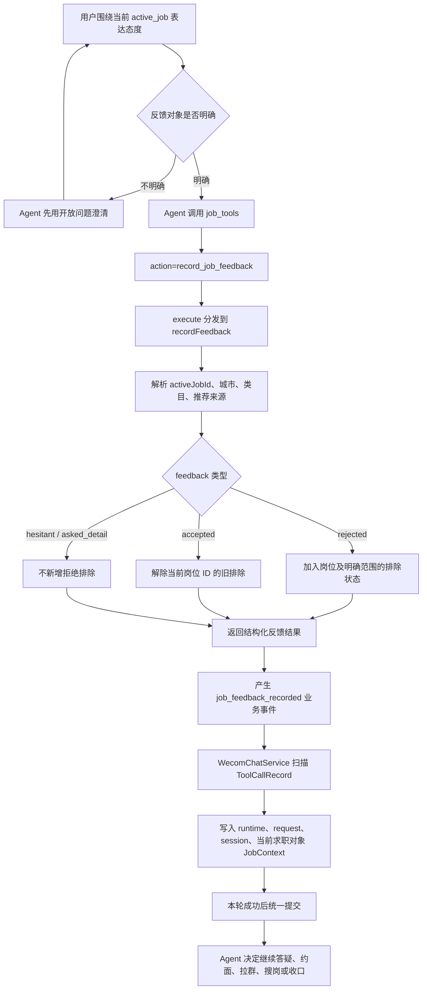
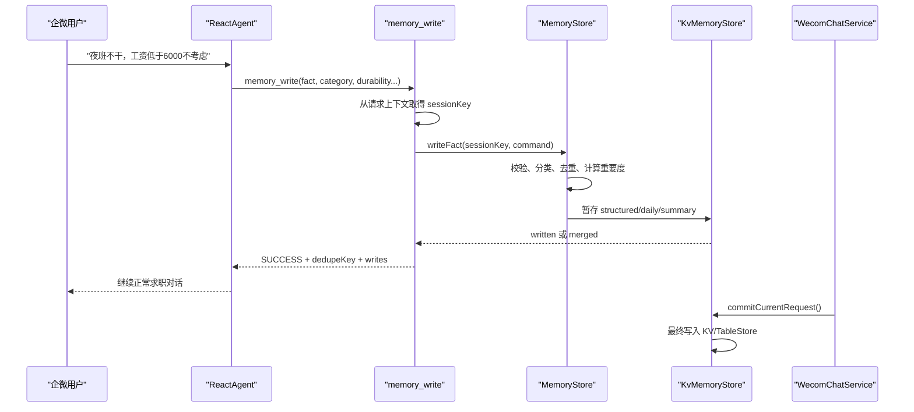

请给出该项目的简历，及面试备战手册（格式如下），放到docs目录下的的"cc面试备战手册.md"文件中
• Part 0｜使用说明与三条心法
• Part 1｜开场脚本（5 分钟口述）
• Part 2｜速记卡（关键词锚点）
• Part 3｜贯穿全局的设计哲学（点题）
• Part 4｜
◦ 4.1
◦ 4.2
◦ 4.3
◦ 4.4
◦ 4.5
◦ 4.6
◦ 4.7
• 4.8

----
----
----
----
## candidate_profile_tool这个函数的作用是什么，及调用流程
【会话中更新session/runtime metadata】它的核心价值不是保存几项字段，而是避免模型已经听懂用户纠正了画像，但后端搜岗和拉群仍继续使用旧数据。----
【对应 Java 方法是 updateProfile()；目前只支持 action="update_profile"。】description":"更新当前企微会话内求职者画像。\n当用户明确说明或纠正年龄、性别、学历、是否有驾照、驾照类型、驾龄、驾驶记录、所在城市、经验、岗位意向、薪资底线等稳定画像时调用。\n尤其是用户纠正导入线索里的年龄/性别时，必须先调用本工具，再继续 job_tools 或 group_delivery_tools。\n只能写用户明确表达的信息，不得根据岗位、称呼或上下文猜测。\n",
--用户说：我是女的啊
--正确链路必须是：candidate_profile_tools(gender=女)---参数校验和标准化：action 只能是 update_profile--性别只能标准化为“男”或“女”--
--投影到本轮 runtimemetadata 和 sessionmetadata
模型理解用户原话
→ candidate_profile_tools 将明确事实写入当前求职对象
→ 同轮刷新 runtime/session 画像
→ 搜岗、资格校验、拉群使用新画像
→ 必要时自动恢复已获用户同意的待拉群任务
----
----
----
----
## 记录反馈  在这个项目中的作用是什么，及调用流程
----record_job_feedback【记录当前岗位接受/拒绝，并更新当前搜索排除条件】：把“用户口头接受/拒绝岗位”转成当前求职对象下的--结构化岗位反馈和--搜索排除状态，让后续搜岗不再重复推荐已拒绝岗位；它本身不负责搜岗、约面或拉群。
【】action====job_tools(action="record_job_feedback")
【接受/拒绝哪个岗位、拒绝原因和拒绝范围】它负责记录求职者对“当前岗位”的态度，并把明确的拒绝对象转成后续搜岗排除条件。
update_search_exclusions==用户改变主意后，删除或清空已有排除条件
【】【】后续再次调用 search_jobs 时，搜索会自动合并这些排除条件，避免继续推荐刚被拒绝的岗位。
--例如用户说：这个岗位太远了，不考虑。
--{
"action": "record_job_feedback",
"currentJobId": "job-1001",
"feedback": "rejected",
"rejectReason": "距离太远",
"userMessage": "这个岗位太远了，不考虑",
"rejectionScope": "COMMUTE",拒绝范围：通勤
"rejectionDimension": "LOCATION"

    rejectedCities,
    rejectedDistricts,
    rejectedCategories: [""]
}拒绝维度：地点
拒绝范围
JOB            只拒绝当前岗位
JOB_ATTRIBUTE  拒绝岗位某个属性
CATEGORY       拒绝整个岗位类目
CITY           拒绝整个城市
DISTRICT       拒绝某个区县
COMMUTE        拒绝当前通勤范围
拒绝维度
SALARY       薪资
WORK_FORM    住家/不住家等工作形式
SHIFT        班次
LOCATION     地点、距离
JOB_CATEGORY 岗位类别
JOB_CONTENT  工作内容
OTHER        其他

返回给 Agent：典型拒绝结果类似：
{
"action": "record_job_feedback",
"recorded": true,
"activeJobId": "job-1001",
"activeJobCity": "杭州",
"activeJobCategory": "保姆",
"feedback": "rejected",
"rejectReason": "距离太远",
"rejectionScope": "COMMUTE",
"rejectionDimension": "LOCATION",
"requiredNextSearchParams": {
"rejectedJobIds": ["job-1001"],
"rejectReason": "距离太远"
},
"currentSearchExclusions": {
"rejectedJobIds": ["job-1001"],
"rejectedCities": [],
"rejectedDistricts": [],
"rejectedCategories": []
}
}当前岗位ID一定加入排除；；如果是accepted，只解除当前岗位 ID 的排除，不会顺带解除城市或类目排除：
只有当前岗位确定来自alternativeJobs时，才返回：nextStep=confirm_original_constraints用于确认用户是否坚持原城市、原岗位方向。

----
----
----
----
## memory_write等相关的工具    在这个项目中的作用是什么，及调用流程
【kv】
----结论：memory_write、memory_search、memory_get 是项目中的“长期记忆工具组”，负责跨轮保存和召回用户稳定信息。它和会话聊天记录、candidate_profile_tools、record_job_feedback 是不同的数据层。
----它们只能使用 WecomRequestContextHolder 中的当前 sessionKey，模型不能自行指定其他用户或其他会话，因此不能跨会话查询或写入。
工具            作用                                               典型场景
memory_write    写入稳定事实、偏好、约束、历史决策、待办    “            不接受夜班”“工资低于6000不考虑”
memory_search   在当前企微会话作用域内检索长期记忆                   “还是按我之前说的找”
memory_get      根据 memory_search 返回的 memory:// 路径读取完整正文 搜索片段不完整，需要精读
----memory_write{
"fact": "用户不接受夜班，薪资低于6000元不考虑",
"category": "constraint",
"durability": "auto",决定写入位置：auto 或long_term 或daily
"confidence": 0.95,
"tags": "shift,salary"
}
MemoryStore.writeFact(sessionKey, command) 执行：
fact 不能为空，且最多300字。
拒绝写入“当前已绑定、当前有简历、当前已投递、密号有效”等易变化状态。
类别限定为 preference / constraint / profile / decision / todo / fact。
生成基于“会话作用域 + 类别 + fact”的 SHA-256 dedupeKey。
同类别、同内容记忆会合并标签和置信度，避免重复追加。
{
"status": "SUCCESS",
"scope": "current_session",
"result": {
"status": "written",或者merged
"dedupeKey": "sha256:...",
"writes": [
{"target": "structured", "path": "memory://structured/..."},
{"target": "daily", "path": "memory://daily/..."},
{"target": "summary", "path": "memory://summary/..."}
]
}
}
【KV 默认是 TableStore、memory table id 为2、TTL为一年】----当前企微主链路使用的是 KvMemoryStore。工具执行期间先把变更暂存在请求上下文中；本轮对话全部成功后，由 WecomChatService 调用 memoryStore.commitCurrentRequest() 最终持久化。
----自动写入链路【它只捕获少量高置信信息，不会把岗位事实、授权、投递、拉群状态写入长期记忆。】：模型不一定每次都会主动调用 memory_write，所以 WecomChatService 在模型执行结束后还有一层确定性兜底：
用户原话
→ captureStableProfileMemory()
→ 正则提取年龄/性别/城市/岗位方向/经验/薪资底线
→ MemoryStore.writeFact(durability=long_term)
→ 同步部分字段到 session metadata
→ 本轮统一 commit
----读取
-----区别
record_job_feedback     记录当前岗位接受/拒绝，并更新当前搜索排除条件
candidate_profile_tools 更新当前 session 年龄、性别、城市、学历等，立即影响搜岗和拉群
memory_write            长期沉淀稳定偏好和历史决策，不会自动更新当前画像
因此，用户说“我45岁，只找济南白班”时，合理顺序是：
candidate_profile_tools(update_profile)→ 立即更新当前搜岗画像
memory_write(profile/preference/constraint)→ 沉淀为后续轮次可复用的长期记忆
job_tools(search_jobs)→ 按最新条件查岗位

----
----
----
----
## candidate_profile_tools 更新当前 session 年龄、性别、城市、学历等，立即影响搜岗和拉群
memory_write            长期沉淀稳定偏好和历史决策，不会自动更新当前画像？？会的【见上面】
。。。。这两个感觉在设计上有些重复
candidate_profile_tools = 当前有效状态 / 热数据 / 业务事实源
memory_write            = 历史记忆    / 冷数据 / 语义召回
你的感觉是对的：两个组件的技术职责不同，但当前实现确实存在“同一份用户事实双写”的设计重叠，而且已经带来一致性风险。
当前实现真正重复的地方：问题是项目现在把年龄、性别、城市、经验等同时写入了两边。
例如用户说“我今年45岁”：
candidate_profile_tools 写 age=45，下一次搜岗马上按45岁过滤；
memory_write 写“用户年龄45岁”，以后模型可以通过语义检索回忆。
先调用 candidate_profile_tools 更新当前 session，再调用 memory_write 长期沉淀。

session metadata:
age = 46
structured memory:
用户稳定画像：年龄45岁：：MemoryStore的去重主要判断内容相同或包含关系，“45岁”和“46岁”不会被判定为重复，所以旧事实不会自动失效。
用户稳定画像：年龄46岁：：【】【】后续memory_search就可能同时召回45岁和46岁。虽然业务工具应该以 session profile 为准，但模型仍可能被旧记忆干扰。
        ：：所以技术分层本身是合理的：一个是“当前状态”，一个是“历史记忆”。
        ：：维度       candidate_profile_tools     memory_write
        数据结构       固定字段                     自由文本+标签
        时效性         当前最新值                   历史事实、偏好、决策
        查询方式       精确字段读取                 memory_search 模糊召回
        正确性要求     强，直接影响业务结果          辅助上下文，不应作为实时事实源
        更新方式       覆盖当前值                   追加或相似内容合并
        主要消费者不同  search_jobs、拉群校验        大模型后续语义检索
        ----
        更合理的职责划分：建议把“当前事实唯一来源”明确下来
        ：：结构化画像只同步到 Profile，只有偏好、约束、决策类信息才进入 MemoryStore。
        ：：这样 Profile 保存的是“现在是什么-当前状态”。memory 保存的是“为什么”和“历史变化”
        ：：数据类型                    推荐唯一存储位置
        聊天上下文                      Conversation History
        当前年龄、性别、学历、驾照、经验               Candidate Profile
        当前求职城市、岗位方向、薪资要求、班次要求      Candidate Profile或专门的Search Constraint
        拒绝岗位及拒绝原因                         Job Feedback/业务状态【】【也相当于是Candidate Profile】
        历史方向变化                    Memory
        长期软偏好                      Memory
        待办、历史决策、沟通背景          Memory
        ----
        当前状态：
        age=46
        city=济南
        minimumSalary=6000
        shift=DAY

        长期记忆：
        用户曾从保安方向切换到普工
        用户明确拒绝住家岗位，原因是需要照顾家人
        用户更看重通勤距离，其次才是包吃住
我认为最合适的改造方案：：不必删除 memory_write，而是收窄它的写入范围。
1：年龄、性别、学历、驾照、经验等结构化字段只写 Candidate Profile。
2：城市、岗位、薪资、班次等当前检索条件进入 Profile/Search Constraint，不再把相同当前值重复写成 memory 文本。

3：memory_write 只保留：
稳定软偏好；
拒绝原因；
历史决策；
诉求变化；
待办；
不适合结构化的用户背景。
4：如果需要保留画像变化历史，写成事件，而不是另存一份“当前事实”：
不推荐：
用户年龄46岁

推荐：
用户在2026-11-09将年龄信息从45岁更正为46岁，
当前值以Candidate Profile为准
5：memory_search 返回内容进入模型前，增加明确规则：
Memory只能提供历史背景；
年龄、性别、城市、简历、授权、投递等当前状态，
必须以对应业务状态工具的最新结果为准。
最终判断：这不是两个完全相同的组件，但当前代码把“长期记忆”和“当前画像”的数据边界画得不够清楚：
架构层面：一个状态存储、一个语义记忆，二者有存在必要。
数据层面：年龄、性别、城市、经验等确实重复。
最大问题：用户修改信息后，Profile会覆盖，Memory却可能保留新旧两份(不一定触发自动更新)。
最合理方向：Profile作为当前事实唯一来源，Memory只保存历史、原因、偏好和决策。：结构化画像只同步到 Profile，只有偏好、约束、决策类信息才进入 MemoryStore。
----
----
----
----
## 【见下面，项目中是session级】项目中，candidate_profile_tools与memory_write都是更新session级记忆吗，不是user级记忆吧？？
严格来说：不一定是 session 级。两者都是“当前 identityKey 作用域”，有 userId 时是 user 级，没有可靠 userId 时才降级为 session 级。
identityKey 的生成规则WecomIdentity.resolveIdentityKey(userId, sessionId)：生成的 identityKey 被作为参数传给 WecomChatService.execute()，随后放进 WecomRequestContext.sessionKey。。因此这里变量虽然叫sessionKey，实际含义已经是：sessionKey== 当前身份作用域的identityKey
userId 是正整数
→ wecom-v2:user:<userId>        用户级
userId 为空、非数字、0、负数
→ wecom-v2:session:<sessionId>  会话级

        candidate_profile_tools##===================================
        jobSeekerContextService.updateProfile(
        context.getSessionKey(),
        jobSeekerId,
        updates
        );
        identityKey：将画像写进该identityKey 对应的 SessionManager 状态
        └─ jobSeekerId：支持 jobSeekerId 子作用域，还多一层 jobSeekerId，因此同一个企微联系人替本人、姐姐、亲戚找工作时，画像可以按 jobSeekerId 隔离。
        └─ 年龄、性别、学历、城市等画像
        
        memory_write##===================================
        memoryStore.writeFact(：：无jobSeekerId，，因此“帮姐姐找工作”的长期记忆存在混入联系人本人记忆的风险，
        context.getSessionKey(),：：同样使用这个 identityKey，只是写入的是独立的长期记忆 KV，包括结构化记忆、每日记录和摘要。
        command
        );
举例##===================================
输入                         实际 key               两个会话是否共享画像和记忆【确定共享吗，】
userId=12345，sessionId=A    wecom-v2:user:12345   共享
userId=12345，sessionId=B    wecom-v2:user:12345   共享
无有效 userId，sessionId=A    wecom-v2:session:A   不共享
无有效 userId，sessionId=B    wecom-v2:session:B   不共享
有有效C端userId：candidate_profile_tools和memory_write都是user级
没有有效C端userId：两者都是session级

当前实现只是通过 wecom-v2:user:<userId> 作为 KV 主键，让 Session状态和 Memory 状态具有用户级复用效果：
wecom-v2:user:<userId>##===================================
├─ Session状态dict的kv形式【】
│    └─ candidate profiles
└─ Memory状态kv形式【】【】
├─ structuredEntries
├─ memorySummary
└─ dailyNotes
也就是说：
逻辑作用域：可以是 user 级。
存储模型：仍然是 SessionStore/MemoryStore，不是独立用户画像服务。
无有效 userId 时：只能退化成 session 级。
----
----
----
----
## 【见此处，项目中是session级】因为：；handle 时还没有C-userId
1）从真实线上日志看，应该都有userId吧，userId 是正整数→ wecom-v2:user:<userId> 用户级，，所以是用户级为主吧？
2）用户级为主的话，两个会话是如何共享画像的呢，，感觉项目中没有共享呀，，有共享的话-请给出两个会话共享的调用流程
----结论：你的判断“日志里有正整数 userId”是对的，但“所以当前线上以用户级为主”不成立。当前句子回调链路实际上仍是会话级，而且不同 sessionId 不共享画像。
节点              已补全正整数    C-userId 最终 user 级 key    最终 session 级 key
39.107.253.69     364            0                           364
123.57.222.193    300            0                           300
而且这 664 个请求都满足：
同一个 requestId：
先/后能够解析出正整数 cUserId
但 identity_key 仍然是 wecom-v2:session:<sessionId>
每个节点还都发现了“同一个正整数 userId 出现在两个不同 sessionId”的实际情况，但两个请求仍分别使用不同的 session identity key。因此这不是“用户级共享”，只是日志中后续补齐了用户 ID。

----为什么日志里有正整数 userId，key 却还是 session 级
根因是执行顺序：WecomInboundProcessor 把空的 userId 传入 WecomChatRequest,,,,WecomChatService.handle() 此时立即计算 identityKey。因为尚无正整数 C-userId，只能得到：wecom-v2:session:<sessionId>,,,,进入 executeTurn() 后，才执行 CUserIdentityEnricher，查出正整数 C-userId，并执行：request.setUserId(normalized);,,,,“WeCom chat request started”日志又是在 enrichment 之后打印，所以日志表现为：user_id=<正整数>  identity_key=wecom-v2:session:<sessionId>但此前算好的 identityKey 不会重新计算。

----
----两个会话实际调用流程:假设同一个用户 U 分别进入两个会话 S1、S2：
会话 S1
→ handle 时还没有 C-userId ##===================================
→ identityKey = wecom-v2:session:S1
→ 后续补齐 userId=U
→ candidate_profile_tools 写入 Session[S1]
→ memory_write 写入 Memory[S1]

会话 S2
→ handle 时还没有 C-userId ##===================================
→ identityKey = wecom-v2:session:S2
→ 后续补齐同一个 userId=U
→ candidate_profile_tools 读取 Session[S2]
→ memory_write 读取/写入 Memory[S2]

2个工具确实都从同一个 context.getSessionKey() 取键：
画像更新：[AihireCandidateProfileTools.java (line 209)](cwecome-craw-tool-memory/src/main/java/com/aihire/cwecraw/tools/memory/AihireCandidateProfileTools.java:209)
长期记忆：[AihireMemoryTools.java (line 129)](cwecome-craw-tool-memory/src/main/java/com/aihire/cwecraw/tools/memory/AihireMemoryTools.java:129)

S1 != S2
→ identityKey1 != identityKey2
→ candidate profile 不共享
→ memory_write 内容也不共享

只有在进入 handle() 之前就已经携带正整数 C-userId，两个会话才会共同命中wecom-v2:user:<userId>：##===================================
所以更准确的结论是：这两个工具；但当前线上主要按照 session identity key 隔离，并没有实现同一用户跨会话共享画像。【不仅仅是纯进程内session 记忆，commit后会持久化】
之前看到的 {"job_feedback":"...","recorded":true} 只代表反馈成功记录，不代表该记录已经按用户级共享。

