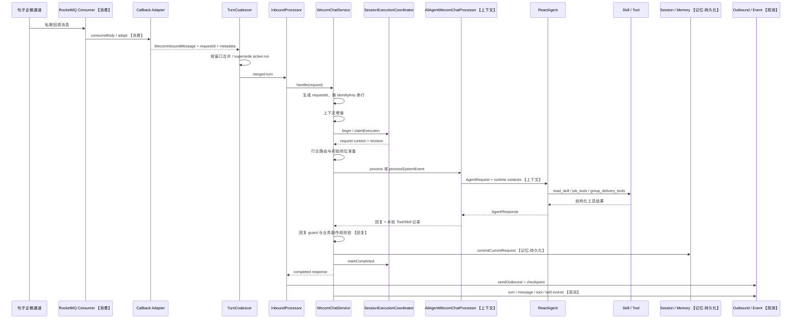
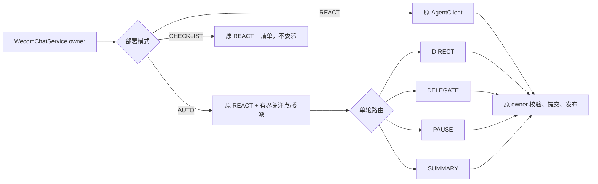
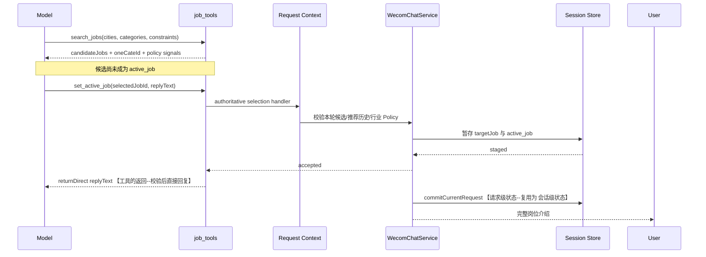
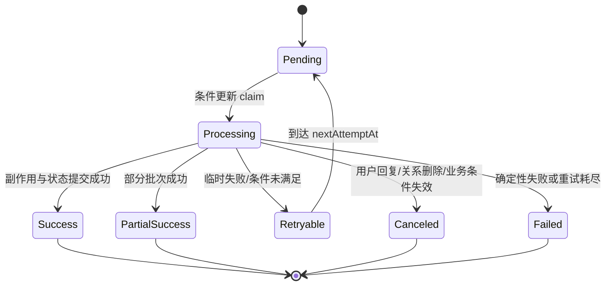

# AIHire C-Agent项目简历与面试备战手册
> 目标岗位：Agent 架构开发
> 建议职责口径：项目核心主导者，负责总体架构、关键链路设计、与跨模块治理；
> 材料主线：架构主线 + 典型难题 + 追问防守。
> 证据基线：2026-11-05 当前检出代码、POM、设计文档与测试文件。本文不虚构QPS、转化率、成本、用户量、或线上效果。


## 简历可复制版
### 项目名称
**AIHire C-Agent｜C端招聘智能对话与业务交付平台**
### 项目角色
**Agent 架构开发 / 核心主导者**
### 项目简介
面向企业微信C端求职场景，建设服务端业务Agent，将自然语言对话、岗位检索与答疑rag、候选人画像、约面拉群、企微关系、人才标签、外呼和促活统一到可追踪、可扩展的业务闭环中。
系统以 Spring Boot 多模块工程为载体，基于 Spring AI Alibaba 与 `agent-platform-ali` 构建 ReactAgent，
----通过 Skill 表达场景策略、
----Tool 执行确定性业务动作、
Workflow 承接强顺序流程；在原 REACT 主链路之上建设 Harness AUTO/CHECKLIST 的有界委派能力，
----并围绕 Session、Memory、
请求并发、幂等任务、异步补偿和
可观测性建立工程约束。

### 技术栈
Java 21、Spring Boot 3.5.7、Spring AI 1.1.4、
Spring AI Alibaba 1.1.2.3、`agent-platform-ali`、ReactAgent、Harness、
Maven多模块、Dubbo、RocketMQ、Nacos、PostgreSQL、MyBatis-Plus、Tair/TableStore、阿里云SLS、JUnit 5、Mockito。
OpenTelemetry/Langfuse、

- 参与原 REACT 主链路向 Harness AUTO/CHECKLIST 的渐进式演进：复用原行业 Agent 与业务事务，不另开会话提交权；以准入函数、读写工具分级、预算/超时、DIRECT/DELEGATE/PAUSE/SUMMARY 路由**【直接/委派/暂停/总结】**及任务回执约束委派边界。
. **让新架构沿用旧链路的业务安全边界**：Harness AUTO 只增加按需委派，原 `WecomChatService` 继续持有 owner、状态提交和对外回复权；系统事件、用户 metadata 和未授权写工具不能绕过准入。
### 【】核心职责
- 核心参与并主导 C-Agent 分层架构设计，明确【】主对话、Workflow、、、、Skill、Tool、Session、Memory与业务事实库的职责边界，避免模型推理直接替代真实业务动作。
- 设计企微主对话请求链路，以 `requestId` 串联入口、模型调用、、、、上下文增强、skil行业路由、工具调用、状态提交与业务事件；
-          通过同身份串行化、latest-wins【】、租约锁和关键业务阶段保护处理并发消息。
- 推动多行业能力采用“单 Agent + 通用 Skill + 当前唯一行业 Policy”模式，通过一级类目选择运行时 Policy 快照，并以 Nacos 覆盖、最后成功缓存和 classpath 回退实现配置化演进与安全降级。
- 
- ----设计岗位上下文的结构化治理：：区分来源岗位、当前岗位、推荐历史和拒绝历史；将`set_active_job`建设为状态与用户话术的一致性边界，，在直接回复前校验候选来源、行业策略和推荐历史。
- ----建设请求级Session/Memory暂存、提交和回滚机制；
- 【上下文】对长对话进行摘要压缩、工具候选响应瘦身、工具调用配对修复和推理元数据清理，降低历史污染及协议错误风险。


- 参与私聊到群聊的 Agent 交接与群会话域拆分，通过私聊历史摘要、独立群会话仓储、worker lease、回复派发和 TableStore 历史投影降低跨场景上下文污染。
- 参与企微好友关系、拉群交付、文员入群补偿、人才标签、外呼与促活链路建设，以状态机、数据库 claim、幂等键、重试/补偿、发送前 guard 和结构化事件保障异步任务可恢复。


- 【观测】建立模型、工具与业务事件的多层观测：以 `requestId/sessionId` 关联阶段耗时、模型调用、Skill 使用、Tool 结果、SLS 事件和 Langfuse trace，并用单元测试和专项验证脚本覆盖关键状态转换。

### 项目亮点
1. **把“聊天机器人”升级为“业务 Agent”**：模型负责理解和决策，代码负责事实、授权、状态和副作用；查岗、选岗、拉群、加好友等动作必须由工具或服务成功结果确认。
2.  **把行业策略做成每轮冻结的运行时快照**：一轮最多注入一份行业 Policy，行业不明确时只走通用策略，避免家政、制造业等规则串用；远程配置异常时保持最后成功版本或安全回退。

3. **----【】把直接回复工具纳入事务边界**：`set_active_job` 不是简单返回文本，而是在 `returnDirect` 暴露话术前完成候选归属、行业 Policy 和当前岗位状态校验；
3. **----持久化失败时回滚--并阻断伪成功话术。
3. **把并发控制扩展到业务关键阶段**：普通轮次遵循 latest-wins；进入建群等不可中断阶段后，，，，新消息根据中断策略排队或取消，避免半完成副作用。


9. **把私聊与群聊拆成两个上下文域**：交接时传递结构化摘要而非整段历史，群 Agent 使用独立策略、存储、租约和发送链路，避免把私聊 Prompt 与状态直接搬进群场景。
6. **把异步链路设计为可恢复状态机**：好友申请、标签抽取、促活和文员入群补偿都有 claim、状态、重试和终态，重复消费不依赖“消息只来一次”。


7. **把观测对象从HTTP 扩展到 Agent 决策链**：记录行业路由、模型请求序号、工具和 Skill、状态提交、、、取消原因及阶段耗时，
8.           使“答错了”可以进一步定位到上下文、策略skill路由、模型、工具或持久化阶段。


----【流程】稳定性分层----
| 层次                  | 当前机制                                                       | 解决的问题           |
|---------------------|----------------------------------------------------------------|-----------------|
| 输入层                 | 参数校验、消息类型准入、回环过滤                                 | 非法请求和机器人自循环     |
| 并发层                 | identity 串行、latest-wins、关键阶段保护                        | 旧回复覆盖新意图、半完成副作用 |
| 模型层                 | fallback、超时分类、回复 guard                                     | 模型异常和内部文本泄漏     |
| --Tool 层            | 权威校验、错误码、retryable、nextStep                                | 模型误调用与伪成功       |
| ----状态层             | request session、memory、stage/commit/rollback、revision、lease | 脏写、旧快照覆盖与多实例竞争  |
| 【业务-幂等一致性】异步层       | claim、幂等、重试、终态、补偿                               | 重复消息和临时依赖失败     |
| 【发送前guard--过期触达】出站层 | 发送前guard、状态回写、历史幂等                          | 过期触达、与主对话断层     |
| 【观测】观测层               | Metrics、SLS、Langfuse、结构化日志                         | 故障定位和业务追踪       |
流程--概率判断与确定性执行分层
大模型擅长理解“用户想找什么、是否犹豫、下一步应该问什么”，
但不适合直接维护事务状态。系统因此把能力拆成：
```mermaid
求职者发消息
→ Agent 理解当前目标
→ 检索或核验岗位事实
→ 选择当前岗位
→ 采集必要条件与明确授权
→ 执行拉群、约面、好友关系或后续触达
→ 状态、事件、和记忆、、、、
→ 【观测】可追踪##===================================

flowchart LR
    U["用户自然语言"] --> A["Agent：理解目标与选择能力"]
    A --> S["Skill / Policy：场景规则"]
    A --> T["Tool：查询或执行真实动作"]
    T --> B["业务服务与事实库"]
    B --> T
    T --> A
    A --> R["用户可见回复"]
    W["Workflow：强顺序流程"] --> T
```
原则不是“所有事情都工具化”，而是：凡是会改变外部世界、形成业务承诺或依赖实时事实的内容，都不能只由模型生成。


示例：
> 同一企微会话可能连续到达多条消息，若只用线程池并发处理，旧回复可能覆盖新意图。这样普通对话保持新请求优先，
> 我在身份维度增加串行器，并用 Session claim 与 latest-wins 标识权威请求；----这样普通对话保持新请求优先，
> 同时对建群这类不可中断副作用增加关键阶段保护。----真实业务动作又不会被任意打断。
> 这样普通对话保持新请求优先，
> 真实业务动作又不会被任意打断。
> 代码入口在 `WecomChatService` 和 `SessionExecutionCoordinator`，相关行为有协调器和会话锁测试覆盖
### 一句话项目介绍
我负责的不是一个只会回复文本的机器人，而是一套面向 C 端招聘的服务端业务 Agent：
模型负责判断，
Skill 负责策略，
Tool 负责真实动作，
代码负责状态一致性、幂等补偿和
可观测性。


### 30 秒简历口径
我在 AIHire C-Agent 项目中核心参与并主导 Agent 架构和关键链路治理。
项目服务于企业微信求职场景，覆盖对话、搜岗、选岗【？？】、企微关系、拉群、标签和促活。
技术上最关键的不是接入大模型，而是让模型判断与业务事实解耦：我们用 
Skill 约束策略、
Tool 执行确定性动作、
请求级Session/Memory事务保证状态一致性，
再用 latest-wins、任务 claim、幂等键【处理并发】、和补偿状态机【异步失败】；
--less同时通过Harness AUTO/CHECKLIST探索有界委派，但仍由原业务owner掌握授权、提交和回复权。
### 真实性调整提示
- 如果本人确实负责总体方案和核心实现，可使用“核心主导”。
- 如果本人主要负责其中若干模块，改为“核心参与，重点负责主对话、状态一致性、与异步任务治理”。
- 不要把仓库中的全部模块都说成个人独立完成；可表述为“我主导关键设计并与通道、产品、搜推、测试等角色协作落地”。
- 没有生产数据时，不写“提升百分之多少”；改写为“建立了可验证的机制”“消除了某类一致性窗口”“补齐了可恢复边界”。


---
## Part 0｜使用说明与三条心法
### 0.1 这份手册怎么用
建议按四轮准备：
1. 第一轮只背 Part 1，确保5分钟能把业务、架构、难点和个人贡献讲完整。
2. 第二轮使用 Part 2 速记卡，把每个关键词展开成 30 秒回答。
3. 第三轮精读 Part 4，重点练习“为什么这样设计”“失败会怎样”“代码在哪里”。
4. 第四轮随机抽取追问题，不看答案口述，再回到证据索引核验。
本文使用四种标签区分证据边界：
| 标签 | 含义 | 面试使用方式 |
| --- | --- | --- |
| `[设计解释]` | 对代码取舍的架构解释 | 可以说“我的设计考虑是” |
| `[演进建议]` | 基于现状的下一步改进 | 必须说“后续可以”而不是“已经完成” |


### 0.2 心法一：先讲业务闭环，再讲框架
不要以“用了 Spring AI、Dubbo、RocketMQ”开场。先说明系统要完成什么：
框架只是实现这条闭环的手段。面试官真正关心的是：哪里允许模型判断，哪里必须由代码裁决，失败后如何恢复。
### 0.3 心法二：所有“成功”都要追问事实源
听到“已推荐”“已选岗”“已拉群”“已加好友”“已发送”时，立刻自问三件事：
1. 成功由模型话术、工具返回还是业务数据库状态定义？
2. 用户可见回复和真实状态是否在同一个一致性边界内？
3. 重试、重复回调、进程重启后是否仍能得到同一个结论？

项目的核心原则可以概括为：
> 模型可以提出动作，但不能宣布一个尚未被确定性系统确认的事实。
### 0.4 心法三：回答必须包含取舍、失败和证据
推荐使用四段式：
```text
背景：当时遇到什么业务问题？
方案：我把边界或状态如何拆开？
取舍：为什么不选另一个更简单的方案？
证据：关键类、状态和测试在哪里？
```


---
## Part 1｜开场脚本（5 分钟口述）
### 1.1 0:00—0:40｜业务背景
我介绍一个我核心参与并主导的项目，叫 AIHire C-Agent。它面向企业微信中的 C 端求职者，
不只是回答问题，还要承接来源岗位、理解求职意向、做岗位检索和答疑，并在用户确认后完成约面、拉群、好友关系和后续促活。

这个场景的难点是，大模型输出是概率性的，但岗位、薪资、用户授权、拉群结果和好友关系是确定性业务事实。
一旦模型把猜测说成结果，或者对话状态和真实动作不一致，就会直接造成错误推荐或虚假承诺。

### 1.2 0:40—1:30｜总体架构
所以我把系统分成五层。
最上面是企微主对话、群聊 Agent、促活、标签和交付等业务应用；
中间是 C-Agent 的上下文、会话、记忆、Skill、Tool 和 Harness；
下面是 Spring AI Alibaba 与 agent-platform-ali 的 ReactAgent 底座；
再往下是 PostgreSQL、TableStore/Tair、Nacos、RocketMQ、SLS 等基础设施；
外侧通过适配层对接句子企微通道、岗位服务和外呼平台。

在 Agent 内部，我定义的口径是：
模型负责目标判断，
Skill 负责场景策略，
Tool 负责确定性业务动作，
Workflow 只承接强顺序、强合规流程。
Session 和 Memory 只帮助连续对话，不替代好友关系、任务状态和岗位事实库。

新架构演进上，我没有直接替换原 REACT，而是在相同入口下增加 Harness AUTO/CHECKLIST。AUTO 可以对复杂问题做有界委派，CHECKLIST 只维护关注点不执行委派；两者都复用原行业 Agent 和原会话事务，`WecomChatService` 仍然掌握状态提交与最终回复权。
### 1.3 1:30—2:20｜主对话与并发一致性
主入口收到请求后先生成并回写 requestId，以同一个身份键进入串行执行。
服务会增强候选人和岗位上下文，，，
然后 claim 当前请求，完成行业路由，--策落policy追加
再调用 Agent。
模型和工具返回后，
还要经过回复安全检查、岗位方向检查和工具副作用处理，##===================================
最后才提交 Session 与 Memory 并标记完成。##===================================

【并发】并发上不是简单加锁。同会话的普通请求采用 latest-wins，新请求可以取消旧请求；
但一旦进入建群等关键阶段，就根据业务中断策略决定排队还是中断。
每个关键步骤都会检查当前请求是否仍然 active，--取消和--异常都会清理处理器现场并回滚请求级状态，避免旧请求留下脏数据。


### 1.4 2:20—3:05｜----多行业Skill
项目要同时支持家政、制造业等行业，但我没有为每个行业复制一个 Agent。方案是单 Agent 加通用 Skill，再按当前岗位一级类目注入唯一行业 Policy。通用能力和行业差异分开，模型一轮最多看到一份行业 Policy；行业不明确或多类目冲突时只使用通用策略。
Policy 可以由 Nacos 覆盖，但远程配置不是无条件信任：内容为空、元数据非法、ID 冲突或网络异常时拒绝新版本，保留最后成功内容或回退 classpath。每轮使用冻结快照，避免一次 ReAct 循环中策略版本前后变化。

### 1.5 3:05—3:50｜----选岗一致性难题set_active_job
一个典型难题是：模型搜索到多个候选后，回复用户某个岗位，但会话里的 active_job 可能还是旧岗位。后续答疑和拉群就会串岗。
我把岗位展示收口到 `set_active_job`。这是 `returnDirect` 工具，但不是拿到文本就直接发。工具先校验岗位是否属于本轮候选或历史推荐、候选行业 Policy 是否已证明，
再在当前请求事务中写入 targetJob 和 active_job。只有权威处理器成功，完整岗位话术才允许直接返回。校验错误会回到模型纠错；持久化或提交失败则回滚，并禁止泄漏成功话术。

### 1.7 4:35—5:00｜【观测】观测、验证
观测上，主链以 requestId、sessionId 关联模型调用序号、行业 Policy 来源、Tool/Skill、阶段耗时和业务状态；
Harness 执行器另保留 run/task、路由和预算等诊断字段。
OpenTelemetry/Langfuse 可表达 trace、generation 和 tool span，但 Harness Observer 是否真实装配必须看部署配置。
项目还为并发、、行业策略、选岗、Harness、TableStore、标签任务、关系任务和促活 guard 建了针对性测试。


### 1.6 3:50—4:35｜异步任务与补偿
对好友申请、标签抽取、促活和拉群补偿，我统一使用“任务状态 + 原子 claim + 幂等键 + 重试/终态”的模式。
--例如标签任务先做短窗口防重，再由 worker 把任务从 pending 原子改为 running；分批抽取后允许 success、partial_success 或 failed，并合并候选人标签快照。
--例如拉群后“候选人已进群但文员没进群”也不能把建群成功当最终成功。补偿状态机会查询原文员成员关系，选择未尝试的替换文员，邀请后按 2、5、10 分钟确认；失败则记录事件、发送安抚和告警，并通过租约避免多实例重复推进。

### 1.8 4:35—5:00｜【个人贡献】个人贡献
我的核心贡献可以总结为：把大模型能力放进可控的业务架构里，
用确定性状态边界、并发治理、幂等补偿和可观测性，让Agent 不只“能回答”，还具备执行真实业务流程的工程基础。


---
## Part 2｜速记卡（关键词锚点）
### 2.1 一张总卡
| 面试主题 | 关键词锚点 | 一句话回答                                    |
| --- | --- |------------------------------------------|
| 项目定位 | 求职业务 Agent | 从一次模型回复升级为持续运行的业务闭环                      |
| Agent 边界 | 判断 / 策略 / 动作 / 顺序 | Agent 判断，Skill 定策略，Tool 做动作，Workflow 保顺序 |
| 主链路 | requestId | 从入口贯穿模型、工具、提交和事件                         |

| 【并发】并发 | identityKey + latest-wins | 同一用户串行，旧请求可取消，,,,关键阶段受保护                 |
| 【业务-幂等一致性】事实源 | 工具与业务库 | 模型不能证明岗位、拉群、好友关系等外部事实                    |

| 【上下文】岗位上下文 | source / target / recommended | 来源、当前、推荐历史分别建模，拒绝混用                      |
| 【上下文】长对话 | 摘要 + 瘦身 + 配对修复 | 控制上下文体积，又不破坏工具协议                         |
| ----多行业 | 单 Agent + 唯一 Policy | 一轮只加载当前行业规则，未知行业走通用策略                    |
| ----配置安全 | Nacos + last-good + classpath | 远程配置异常不能污染当前策略                           |
| --状态事务 | stage / commit / rollback | Session 与 Memory 随请求提交，失败不留半状态           |
| ----选岗 | set_active_job | 状态先成功，再允许直接回复岗位介绍                        |

| 【观测】观测 | SLS + Langfuse | 业务事件和 Agent trace 分层关联                   |


| 企微关系 | request / relation / retry | 请求、关系、尝试和补偿分别持久化                         |
| 标签 | task / batch / snapshot | 任务防重、批次抽取、校验后合并快照                        |
| 拉群补偿 | membership / phase / lease | 查成员事实、状态机推进、多实例租约                        |
| 促活 | claim + pre-send guard | 发送前重新检查回复、好友关系、岗位与时间窗                    |

 Harness | AUTO / CHECKLIST / owner | 新能力只做有界委派，原主链路继续掌握授权、提交与回复               |
| 委派路由 | DIRECT / DELEGATE / PAUSE / SUMMARY | 每轮显式决策，任务有预算、回执和未决状态                     |
| 群聊 Agent | handoff + 独立会话域 | 私聊只交接结构化事实，群聊独立存储、租约与派发                  |
| 历史存储 | TableStore 分块 + 元数据提交点 | 大历史分块写入，元数据行作为可见快照提交点                    |

### 2.2 高频类名卡
| 类或文件                                | 看到它要想到什么 |
|-------------------------------------| --- |
| `WecomController`                   | HTTP/调试/系统事件入口，参数校验与 API 边界 |
| `WecomChatService`                  | 主对话编排、状态提交、异常回滚、工具副作用 |
| 【并发】`SessionExecutionCoordinator`   | latest-wins、claim、关键阶段保护、取消线程 | ##===================================
| 【上下文】`AliAgentWecomChatProcessor`   | Agent请求构造、运行时上下文、Tool/Skill结果归属 |
| ----`RuntimePolicyContextAssembler` | 通用 Skill 与唯一行业 Policy 的每轮快照 |
| --`AihireJobServiceTool`            | 岗位检索、反馈、答疑、选岗工具边界 |
| --`set_active_job`                  | 选岗状态写失败,,禁止 direct reply，回滚状态并返回失败 |
| --`AihireGroupDeliveryTool`         | 拉群前校验、建群、欢迎语、告知与激活 |
| ----`KvSessionStore`                | 会话持久化、active 请求列、本地锁与分布式租约锁 |
| ----`KvMemoryStore`                 | 长期记忆请求级暂存、提交和回滚 |

| `WecomFriendRelationOperationsImpl`   | 好友申请与接受事件、归属判断、关系落库 |
| `TagExtractionWorkerServiceImpl`      | 标签任务 claim、分批抽取、校验、快照合并 |
| `ReactivationDispatchService`         | 促活任务 claim、发送前 guard、发送与历史回写 |
| `DefaultStaffJoinCompensationService` | 文员未入群的状态机、替换、提醒与告警 |

| `HarnessConversationExecution`        | AUTO/PLAN 接入、准入、预算、读写工具分级和 owner 边界 |
| `CWecomLegacyAutoExecution`           | 原 REACT 上的按需委派、子任务回执与一次性收尾 |
| `GroupAgentAutoConfiguration`         | 私聊转群、群 Agent、仓储、lease、dispatch 的运行时装配 |
| `TableStoreConversationMessageStore`  | 对话历史分块、TTL、读失败保护与元数据提交点 |

### 2.3 失败场景卡
| 失败场景         | 不能怎么做 | 当前设计的处理方向 |
|--------------| --- | --- |
| 【并发】新消息覆盖旧消息 | 只比较 HTTP 返回时间 | active request + 取消检查 + 请求级回滚 | ##===================================
| 【并发】建群中途被取消      | 任意 interrupt | 关键阶段标记，按业务策略排队或中断 | ##===================================
| 【业务-幂等】回调重复到达 | 假设 MQ exactly-once | eventId/requestId/状态条件更新实现幂等 |

| ----行业配置拉取失败 | 随机使用另一行业规则 | last-good 或同名 classpath 回退 |
| --set_active_job选岗状态写失败 | 仍发送岗位成功话术 | 禁止 direct reply，回滚状态并返回失败 |
| --工具历史被压缩破坏 | 只按消息数量裁切 | 修复 assistant tool_call 与 response 配对 |


| 标签任务多实例消费 | 每个实例都执行 | 原子 `pending -> running` claim |
| 促活前用户已回复 | 仍按旧计划发送 | 发送前重新检查并取消任务 |
| 文员邀请接口成功但没入群 | 把接口成功当成员成功 | 查询成员关系，按时间点继续确认和补偿 |

| 子任务工具完成但用户问题未回答 | 把技术完成等同业务完成 | 汇总必须消费回执和未决项，最终回复仍由原 owner 发布 |
| TableStore 读取失败 | 降级为空历史再覆盖写 | 保留读取失败事实并中止 read-modify-write，避免静默丢历史 |


---
## Part 3｜【代码】【架构设计】贯穿全局的设计哲学（点题）

#### 3.0.1 【代码】代码证据索引
以下路径均为仓库相对路径，面试前可直接复制定位：

| 主题                                               | 证据路径 | 可核验内容                                                             |
|--------------------------------------------------| --- |-------------------------------------------------------------------|
| 构建与技术栈                                           | `pom.xml` | Java 21、Spring Boot、Spring AI Alibaba、Dubbo、RocketMQ、Nacos 等版本和模块聚合 |
| 项目定位                                             | `docs/文档总览.md` | 业务范围、核心架构口径和设计原则                                                  |
| 总体设计                                             | `docs/主对话/C端智能体整体技术设计方案.md` | 分层、模块、业务流程和稳定性设计                                                  |
| 【ui-api链路WecomController.java】HTTP 入口            | `cwecome-craw-app/cwecome-craw-app-ali/src/main/java/com/aihire/cwecraw/appali/web/WecomController.java` | chat、event、、、、回调模拟、、、、Session/Memory调试接口                          |
| 【mq链路ConsumerHandler.java】句子 MQ 入口               | `cwecome-craw-app/cwecome-craw-app-ali/src/main/java/com/aihire/cwecraw/appali/messaging/juzibot/JuzibotSentenceCallbackConsumerHandler.java` | MQ 消费、回调适配与主链调用                                                   |
| []消息合并WecomTurnCoalescer.java                    | `cwecome-craw-conversation/cwecome-craw-conversation-inbound/src/main/java/com/aihire/cwecraw/appali/messaging/coalesce/WecomTurnCoalescer.java` | 短窗口合并、active run替换与 drain                                         |
| []入站处理Processor.java                             | `cwecome-craw-conversation/cwecome-craw-conversation-inbound/src/main/java/com/aihire/cwecraw/appali/messaging/consumer/WecomInboundProcessor.java` | turn buffer、、主对话调用、、出站、、与checkpoint                               |
| 【】主对话编排WecomChatService.java                     | `cwecome-craw-conversation/cwecome-craw-conversation-wecom/src/main/java/com/aihire/cwecraw/wecom/WecomChatService.java` | requestId、行业路由【前处理】、Agent调用【】、guard【后处理】、commit/rollback【】、事件     |
| 【并发】本地轮次串行                                       | `cwecome-craw-conversation/cwecome-craw-conversation-wecom/src/main/java/com/aihire/cwecraw/wecom/SessionTurnSequencer.java` | identityKey 进程内串行；不等同分布式锁                                         |
| 【并发】并发协调                                         | `cwecome-craw-conversation/cwecome-craw-conversation-wecom/src/main/java/com/aihire/cwecraw/wecom/SessionExecutionCoordinator.java` | latest-wins、取消、关键阶段保护、状态标记                                        |
| ----Session 存储                                   | `cwecome-craw-conversation/cwecome-craw-conversation-wecom/src/main/java/com/aihire/cwecraw/session/KvSessionStore.java` | claim、active列、锁、租约、旧快照保护                                          |
| ---- Memory 存储                                   | `cwecome-craw-conversation/cwecome-craw-conversation-wecom/src/main/java/com/aihire/cwecraw/agent/evolution/KvMemoryStore.java` | 请求级记忆暂存、提交                                                        |
| 上下文runtimecontext--Agent处理器--directreply解码       | `cwecome-craw-conversation/cwecome-craw-conversation-agent-ali/src/main/java/com/aihire/cwecraw/agentali/AliAgentWecomChatProcessor.java` | AgentRequest、runtime context、Tool/Skill 结果归属、directreply解码        |
| 【上下文】长对话压缩                                       | `cwecome-craw-conversation/cwecome-craw-conversation-agent-ali/src/main/java/com/aihire/cwecraw/agentali/memory/AihireCompressingConversationMemoryService.java` | 摘要、工具配对修复、候选响应瘦身、推理元数据清理                                          |
| ----通用规则AGENTS.md                                | `cwecome-craw-conversation/cwecome-craw-conversation-agent-ali/src/main/resources/workspace/aihire-wecom-agent/AGENTS.md` | 事实优先级、真实动作、隐私和输出边界                                                |
| ----Skill 选择                                     | `cwecome-craw-conversation/cwecome-craw-conversation-agent-ali/src/main/java/com/aihire/cwecraw/agentali/IndustrySkillSelector.java` | 模型可见通用 Skill 与行业 Policy 隔离                                        |
| ----Policy 装配                                    | `cwecome-craw-conversation/cwecome-craw-conversation-agent-ali/src/main/java/com/aihire/cwecraw/agentali/skill/RuntimePolicyContextAssembler.java` | 通用规则、唯一行业 Policy 与运行时快照                                           |
| ----Nacos Skill                                  | `cwecome-craw-conversation/cwecome-craw-conversation-agent-ali/src/main/java/com/aihire/cwecraw/agentali/skill/NacosIndustrySkillConfigClient.java` | 远程配置、缓存、校验和回退                                                     |
| --岗位工具`job_tools动作`与 `set_active_job`            | `cwecome-craw-conversation/cwecome-craw-conversation-tools/cwecome-craw-tool-job/src/main/java/com/aihire/cwecraw/tools/job/AihireJobServiceTool.java` | `job_tools` 动作与 `set_active_job`                                  |
| --direct reply纠错==`set_active_job`校验失败回到模型而非直接暴露 | `cwecome-craw-conversation/cwecome-craw-conversation-agent-ali/src/main/java/com/aihire/cwecraw/agentali/activejob/ActiveJobReturnDirectRecoveryHook.java` | 校验失败回到模型而非直接暴露                                                    |
| --拉群工具                                           | `cwecome-craw-conversation/cwecome-craw-conversation-tools/cwecome-craw-tool-group/src/main/java/com/aihire/cwecraw/tools/group/AihireGroupDeliveryTool.java` | readiness、资格校验、建群及后续动作                                            |


| 业务事件                                             | `cwecome-craw-app/cwecome-craw-app-ali/src/main/java/com/aihire/cwecraw/appali/analytics/SlsConversationEventEmitter.java` | 统一字段、异步 SLS 发送及失败隔离                                               |
| 模型观测                                             | `cwecome-craw-conversation/cwecome-craw-conversation-agent-ali/src/main/java/com/aihire/cwecraw/agentali/AihireModelObservabilityInterceptor.java` | 模型请求、行业Policy、消息与工具数量                                            |
| Langfuse                                         | `cwecome-craw-conversation/cwecome-craw-observability-langfuse/src/main/java/com/aihire/cwecraw/langfuse/observability/langfuse/CweLangfuseEventFactory.java` | trace、generation、tool span 与脱敏                                    |
| OTel 观测                                          | `cwecome-craw-conversation/cwecome-craw-observability-langfuse/src/main/java/com/aihire/cwecraw/langfuse/observability/langfuse/CweOtelRecorder.java` | OpenTelemetry operation 生命周期、模型与工具观测                              |
| Langfuse 协议                                      | `cwecome-craw-conversation/cwecome-craw-observability-langfuse/src/main/java/com/aihire/cwecraw/langfuse/observability/langfuse/LangfuseConfiguration.java` | Legacy/OTel 主出口与镜像装配、Noop 和故障隔离                                   |
| 指标枚举                                             | `cwecome-craw-common/cwecome-craw-monitor/src/main/java/com/aihire/cwecraw/monitor/CwecomeMetric.java` | 会话、Tool、LLM、KV 和身份迁移指标                                            |
| 实验准入                                             | `cwecome-craw-conversation/cwecome-craw-conversation-agent-ali/src/main/java/com/aihire/cwecraw/agentali/ConversationHistoryExperimentEligibilityResolver.java` | 新旧会话判定与历史欢迎语边界                                                    |
| 实验事件                                             | `cwecome-craw-app/cwecome-craw-app-ali/src/main/java/com/aihire/cwecraw/appali/analytics/ExperimentEnrichingConversationEventEmitter.java` | 实验上下文写入业务事件                                                       |


| 好友关系                                             | `cwecome-craw-candidate/src/main/java/com/aihire/cwecraw/candidate/wecomrelation/ops/WecomFriendRelationOperationsImpl.java` | eventId幂等、好友接受、关系绑定与失败记录                                          |
| 好友派发                                             | `cwecome-craw-candidate/src/main/java/com/aihire/cwecraw/candidate/wecomrelation/dispatch/WecomFriendDispatchOperationsImpl.java` | 任务 claim 与 success/reschedule/failed/canceled                     |
| 好友重试                                             | `cwecome-craw-candidate/src/main/java/com/aihire/cwecraw/candidate/wecomrelation/retry/WecomRelationRetryOperationsImpl.java` | 分类型重试、换账号与重试耗尽                                                    |
| 标签任务                                             | `cwecome-craw-candidate/src/main/java/com/aihire/cwecraw/candidate/tag/service/TagExtractTaskServiceImpl.java` | 短窗口防重、任务与批次创建                                                     |
| 标签执行                                             | `cwecome-craw-candidate/src/main/java/com/aihire/cwecraw/candidate/tag/service/TagExtractionWorkerServiceImpl.java` | 原子 claim、分批、校验、快照与 partial success                                |
| 促活发送                                             | `cwecome-craw-cron/cwecome-craw-cron-reactivation/src/main/java/com/aihire/cwecraw/reactivation/service/ReactivationDispatchService.java` | claim、黑窗、guard、发送、历史和岗位回写                                         |
| 发送前保护                                            | `cwecome-craw-cron/cwecome-craw-cron-reactivation/src/main/java/com/aihire/cwecraw/reactivation/service/ReactivationPreSendGuard.java` | 用户回复、好友删除、失败策略                                                    |
| 外呼客户端                                            | `cwecome-craw-outbound/cwecome-craw-outbound-aliyun/src/main/java/com/aihire/cwecraw/outboundbot/AliyunOutboundBotClient.java` | 通道提交、路由、A/B 分组、响应解析与脱敏日志                                          |
| 文员补偿                                             | `cwecome-craw-app/cwecome-craw-app-ali/src/main/java/com/aihire/cwecraw/appali/groupcompensation/DefaultStaffJoinCompensationService.java` | 成员查询、换人、2/5/10 分钟确认、安抚和告警                                         |
| 补偿状态                                             | `cwecome-craw-app/cwecome-craw-app-ali/src/main/java/com/aihire/cwecraw/appali/groupcompensation/StaffJoinCompensationPhase.java` | 补偿阶段与终态                                                           |


| conversation 模块                                  | `cwecome-craw-conversation/pom.xml` | core、wecom、inbound、group、agent、tools、观测和 Harness 聚合               |
| Harness 模式                                       | `cwecome-craw-conversation/cwecome-craw-conversation-agent-ali/src/main/java/com/aihire/cwecraw/agentali/AihireHarnessProperties.java` | REACT/AUTO/CHECKLIST、部署配置与预算参数                                    |
| Harness 执行器                                      | `cwecome-craw-conversation/cwecome-craw-conversation-harness/src/main/java/com/aihire/cwecraw/harness/HarnessConversationExecution.java` | owner 边界、准入、工具分级、预算、AUTO/PLAN 执行                                  |
| AUTO 旧链委派                                        | `cwecome-craw-conversation/cwecome-craw-conversation-harness/src/main/java/com/aihire/cwecraw/harness/CWecomLegacyAutoExecution.java` | 原 REACT 上的按需委派、回执、未决项与一次性收尾                                       |

| 群业务结构                                            | `docs/group-agent/module-layout.md` | 私聊/群聊分域、依赖方向、交接和群消息执行链                                            |
| 群 Agent 装配                                       | `cwecome-craw-app/cwecome-craw-app-ali/src/main/java/com/aihire/cwecraw/appali/group/GroupAgentAutoConfiguration.java` | 摘要、群Agent、仓储、租约、派发、和历史投影装配                                        |
| 群交接摘要                                            | `docs/group-agent/handoff-summary.md` | 职位/求职对象范围、引用校验、降级和持久化边界                                           |

| TableStore 历史                                    | `cwecome-craw-app/cwecome-craw-app-ali/src/main/java/com/aihire/cwecraw/appali/memory/TableStoreConversationMessageStore.java` | 分块、TTL、metadata 提交点、读失败与中断语义                                      |


#### 3.0.2 【测试代码】测试策略
2026-11-05 对当前工作区做静态盘点，共找到 573 个位于 `src/test/java` 下的 Java 测试源文件，分布在 app、candidate、conversation、cron、dao、outbound、rpc、common 和工具目录。这个数字只说明测试资产规模，不说明当前全量测试已经执行或全部通过。高价值测试不是追求总数，而是覆盖边界：
- `SessionExecutionCoordinatorCriticalPhaseTest`：关键阶段下的中断与保护。 ##===================================
- `KvSessionStoreLockTest`：Session 锁和并发行为。 ##===================================
- --`WecomChatServiceJobToolSessionStateTest`：选岗持久化、回滚与 direct reply。##===================================##===================================
- ----`RuntimePolicyContextAssemblerTest`：通用与行业 Policy 选择。
- ----`NacosIndustrySkillConfigClientTest`：远程配置校验与降级。
- 
- `TagExtractTaskServiceImplTest` / `TagExtractionWorkerServiceImplTest`：标签----任务防重、claim、批次与快照。
- `WecomFriendRelationOperationsImplTest` / `WecomFriendDispatchOperationsImplTest`：关系----幂等与派发状态。
- `ReactivationDispatchServiceTest` / `ReactivationPreSendGuardTest`：促活----发送前取消、重排与失败。
- `DefaultStaffJoinCompensationServiceTest`：文员补偿----文员入群确认与替换状态机。
- 
- `GroupAgentAutoConfigurationTest` 及group模块测试：：群装配、交接、租约、回复派发和上下文隔离。
- 
- `AihireHarnessModeConfigurationTest`：REACT/AUTO/CHECKLIST 的启动准入与依赖校验。
- `EvaluationLegacyAutoDelegationTest` / `EvaluationInlineAutoTest`：AUTO 路由、子任务回执、静默与汇总边界。
- `TableStoreConversationMessageStoreTest`：分块历史、TTL、清理与失败语义。


验证金字塔建议：
```text
纯函数/策略单测
→ Service + fake repository 状态转换测试
→ DAO 条件更新与唯一约束测试
→ 模块集成测试
→ 通道沙箱与模型回放
→ 小流量生产观测
```
本文只完成静态代码证据和文档结构验证；是否所有测试当前均能构建通过，需要实际执行 Maven 后才能确认。


验证边界声明
```text
本手册的事实来源是当前检出代码、POM、设计文档和测试文件。可确认的是：相关类、状态、分支和测试资产存在；不可仅据此确认的是：
- 当前生产环境是否启用了所有模块与配置开关。
- Nacos、RocketMQ、数据库、SLS、Langfuse 和外部通道的实际部署值。
- 全量 Maven 构建、模块集成测试和端到端链路是否在本次文档生成时通过。
- 线上调用规模、成功率、时延、转化率、成本或业务收益。
- 仓库全部代码是否均由个人独立完成。
```
面试中如被追问线上结果，应使用本人掌握的真实监控、发布记录和团队分工补充；没有证据时明确说“代码机制已落地，线上数据需要以监控平台为准”。


### 3.1 【并发】取消与失败是正常状态
在对话系统里，新消息到达、用户改变主意、好友关系删除、岗位下线都很常见。
设计时将 `canceled`、`rescheduled`、`partial_success`、`retryable failure` 作为正式状态，而不是都抛成异常，有利于恢复、观测和解释。

### 3.2 【业务-幂等一致性】幂等不是一个去重表，而是一套状态约束
项目中不同链路使用不同幂等策略：
- 同一业务事件：用 `eventId` 查已有请求。
- 同一异步任务：用条件更新 claim 状态。
- 短时间重复触发：使用带过期时间的防重键。
- 同一出站历史：用任务 ID 与消息 ID 组成幂等键。
- 同一补偿里程碑：将已完成 milestone 写进状态。
面试点题：幂等键必须和业务语义对应，不能用随机 requestId 掩盖重复业务。

### 3.3 ----skill配置是运行时依赖，也需要一致性
Skill 配置化后，Nacos 不只是“读文本”。系统还要处理：格式校验、身份匹配、重复 ID、最后成功缓存、classloader 资源回退和一轮内版本冻结。否则配置更新会引入比代码发布更隐蔽的跨请求不一致。


### 3.4 --工具set_active_job--成功语义必须覆盖副作用
真正的成功通常要同时满足：

```text
输入合法
+ 权威事实校验通过
+ 外部动作或状态写入成功
+ 本轮状态提交成功
+ 用户可见回复与状态一致
```
`set_active_job` 是这个思想的代表：不是“工具返回了文字”就成功，而是当前岗位状态已被当前请求事务接受后，文字才可以直接发给用户。


### 3.5 ----对话状态不等于业务事实
- Session：当前会话现场，例如当前请求、当前岗位、推荐历史、工具调用记录。
- Memory：跨轮复用的稳定画像、偏好、摘要和历史约束。
- 业务事实库：好友关系、群成员、标签快照、任务状态、发送结果。

Session 或 Memory 中出现“已拉群”只能作为线索，最终仍应以群关系或任务结果为准。这种分层避免模型历史成为事实数据库。


### 3.6 【观测】观测必须与决策边界同构
如果架构按“行业路由 → 模型 → 工具 → 状态提交 → 出站”分段，日志也要按这些阶段记录。只记录 HTTP 200 无法解释模型为什么选了某岗位，也无法证明工具结果是否属于本轮请求。


### 3.7 防御纵深优于单点 Prompt
重要约束同时落在多个层次：
- Prompt / Skill：告诉模型应该怎样做。
- Tool 参数与返回：提供结构化协议。
- 
- - Service：校验权威上下文与状态。
- interceptor / hook：纠正特定模型行为。
- Repository：用条件更新、唯一键和事务守住最终一致性。
- Response guard：阻止内部信息或错误方向直接暴露给用户。
Prompt 是第一道引导，不是最后一道安全边界。
### 3.8 架构演进先保持权威边界，再增加智能程度
从原 REACT 演进到 Harness AUTO/CHECKLIST 时，最危险的不是新模型效果不佳，而是新执行器悄悄拿走原链路的授权、状态提交或发消息权限。项目选择让 Harness 复用原 `WecomRequestContext`、行业上下文和业务工具，原 `WecomChatService` 继续持有 owner 与最终回复权；委派只在部署准入、预算和工具白名单内增加能力。

面试点题：替换底座不是目的。先证明新架构与旧业务不变量兼容，再谈更强的规划和委派。


---
## Part 4｜【】【面试题+追问】八个核心专题深挖

### 4.1｜总体架构：从企业微信消息到业务闭环
#### 4.1.1 【【各种记忆-状态】】项目解决的不是单轮问答
业务链路至少包含四类状态：
1. 对话状态：用户本轮意图、当前焦点、历史消息。
2. 岗位状态：来源岗位、当前岗位、推荐与拒绝历史。
----画像呢
3. 关系状态：当前企微账号、好友关系、群成员关系。
4. 任务状态：拉群、标签、促活、外呼及补偿进度。

如果只保留模型 messages，后三类状态都会退化成自然语言，无法可靠查询、幂等或补偿。


#### 4.1.2 模块分层
当前父 POM 聚合 `common`、`outbound`、`conversation`、`cron`、`rpc`、`candidate`、`dao` 和 `app`。推荐在面试中这样解释：

| 模块组 | 架构职责 |
| --- | --- |
| `cwecome-craw-common` | 契约、内部 API、领域对象、监控等跨模块能力 |
| `cwecome-craw-conversation` | Agent、企微会话、inbound、群会话、Harness、Session/Memory、岗位和拉群工具 |
| `cwecome-craw-app` | Spring Boot 启动、HTTP/MQ 装配、SLS 与运行配置 |

| `cwecome-craw-candidate` | 候选人画像、企微关系、人才标签业务 |
| `cwecome-craw-cron` | 促活、标签扫描、群后回访等计划任务 |
| `cwecome-craw-outbound` | 外呼通道接口与阿里云/灵犀适配 |
| `cwecome-craw-rpc` | Dubbo API、Provider 与消费测试 |
| `cwecome-craw-dao` | PostgreSQL/MySQL 等持久化实现 |


依赖原则是业务入口依赖能力，基础契约不反向依赖业务实现。跨域调用优先通过内部 API、RPC 或 adapter，不让 Prompt 直接知道基础设施。
`conversation` 组内部又拆为 
`core`、
`wecom`、
`inbound`、
`group`、
`agent-ali`、
`tools`、
`feature-tool-report`、
`observability-langfuse` 
和 `harness`。这里要强调：模块拆分不是按类名平均切目录，而是把“协议与领域”“私聊编排”“入站归一”“群聊域”“模型执行”“业务工具”“观测”和“实验/演进执行器”分离，使主链路可以稳定，新增架构可以在同一入口下受控切换。


#### 4.1.3 【流程--调用】当前主对话调用链


这条链路中的“串行”要分层解释：
`SessionTurnSequencer` 只提供进程内同身份串行；
`WecomTurnCoalescer` 解决连续短消息合并与 active run 替换；
跨实例的 active request、revision、lease 与副作用 fence 由 `SessionExecutionCoordinator/KvSessionStore` 承担。
不能把一把本地锁说成完整分布式一致性。


#### 4.1.4 入口分支
生产消息可以从句子 RocketMQ Callback 进入， 【mq链路】##===================================

也保留 HTTP 主对话与调试入口。`WecomController` 不只有普通聊天： 【UI与api链路】##===================================
- `/api/wecom/chat`：主对话入口。
- 开场白调试入口：构造加好友事件并复用真实主链路。
- 句子回调模拟入口：本地复用 inbound processor。
- 系统事件入口：没有真实用户输入，由加好友、定时召回等触发主动消息。
- Session、Memory、Agent 历史查询与状态清理：用于诊断，清理操作受安全 guard 约束。

面试时不要只画 `/api/wecom/chat` 就声称覆盖全部生产入口，
也不要把调试接口当作生产回调。
正确口径是：MQ 与 HTTP 在入口协议不同，最终复用同一 `WecomChatService` 业务事务和 Agent 编排。


#### 4.1.5 典型追问
**问：为什么不让 Agent 直接调用所有外部 HTTP？**
答：外部系统有鉴权、超时、重试、限流、幂等和敏感字段。
它们应收口到Tool 或adapter；Agent只看到业务语义，不接触连接细节和密钥。

**问：当前架构最大的复杂度是什么？**
答：不是模型调用，而是【并发】【业务-幂等一致性】同一用户跨对话、岗位、关系和异步任务的状态一致性。
每次回复都可能触发真实动作，必须把可取消推理##===================================
和不可随意中断的业务副作用放在不同边界。##===================================


### 4.2｜Agent、Skill、Tool、Workflow：怎样划分职责
#### 4.2.1 四者的判定标准
| 能力 | 适合放什么 | 不适合放什么 |
| --- | --- | --- |
| Agent | 意图理解、上下文判断、选择下一步能力 | 权威业务状态、外部副作用最终确认 |
| Skill / Policy | 行业规则、话术约束、步骤提示、事实优先级 | 数据库事务、接口密钥、不可绕过的最终校验 |
| Tool | 查询事实、写状态、执行动作、返回结构化结果 | 长篇人格设定、开放式多轮推理 |
| Workflow | 强顺序、强合规、跨步骤补偿 | 所有普通对话都固定成流程图 |


#### 4.2.2 【上下文】当前 Prompt 合同的核心
通用 `AGENTS.md` 明确了规则优先级：法律安全与真实动作边界，高于当前岗位和工具事实；
工具事实高于运行时上下文；
当前行业 Policy 高于通用岗位 Skill；
历史和记忆最低。

这不是单纯的 Prompt 技巧，而是冲突解决协议。例如历史记忆说用户想找保洁，但本轮明确说只找普工，必须以本轮为准，并在状态层更新，不能继续沿用旧行业。


#### 4.2.3 ----Skill 为什么不等于 Markdown 文件
Skill 的完整生命周期包括：
```text
发现 → 白名单 → 加载 → 校验 → 运行时选择 → 注入 → 使用记录 → 版本/来源观测
```
模型可主动 `read_skill` 的是按需能力；
通用 `job-service` 与当前行业 Policy 由工程在模型调用前注入，避免模型忘记加载。行业 Policy 名称也不进入可调用白名单，防止模型跨行业读取。


#### 4.2.4 --Tool 设计要包含失败语义
一个合格 Tool 返回的不只是 `success=true/false`，还应包含：
- `status` 与稳定错误码。
- `retryable`，区分可重试和确定性失败。
- `nextStep`，告诉 Agent 应纠错、追问、降级还是停止。
- `requestId` / 业务 ID，支持结果归属和追踪。
- 用户可见性边界，内部错误不能直接泄漏。


`AihireJobServiceTool` 将多个岗位动作统一在 `job_tools` 下，通过 `action` 分派，降低模型要记忆的工具数量；
而 `set_active_job` 独立出来，是因为它同时承担岗位展示和当前岗位状态的一致性语义。


#### 4.2.5 为什么 Workflow 不能滥用
普通求职对话具有高开放性，用户可能跳跃提问、修改条件或插入闲聊。把全部对话固化成 Workflow 会导致状态爆炸。
项目把普通理解与能力选择交给 Agent，
只将拉群交付、补偿等强顺序流程做成确定性编排。

仓库中存在通用 `WorkflowEngine`、`AgentRuntime`、`ReActExecutor` 等内核代码，但当前 Ali 主对话的真实执行器是 `AliAgentWecomChatProcessor + Spring AI Alibaba ReactAgent`，未发现主链直接调用该 `WorkflowEngine`。因此可以讲“Workflow 的职责边界和确定性编排思想”，不能把通用内核描述成当前生产主链。


#### 4.2.6 【升级vs】Harness AUTO/CHECKLIST 如何在不破坏主链路的前提下演进
部署级模式由 `AihireHarnessProperties.Mode` 控制：
| 模式 | 语义 | 关键边界 |
| --- | --- | --- |
| `REACT` | 完全沿用原 AgentClient/Skill | 不装配 Harness 执行器、清单或执行存储 |
| `AUTO` | 原执行链增加关注点清单，必要时按需委派 | 委派必须受 admission、预算、超时和工具分级约束 |
| `CHECKLIST` | 保留清单与历史总结边界 | 代码与模型端点同时禁止规划委派 |


默认部署模式是 `REACT`。
AUTO/CHECKLIST 已进入构建与主链集成代码，但当前静态仓库不能证明线上已经启用；实际模式必须由环境变量、启动日志或部署配置确认。
AUTO 的 `DIRECT / DELEGATE / PAUSE / SUMMARY` 是单轮路由决定，不是部署模式。用户 metadata 不能切换模式，提示词资源也只能由部署配置选择。显式启用 AUTO/CHECKLIST 但运行包缺少 Harness 执行适配器时，启动校验直接失败，不能悄悄退化成“看起来已开启”。`HarnessConversationExecution.Mode.PLAN` 是通用类/评测兼容路径，也不是对外暴露的生产部署模式。

`HarnessConversationExecution` 的类注释明确：它复用已装配的行业/用户上下文，不另开会话事务，也不自行发送企微消息。`CWecomLegacyAutoExecution` 即使运行子任务，最终也必须根据任务状态、工具回执和未决项收口；不能因为子工具已返回就重复执行副作用或把“技术执行完成”误当成“用户问题已回答”。


#### 4.2.7 典型追问
**问：Prompt 已经要求不能编造，为什么还要代码 guard？**
答：Prompt 是概率约束，不能成为合规或事务边界。
岗位归属、用户授权、拉群结果必须在 Tool 和 Service 再校验，最终由 Repository 条件更新守住。
**问：一个工具很多 action，会不会太大？**
答：这是模型认知负担与代码内聚之间的取舍。对模型暴露一个岗位域工具可减少选错工具；Java 内部仍可把每个 action 委托给独立服务。
对于具有独立完成语义的 `set_active_job`，则单独暴露工具。
**问：如何防止工具结果串轮？**
答：业务工具结果携带 requestId，处理器只接收属于当前请求的响应；
`read_skill` 和 direct-reply 等没有业务 requestId 的结果，则用调用前后的响应身份差集判断。

            **问：为什么不直接用 Harness 替换原 REACT？**
            答：原主链路已经承载行业策略、业务工具、latest-wins、状态提交和出站边界。直接替换会同时改变模型行为与业务事务，风险不可分辨。渐进方案只在明确准入的请求上增加清单或委派，并复用原 owner；这样可以单独比较“是否需要委派”，而不破坏已有业务不变量。
            **问：AUTO 如何防止无限规划和成本失控？**
            答：执行器具备 prompt 字符、单次预留 token、总 token、总 deadline 和单工具 timeout 等预算；工具还区分 read-only 与 write。预算是技术上限，业务上仍要用 admission 和任务范围约束“允许做什么”。


### 4.6｜【上下文】压缩、摘要

#### 4.4.5 长对话压缩的工程细节
`AihireCompressingConversationMemoryService` 不只是“超过长度做摘要”，还处理：
- 摘要折叠为唯一系统消息，避免每轮重复合并多条摘要。
- 保留最近消息并按阈值触发摘要。
- 移除 reasoning/thinking 元数据，避免模型内部过程回灌。
- 规范 assistant tool_calls 与 ToolResponse 配对，防止兼容协议返回 400。
- 将 `search_jobs` 的大候选 JSON 投影成轻量字段，但保留 requestId、候选 ID、类目和后处理所需信息。
- 回滚时只裁掉本请求新增消息；读到旧快照或空历史时宁可保留，不能覆盖整段会话。


### 4.6｜【业务-幂等一致性】企微通道、关系与幂等：为什么“发起加好友”不等于“已成为好友”

#### 4.6.1 ----关系链路的对象拆分
建议用四张逻辑表理解：

1. 好友请求：谁、通过哪个事件、向哪个托管账号发起，状态是 requesting、pending_accept、failed 等。
2. 好友关系：外部联系人与托管账号的当前有效关系。
3. 调用尝试：每次外部 API 调用的账号、响应码与结果。
4. 重试/派发任务：何时再执行、当前由谁 claim、是否终止。

这样“请求已经发出”“用户已经接受”“关系已经绑定”不会混成一个布尔值。


#### 4.6.2 从线索创建好友请求
`createFromClue` 先按 `eventId` 查已有请求，命中则返回同一业务请求，避免上游重试重复创建。
新请求进入持久化和派发，
再由可用账号调用句子通道。外部调用成功通常只把状态推进到 `PENDING_ACCEPT`，不是最终好友成功。


#### 4.6.3 好友接受事件
回调到达后需要：
- 检查本地是否有 active 请求。
- 处理 C/B 两侧归属，避免双方重复认领同一联系人。
- 激活或创建 C 端用户身份。
- 绑定 external user / im contact 映射。
- 更新请求和关系状态。
- 对外部回写失败创建重试任务，而不是回滚已经存在的真实好友关系。

这里体现“本地事务”和“跨系统最终一致性”的边界：外部系统不可加入同一数据库事务，失败要通过补偿任务恢复。


#### 4.6.4 调度与重试
派发任务通过状态条件 claim；处理结果分为 success、reschedule、failed、canceled。
好友重试按任务类型分派，例如重新加好友、查询联系人、更新上游状态或补做线索绑定。达到重试上限后记录最终失败事实，不能无限重试。

#### 4.6.5 入站消息与 lastWin
句子私聊回调经 MQ consumer 
进行机器人回环过滤、消息类型准入和短窗口 lastWin 合并，
再归一化成 `WecomChatRequest` 进入主链路。
通道重试可能重复投递，因此 inbound event、业务 request 和对话 requestId 应分别建模。

#### 4.6.6 安全与隐私
- 日志中的手机号应脱敏，密钥只从配置注入。
- Prompt 不接触通道凭证和原始内部字段。
- 状态清理接口只用于受控调试并加安全 guard。
- 外部回调必须在网关/适配层完成签名或可信来源校验；本文从仓库静态代码不能证明生产网关最终配置。


#### 4.6.7 典型追问
**问：MQ 已经能重试，为什么还要业务重试表？**
答：MQ 重试解决消息消费失败，业务重试表表达的是“外部动作现在不满足，但未来可以再做”，需要保存业务对象、下一执行时间、重试次数和终态。两者语义不同。

**问：exactly-once 能解决吗？**
答：跨 MQ、HTTP 和数据库很难获得端到端 exactly-once。工程上使用 at-least-once 传输，加业务幂等、状态条件更新和可重放记录。


### 4.3｜----多行业动态Skill   +【上下文】：单 Agent 如何避免策略污染
#### 4.3.1 选型
选择“单 Agent + 通用 Skill + 当前唯一行业 Policy”，而不是：
- 每行业一个 Agent：会复制工具、记忆和基础规则，跨行业切换成本高。
- 所有行业规则同时注入：上下文膨胀，规则冲突且容易误用。

#### 4.3.2 每轮策略装配【这是上下文的系统提示词----不通过模型读取read_skill----】
```mermaid
flowchart TD
    A["请求 metadata / active job"] --> B{"能否唯一确定 oneCateId"}
    B -- 否 --> C["generalPolicyOnly=true"]
    C --> D["只注入通用 job-service"]  ##===================================
    B -- 是 --> E["IndustryPolicyCatalog 查对应 Policy"]
    E --> F{"Policy 唯一且合法"}
    F -- 否 --> D
    F -- 是 --> G["读取 Nacos / last-good / classpath"]
    G --> H["构建 RuntimePolicySnapshot"]  ##【通用+策略policy】##===================================
    H --> I["同一轮 ReAct 固定使用该快照"]
```
`IndustrySkillSelector` 只返回模型可见的通用 Skill，不返回行业 Policy。
`RuntimePolicyContextAssembler` 依据 `oneCateId` 装配通用岗位规则、行业 Policy 及其来源元数据，再将快照放进请求上下文。

#### 4.3.3 行业切换语义
- 同行业换岗位：更新岗位事实，不必更换行业 Policy。
- 跨行业切换：保留可复用用户画像，但清理旧岗位相关 metadata，后续模型调用使用新 Policy。
- 多行业同时表达：先澄清，不合并两份行业 Policy。
- 未覆盖行业：仍可走通用搜岗与沟通，但不能借用另一行业规则。
- 替代岗位：候选本身不能立即改变当前行业；只有用户接受或工具原子选中后，岗位一级类目才成为当前行业事实。

#### 4.3.4 Nacos 安全降级
远程配置的风险包括内容为空、frontmatter 不合法、Policy ID 与类目不匹配、重复类目、网络抖动和发布中间态。当前设计采用：

1. Nacos 是覆盖层，不是唯一来源。
2. 新内容校验通过后才替换缓存。
3. 异常时优先最后成功版本，再回退同名 classpath。
4. 不允许“未知行业默认回退家政”这类隐式策略。
5. 日志记录 Policy 名称、Data ID、source 和当前行业，便于定位。

#### 4.3.5 一轮冻结为什么重要
一次 ReAct 可能多次调用模型和工具。若每次都读取最新 Nacos，可能第一次模型按版本 A 搜岗，第二次按版本 B 审核，形成一轮内不一致。运行时快照把策略版本固定到当前请求，下一请求才读取新版本。


#### 4.3.6 典型追问
**问：行业识别错了怎么办？**
答：先区分“类目未唯一”和“唯一但识别错误”。
未唯一时强制通用策略并澄清；
唯一后又因候选岗位切换行业，则在 `set_active_job` 前校验候选 Policy 证据。##===================================重要动作不会只相信早期路由结果。
**问：如何灰度行业 Policy？**
答：可在 Nacos 内容外增加版本、租户或实验条件，装配时写入快照和事件字段；灰度单位应至少绑定请求，避免一轮内漂移。当前代码可证明来源观测和快照机制，完整灰度指标需结合部署配置验证。


**问：为什么行业 Policy 不让模型主动读取？**
答：主动读取存在漏读和跨行业误读。按需知识Skill才适合由模型选择读取。##===================================##===================================##===================================
当前行业属于工程已知上下文，应由系统注入；##===================================##===================================##===================================


### 4.4｜----历史消息history与状态--Session、Memory与   +【并发】：如何守住多轮一致性
#### 4.4.1 Session 与 Memory 的分工
| 状态 | 典型内容                            | 生命周期 |
| --- |---------------------------------| --- |
| Request Context | 本轮临时metadata、候选、待提交状态   | 单请求 |      ##请求级##===================================
| Session | 当前请求、当前岗位、推荐历史、消息与Tool 记录  | 会话级、较短期 |    ##会话级 ##===================================
| Memory | 稳定画像-偏好、、摘要、每日记忆                | 用户/身份级、跨会话 |    ##用户级##===================================
请求内写入先暂存到 `WecomRequestContext`。##===================================##===================================
`WecomChatService` 在回复 guard、工具副作用和 active 检查全部通过后，
调用 Session 的 `commitCurrentRequest`##===================================##===================================
与 Memory 的 `commitCurrentRequest`。##===================================##===================================
取消或异常走统一 rollback。
#### 4.4.2 latest-wins 的四层控制
1. `WecomTurnCoalescer`：把私聊短窗口连续消息合并为一轮，并可 supersede 当前 active run。
2. `SessionTurnSequencer`：同一 identityKey 的本地执行有序。
3. `SessionExecutionCoordinator`：新请求替换 active handle，可中断旧线程并更新权威请求。##===================================
4. `KvSessionStore`：以独立 active 列记录 activeRequestId、revision、lease 和状态，持久化前再次检查请求仍有效。
在多实例场景，`KvSessionStore` 如果底层实现 `LeaseLockStore`，使用分布式租约锁；否则退化为进程内 `ReentrantLock`。面试时要主动说明：进程内锁只解决单实例竞争，多实例一致性依赖共享 KV 的租约能力。


#### 4.4.3 关键业务阶段保护
普通模型推理可以被新消息取消，
但建群等动作已经进入外部副作用后，强行中断可能留下“群建了一半”。协调器读取当前关键阶段：
- 可中断且新消息明确改变业务目标：允许interrupt。##===================================
- 不可中断阶段：返回protected，，，新消息排队。##===================================
- 关键阶段完成后：把排队消息按序写入历史或开始下一轮。

这体现了取消粒度从“线程”，，，升级为“业务阶段”。

对于远程建群等不可安全重放的动作，还要 claim 可恢复的副作用 fence。线程超时或取消时，如果无法确定对端是否已执行，系统保存未知/处理中状态并等待查询或回调收敛，不能直接再发一次请求。
#### 4.4.4 防止旧快照覆盖新状态
KV 可能在极短时间读到旧副本。`markRequestStatus` 不直接拿旧主会话整包回写，而将 completed/failed 的权威状态放在独立 active 列；
只有主会话 `updatedAt` 明确晚于 claim 时间时，才补写状态，避免覆盖刚提交的新消息与推荐岗位。##===================================


#### 4.4.5 ----TableStore 历史消息history【分段存储】为什么不能在读取失败时返回空列表
`TableStoreConversationMessageStore` 通过 `ConversationMessageStore` SPI 保存 Agent history。为了规避单属性大小限制，它把序列化后的消息拆成固定大小 chunk，并用单独 metadata 行记录 chunk 数、消息数、TTL、更新时间和业务元数据。

普通历史写入是 read-modify-write。如果读取失败被伪装成“没有历史”，随后写入本轮少量消息，就会把原有长历史静默覆盖。因此存储层在读取异常时保留失败语义并抛给上层；线程因 latest-wins 被中断时，还会恢复 interrupt 标记。对于群交接等不可变快照，先写新 chunk，最后更新 metadata；metadata 行是新快照的可见提交点，发布成功后再清理旧 chunk。

这体现一个通用原则：**fail-open 不能破坏数据不变量**。回复可否降级由上层决定，但底层存储不能把“未知”伪装成“空”。


#### 4.4.7 典型追问
**问：latest-wins 会不会丢用户消息？**不会
答：被取消的是旧请求继续生成并提交回复的权力，不等于必须丢弃用户输入。取消回调也可保留被取消请求的用户消息。##===================================##===================================
关键阶段的新消息可以排队，并在受保护轮次提交后按顺序保存；##===================================##===================================


**问：为什么 Session 和 Memory 要分别 commit？能否做到强事务？**
答：当前是应用层请求事务语义，两者按顺序提交，并在提交前多次检查 active。
若底层分属不同存储，严格原子事务成本高；可进一步引入版本化 commit marker、事务日志或 outbox 做恢复。
面试中应说明当前代码边界，不把它说成跨存储 ACID。

**问：摘要会不会丢关键信息？**
答：关键信息不应只存在摘要里。
当前岗位、推荐记录和稳定画像有结构化状态；摘要主要保留对话语义。压缩后仍保留最近消息及必要工具导航字段。


### 4.5｜--岗位上下文与`set_active_job`：如何避免推荐、答疑、拉群串岗
#### 4.5.1 为什么一个 `jobId` 不够
对话中至少有四种岗位：
- `sourceJob`：用户从外部渠道进入时携带的来源岗位。
- `targetJob / active_job`：当前正在向用户介绍并用于后续答疑、资格判断、拉群的唯一岗位。
- `recommendedJobRecords`：实际向用户展示过的推荐历史。
- 候选集合(本轮吗--应该是)：`search_jobs` 本轮返回但尚未展示的岗位。

若把候选直接当已推荐，或把来源岗位一直当当前岗位，后续问“工资多少”或“拉群吧”就可能指向错误岗位。


#### 4.5.2 【流程【】】搜岗到选岗的两阶段协议



#### 4.5.3 `set_active_job` 的校验顺序：：`set_active_job` 必须有调用与成功结果配对，只有实际输出的returnDirect正文可作为已回答证据；
1. `selectedJobId` 与 `replyText` 必填。
2. 候选行业 Policy 不能处于待解析状态。
3. 本轮存在候选集时，岗位必须属于本轮搜索结果。 ##========
4. 岗位必须存在于推荐历史，或能由本轮候选构造推荐记录。 ##========
5. 必须能构造完整 `TargetJobRecord`。
6. 候选一级类目必须与当前行业策略一致，或存在候选 Policy 证明。
7. 将岗位绑定到当前求职对象，并写入 active job 与 runtime metadata。 ##========   ##======== ##===================================

#### 4.5.4 `returnDirect` 的纠错与回滚：：`set_active_job` 必须有调用与成功结果配对，只有实际输出的returnDirect正文可作为已回答证据；
`returnDirect=true` 的风险是工具失败信息可能被直接当用户话术。
项目增加 `ActiveJobReturnDirectRecoveryHook`：如果最后一个 `set_active_job` 返回 `ACTIVE_JOB_CORRECTION_REQUIRED`，移除 return-direct 完成标记，让模型继续纠错；正确的文本结果才直接结束。
此外，主服务会区分：
- 校验未通过：返回模型内部纠错信号，不向用户暴露错误 JSON。
- 状态暂存成功但最终 commit 失败：回滚，不发送 direct reply，也不使用固定成功兜底。
- 已有模型生成的安全恢复话术：可以作为失败响应，但必须标记请求失败。


#### 4.5.5 【状态checkpoint--短期记忆】岗位拒绝与搜索排除
用户说“这个太远”“不做夜班”“不要保洁”时，拒绝范围不同：岗位、岗位属性、类目、城市、区县或通勤。
工具协议要求结构化记录scope与dimension，并将拒绝 ID/城市/类目合并到后续搜索条件。
不能把“太远”扩大为拒绝整个城市，


#### 4.5.6 典型追问
**问：为什么设置 active_job 还要带 replyText？**
答：因为“选中了哪个岗位”和“向用户展示了哪个岗位”必须在同一个语义边界。
拆成两个独立步骤会出现状态已经切换但回复失败，或回复成功但状态未切换的窗口。


**问：能否靠数据库事务解决？**
答：数据库事务只能覆盖本地状态，
无法让模型生成和企微发送自动加入同一事务。
当前方案先把权威状态暂存在请求事务中，
只有全部校验与提交成功才允许成功话术出站；更进一步可用 outbox 将状态提交和出站消息关联。


**问：用户重新提到历史岗位怎么办？**
答：允许从推荐历史恢复，
但仍要验证当前行业与上下文，不允许随意使用从未展示的候选 ID。


### 4.7 【群聊Agent】私聊到群聊Agent的交接
- `GroupAgentAutoConfigurationTest` 及group模块测试：：群装配、交接、租约、回复派发和上下文隔离。
#### 【群聊Agent】是新的agent呀--3个之一
cwecome-craw-conversation/cwecome-craw-conversation-agent-ali/src/main/resources/workspace/aihire-managed-service-agent
cwecome-craw-conversation/cwecome-craw-conversation-agent-ali/src/main/resources/workspace/aihire-qualification-reply-review-agent
cwecome-craw-conversation/cwecome-craw-conversation-agent-ali/src/main/resources/workspace/aihire-wecom-agent

#### 【群聊Agent】流程
群聊不是把私聊Agent 换一个 Prompt 后继续跑。
当前工程把群业务拆到与 `wecom` 并列的 `cwecome-craw-conversation-group`：
```text
私聊拉群工具
→ 选择并校验职位/求职对象范围
→ 生成结构化 handoff summary
→ 保存交接记录与群绑定

→ 群就绪事件初始化群状态
→ 群消息入库
→ due task + worker lease
→ Group Agent 生成候选回复 ##===================================
→ 发前复核 ##===================================
→ MQ 派发并回写状态/历史
```

交接摘要只保留当前 `jobId + jobSeekerId` 范围内、具有可信归属的用户与助手发言。
---文员接管、停发或租约失效后，旧模型回复必须丢弃或复核，避免过期回复出站。
---`set_active_job` 必须有调用与成功结果配对，只有实际输出的 returnDirect 正文可作为已回答证据；
摘要模型失败、超时或结构非法时保存明确的降级状态，并以已确认事实继续建群，不能把“摘要不可用”解释成“用户没有待确认问题”。

群Agent使用局部 Skill Registry，只加载 group-opening、group-conversation 与只读复用的 job-qa，不污染单聊全局 Skill。
群会话、绑定、CAS、worker lease、pendingReply 与派发状态独立持久化；


#### 【群聊Agent】问：为什么群聊要单独建模，不能复用私聊 Session？**
答：私聊 owner 是单个求职者，
群聊同时包含求职者、文员、机器人和接管状态；
回复时机、权限和停发条件不同。直接复用会让私聊历史、行业 Prompt 和群状态互相污染。共享的是经过校验的业务事实与交接摘要，不是整段运行时上下文。

#### 【群聊Agent】问：交接摘要为什么不能只让大模型自由总结？**
答：自由总结无法证明某句话属于哪个职位和求职对象，也无法区分候选岗位、成功切换和失败工具调用。
当前方案先用代码做范围筛选、调用结果配对和引用白名单，
再让模型抽取结构化 concerns/answered/unresolved，
最后仍由代码校验对象、职位、长度和引用。


### 4.7｜标签、拉群、外呼、与促活：异步业务如何做成可恢复系统
#### 4.7.1 共用模式
这四类业务看似不同，底层都可以抽象为：

共同字段包括业务 ID、状态、版本/claim、重试次数、nextAttemptAt、失败码、失败原因、requestId/traceId 和时间戳。


#### 4.7.2 --人才标签抽取
标签任务创建时：
1. 校验 C 端用户、来源类型和来源引用。
2. 获取当前生效的标签定义快照。
3. 以用户、来源类型和来源引用申请短窗口防重。
4. 创建 task，并按标签定义分批创建 batch。


Worker 执行时先原子 `markTaskRunning`。claim 失败说明其他 worker 已处理，当前实例返回 skipped。
随后加载会话与线索上下文，逐批调用抽取模型，解析并按标签定义校验。有效与无效记录都落明细，最终合并快照；部分批次失败但存在有效结果时标记 `partial_success`，并按需通知下游。

关键设计：标签不是模型自由生成的键值。标签定义、允许值、证据消息和快照合并策略都由代码约束；临时闲聊不能自动升级为长期事实。


#### 4.7.3 --拉群交付【并发时-业务不打断】
`group_delivery_tools` 将拉群拆成 readiness、create/reuse、欢迎语、私聊告知、激活调度和取消等动作。
进入 readiness 或建群时标记关键业务阶段，，，，真实远程副作用前冻结业务身份与请求关联，防止并发消息任意打断或旧回调覆盖新岗位。

拉群前至少核验：
- 当前 `active_job` 是否存在且与求职对象一致。
- 岗位与商家交付上下文是否一致。
- 候选人的硬性条件是否满足或需要补充。##===================================
- 用户是否明确同意拉群，并保存同意原话作为审计证据。##===================================
- 手机号补采策略是群前还是群后执行。
“建群接口成功”不自动等于“交付完成”。还需要看候选人、文员成员关系、欢迎语、私聊告知和激活任务的结果。

远程超时也不能简单重放create：结果可能已经在对端生效，只是本地没有收到响应。此时应保留 `CREATING/PENDING` 或 effect 标识，等待状态 MQ/查询收敛。回调处理还要核验稳定请求 ID、当前岗位、托管身份与 epoch；陈旧 effect 只能忽略或重试，不能直接覆盖 Session。


#### 4.7.4 --文员未进群补偿
当前代码包含专门的文员入群补偿--状态机：
```text
INITIAL_CHECK
→ STAFF_REPLACE_REQUESTED
→ WAITING_REPLACEMENT_CONFIRM
→ STAFF_CONFIRM_TIMEOUT_2M
→ STAFF_CONFIRM_TIMEOUT_5M
→ STAFF_CONFIRM_TIMEOUT_10M
→ STAFF_REPLACED / COMPLETED_ORIGINAL_JOINED / COMPLETED_NO_AVAILABLE_STAFF
```
核心处理：
- 先查询原文员成员关系；`JOINED`才完成，`ABSENT`才选替换，`UNKNOWN`延迟重试【到什么时候呢，，其实每次换人的时候--都会查有没有文员】。
- 替换文员排除原文员和已尝试人员，避免循环邀请。
- 邀请接口成功后仍查询成员关系，不把API接受当实际入群；
- 【3次失败-直接换人】同一替补人员的邀请次数也有上限，避免无止境重复动作。
- 2 分钟向群内安抚，5 分钟私聊提醒文员，10 分钟仍未入群则记失败并换人。
- 安抚、失败事件和飞书告警分别用稳定事件 ID / milestone 防重。
- 每个 relayId 用租约推进，避免多实例同时替换。
- 成功后调度群激活；duplicate 视为已调度，保持幂等。


#### 4.7.5 --外呼通道
外呼模块把业务请求与供应商适配分开。请求包含 referenceId、手机号、内部渠道和场景变量；客户端根据 sendSource、行业和 Nacos 路由解析 appKey/taskId，可选 A/B 分组，找不到配置时回退基础枚举。

供应商返回要同时判断 HTTP 状态和业务 code，成功后保存供应商 requestId/seq。日志对手机号脱敏。这里应进一步关注：业务幂等键是否在供应商侧生效、重复提交如何查询、回调如何落状态；不能只用每次新生成的 UUID 当业务防重。


#### 4.7.6 --促活发送
`ReactivationDispatchService` 扫描到期任务后先 claim 为 dispatching，再依次检查：
1. 是否处于发送黑窗。
2. 候选人促活状态是否允许。
3. 前置触达槽位和时间间隔是否满足。
4. 任务创建后用户是否已回复。
5. 好友关系是否删除，实时检查失败，应 cancel、reschedule 还是 fail。
6. 引用岗位是否仍然有效。

只有guard全部允许才调用 Sender。
成功后写发送历史、更新任务/用户状态，并以 `taskId + wecomMsgId` 形成出站对话历史幂等键；
若消息带岗位卡，还将推荐岗位写回 Session，避免促活消息和主对话岗位历史断裂。


#### 4.7.7 典型追问
**问：标签抽取为什么允许 partial_success？**
答：标签按批次执行，单批失败不应抹掉其他可靠结果。
保留明细与批次状态后，可以合并有效标签，
同时让失败批次进入补偿或人工诊断。


**问：文员邀请失败为什么要区分 UNKNOWN 和 ABSENT？**
答：ABSENT 是权威查询确认未入群，可以换人；
UNKNOWN 可能是查询接口异常，直接换人会导致多个文员同时进入群。因此UNKNOWN应重试查询。


**问：促活为什么发送前还要查一次？**
答：任务从生成到发送存在时间差，用户可能已经回复、删除好友或岗位下线。生成时检查只能证明过去，发送前 guard 才能阻止过期动作。


**问：--------状态机如何防止卡死？**
答：每个非终态必须明确 nextAttemptAt、超时和最大重试；
processing状态需要超时回收；
同时记录最后失败码和推进版本
。没有这些字段的状态机只是枚举，不是可恢复执行器。


### 4.8｜【观测】可观测性


#### 4.8.1 观测流程
主链路可按下面的关联键排查：
```text
sessionId / identityKey
  └─ requestId + revision
      ├─ modelRequestId + modelCallSequence
      ├─ activeIndustryId + policy source
      ├─ toolCallId + toolName + duration
      ├─ skillName + source
      ├─ business taskId / relayId / eventId
      └─ outbound messageId / provider requestId
```
`WecomChatService` 记录 
context enrich、
session claim、
industry route、
processor、
tool side effects、
memory flush、
state commit 和
event emit 等阶段耗时。

`AihireModelObservabilityInterceptor` 记录
模型请求序号、
模型名、
消息数、
字符估算和
工具数。

#### 4.8.2 两套观测SLS----与Langfuse
========--------
两套观测并不重复：SLS 更适合业务事件统计与排障，Langfuse 更适合模型/工具调用链分析。
========--------
     Harness 执行器还形成 run/task、路由模式、delegated、预算消耗和未决项等诊断字段；当前源码允许 Observer 回退为 NONE，不能仅凭字段存在声称 Harness trace 已在线上生效。
SLS emitter 对统一事件字段做规范化并异步发送，异常只记录日志，不反向拖垮主对话。


Langfuse侧将一轮业务请求映射为 trace，
把模型调用映射为 generation，
把工具调用映射为 span。
当前代码还保留Legacy 与OpenTelemetry两类Langfuse协议，通过统一配置选择主出口，并可配置OTel镜像双写。
正确的迁移顺序是先双写对比 trace/generation/tool span 结构，再切主协议；两个出口需要故障隔离。Legacy 内存队列和任何旁路上报都属于 best-effort，不能承诺零丢失。
```text
####指标口径
代码中已定义企微进入与回复、岗位工具、知识工具、候选人工具、LLM 成功/失败/超时与 fallback、KV Session/Memory、身份迁移等指标枚举。面试时要区分：
- “监控平台已注册且线上有数据”需要环境配置和平台查询证明。
- 不能因为 code 已填写，就声称告警已上线或指标达到某个数值。
```


### 4.9｜【】故障复盘
#### 4.9.6 典型故障复盘一：旧请求覆盖新请求
**现象**：用户连续发送 A、B，两次模型调用并发，A 最后返回并写入状态，覆盖 B 的新意图。

**根因**：只在 HTTP 层异步执行，，，没有身份级权威请求、提交前 active 校验和请求级状态隔离。

**治理**：identityKey 串行器 
+ active request claim 
+ latest-wins
+ 中断 + 
+ commit 前多次 `ensureActive` + 
+ canceled rollback。

**剩余边界**：分布式场景必须确认共享 KV 的租约实现已启用；单机锁不能代替多实例一致性。


#### 4.9.7 --典型故障复盘二：岗位话术与 active_job 不一致
**现象**：用户看到岗位 B，但后续答疑或拉群使用岗位 A。

**根因**：模型展示岗位与状态切换是两个独立步骤，候选结果也可能串轮。

**治理**：本轮工具结果按 requestId 归属；
`set_active_job` 同时接收岗位ID 和完整话术；先权威校验并暂存状态，成功后才returnDirect；
提交失败不发送成功话术。


#### 4.9.8 典型故障复盘三：建群成功但文员未入群
**现象**：群已创建、候选人已在群，但指定文员缺席；如果只看 createRoom 成功，会误判交付完成。

**根因**：把 API 请求成功当成成员事实，缺少文员成员查询、确认时间窗和替换状态。

**治理**：以 membership查询为事实源；区分 JOINED、ABSENT、UNKNOWN；
按 2/5/10 分钟推进确认，失败换人、安抚和告警；租约与 milestone 防止重复执行。

#### 4.9.9 典型故障复盘四：促活误打扰
**现象**：任务生成后用户已经回复或删除好友，系统仍发送促活。

**根因**：只在任务生成时检查，缺少发送前的实时事实校验。

**治理**：claim 后再次检查用户活动、实时私聊回复、好友关系、发送时间窗和岗位状态；分别返回 cancel、retry later、fail 或 allow。


#### 4.9.10 【新的架构--委派--没有使用吧】典型故障复盘五：子任务完成但没有回答用户
**现象**：AUTO 委派的子任务或工具已经完成，主回复却只汇报“执行成功”，没有回答用户原始问题；或者汇总阶段再次调用写工具，造成重复副作用。

**根因**：把 task completion 当成 conversation completion，未区分工具回执、证据、未决项和用户可见答案；汇总角色仍带有执行工具权限。

**治理**：子任务保存结构化receipt和状态；
主流程根据 DIRECT/DELEGATE/PAUSE/SUMMARY 明确收口； 只读汇总上下文不携带执行域与写工具；
最终发布仍回到原 owner，且同一副作用不能因汇总失败被重跑。


### 4.10｜【】----面试前自检清单----不足、优点、重新做一次改进、架构能力的工作
#### 4.10.0 面试前自检清单
- 能在 30 秒说清项目不是普通聊天机器人。
- 能画出 Controller → Service → Processor → Agent → Tool → State 的调用链。
- 能解释 Agent、Skill、Tool、Workflow 的判定标准。
- 【并发】能完整讲出 latest-wins、关键阶段保护和请求级回滚。
- 【业务-幂等一致性】
- ----能说明多行业为什么一轮只允许一份 Policy。
- --能讲清 `set_active_job` 的校验、returnDirect 和失败处理。
- ----能解释为什么 Session/Memory 不是业务事实库。
- 【观测】


- 能用好友关系说明跨系统最终一致性。
- 能用标签或促活说明 claim、幂等、重试和终态。
- 能解释“建群成功”和“文员实际入群”的差别。
- 能解释 REACT、AUTO、CHECKLIST，以及为什么单轮 DIRECT/DELEGATE 不是部署模式。
- 能说明 Harness 为什么不能拿走原 owner 的状态提交和发消息权限。
- 
- 【群聊agent】能说明私聊到群聊为什么交接结构化摘要，而不是复制整段历史。
- 能解释 TableStore 读取失败为什么不能降级为空历史。
- 能区分代码事实、测试证据、部署配置和生产结果。
- 不背诵未经本人确认的规模、指标或团队归属。


#### 4.10.1 问：你认为当前系统还有什么不足【不足】？**
答：第一，Session 与 Memory 如果落在不同存储，当前是应用层事务语义，还可增加 commit marker 或 outbox 提升恢复能力；
第二，部分跨系统动作仍依赖重试补偿，需要持续核验幂等键和终态；
第三，模型与行业 Policy 的效果必须靠--回放集和--线上灰度指标验证，不能只看单测；
第四，指标门面存在但当前仓库未发现生产 Reporter 装配，不能把埋点等同于监控闭环；
第五，标签 MQ 消费异常更依赖应用侧失败状态与重新扫描，需要加强卡死告警；
第六，配置凭据、外呼请求日志和观测正文仍需统一 Secret/PII 治理。


#### 4.10.2 问：你如何证明这些设计有效【优点】？**----less
答：
代码路径证明机制存在；
单元/集成测试证明关键状态转换；
生产SLS、trace和业务库证明线上效果。


#### 4.10.3 问：如果让你重新做一次，优先做什么？**
答：先定义业务事实和状态机，再设计 Agent 协议；
优先建设requestId、幂等、outbox/补偿和观测字段，然后接模型。----因为模型接入通常最快，真正昂贵的是上线后无法解释或恢复的半状态。


#### 4.10.4 问：你个人贡是什么？**
答：我的核心贡献可以总结为：把大模型能力放进--可控的业务架构里，
用确定性状态边界、并发治理、幂等补偿和【】可观测性，让Agent不只“能回答”，还具备执行真实业务流程的工程基础。


#### 4.10.4 问：你个人最能体现架构能力的工作是什么？**
答：不是某个框架接入，而是把对话、
策略、
真实动作和
状态，提交拆成明确边界，
并把同一原则复用到、、、、选岗、、、、拉群、、、、关系、标签和促活：
模型只能在受控接口内提出动作，成功语义由确定性系统确认，失败能回滚或补偿，整个过程可追踪。


